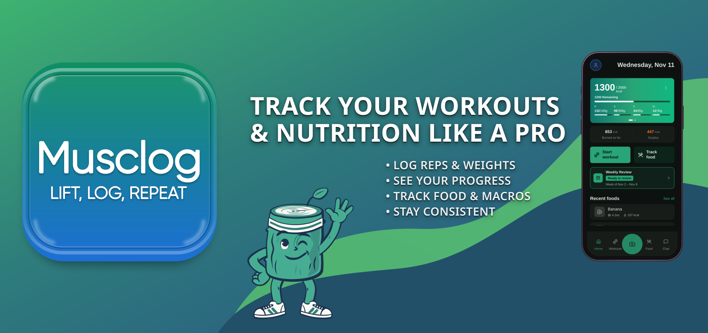
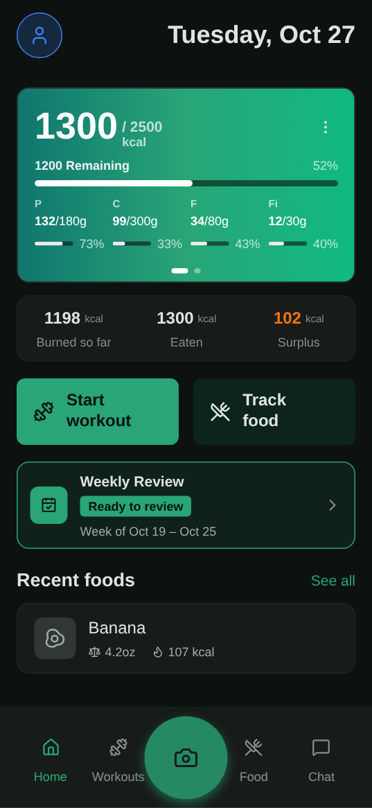
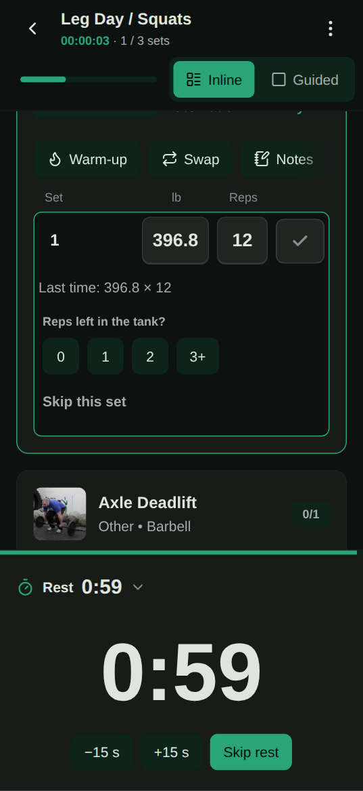
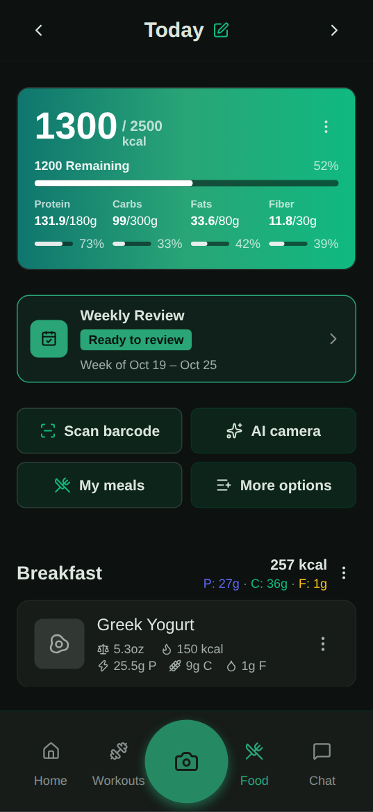
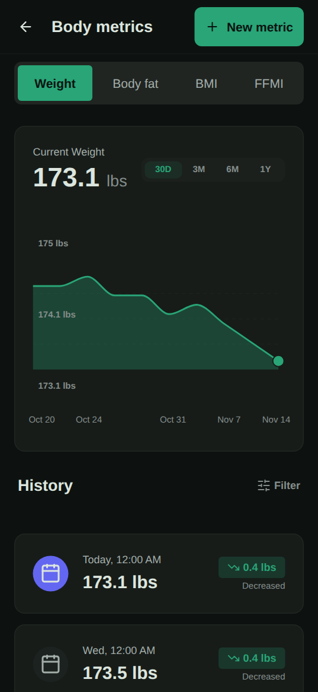

<p align="center">
  
</p>

<h1 align="center">Musclog – Lift, Log, Repeat</h1>

<p align="center">
  <strong>A free, open-source workout and nutrition tracker. No account, no ads, works offline.</strong>
</p>

<p align="center">
  <a href="LICENSE"></a>
  <a href="https://github.com/blopa/musclog-app/releases/latest"></a>
  
  
</p>

<p align="center">
  <a href="https://play.google.com/store/apps/details?id=com.werules.logger"><b>Google Play</b></a> ·
  <a href="https://testflight.apple.com/join/mq3QMSHU"><b>iOS (TestFlight)</b></a> ·
  <a href="https://musclog.app/app"><b>Web demo</b></a> ·
  <a href="https://musclog.app"><b>Website</b></a>
</p>

<p align="center">
  
  
  
  
</p>

Musclog logs your lifts and your food in one app. Data lives on your device (sensitive fields are encrypted), it works offline, and you can export it or move it to another phone without a cloud account.

- **Train:** plans, explained progression, plate math, rest timers, weekly review
- **Eat:** food diary, barcode and label scanning, macros, and a calorie target that follows your weight trend
- **Optional:** AI coaching with your own API key, cycle tracking, Health Connect and HealthKit
- **Import:** Strong, Hevy and FitNotes CSV exports

### What leaves your device

Nothing is uploaded to a Musclog server. Some features contact third parties only when you use them:

- Food search: Open Food Facts and USDA by default (the "All" source). USDA search needs an API key in the build (`EXPO_PUBLIC_USDA_API_KEY`); without one only Open Food Facts is used. You can pick a single source, the Musclog barcode database, or none in Settings → Basic settings.
- AI coach and photo analysis: Google Gemini, OpenAI or Claude, using your own key, only if you enable it. There is also an opt-in Musclog free tier that forwards requests to Google Gemini; it asks for consent before it is turned on. Musclog Premium, an optional monthly subscription for a hosted AI allowance (no key needed), is built but hidden behind the `EXPO_PUBLIC_PREMIUM_UI` build flag until its release; everything else in the app stays free.
- Crash reports (Sentry): on by default and sent only if the build includes a Sentry DSN; you can turn them off under Settings → Backups and data ("Anonymous bug report"). A report holds the error and where it happened, the app version and the device model; no name, email, workouts, food or body data.

### Get involved

[Report a bug](https://github.com/blopa/musclog-app/issues/new/choose) · [Request a feature](https://github.com/blopa/musclog-app/issues/new/choose) · [Ask a question](https://github.com/blopa/musclog-app/discussions) · [Contributing](CONTRIBUTING.md)

Licensed under [GPL-3.0](LICENSE). Bundled exercise data is CC0 (free-exercise-db).

---

## Key Features

> See [CURRENT_FEATURES.md](docs/CURRENT_FEATURES.md) for the complete shipped feature list and
> [FUTURE_FEATURES.md](docs/FUTURE_FEATURES.md) for the roadmap.

### 🏋️ Track Workouts

- Log workouts with sets, reps, and weights
- Create and manage custom workout templates and exercises
- Group workouts into named weekly or rotating plans, with multi-plan membership and an Unplanned section
- Browse built-in workout programs, including a five-session cable superset split
- Schedule workouts on a weekly basis with reminders
- Log directly in Inline or Guided views with shared inputs, one-tap completion, and persistent rest timers
- Set per-exercise progression rules, see explained upcoming targets, and undo changes to unfinished sets
- View lifting volume stats and progression over time
- Browse 873 built-in exercises with localized names and instructions, muscle-group categorization, and two-frame technique photos
- **Superset support**: Group exercises with a shared group ID for superset tracking
- **Exercise reordering**: Drag-and-drop reordering of exercises in both active and past workouts
- **Rest timer**: Built-in rest timer with customizable duration and alerts
- **Keep-screen-awake** during active workout sessions

### 📅 Schedule & Plan

- Plan workouts on a weekly basis to ensure consistency
- Receive reminders to stay on track with your goals

### 🍎 Food Tracking & Nutrition

- **Daily Food Logging**: Track meals (breakfast, lunch, dinner, snack) with detailed macro and calorie info
- **Barcode Scanning**: Add foods instantly by scanning product barcodes with your camera
- **Food Search**: Search Open Food Facts, USDA, or a local barcode database — configurable per user
- **Custom Foods & Meals**: Create your own food entries and save meal templates for quick access
- **Meal Display**: AI-generated and saved meals are shown as a single item (not individual ingredients) in the food log
- **Micronutrient Tracking**: Track 40+ vitamins and minerals beyond basic macros
- **AI Macro Estimation**: Use AI vision to estimate nutrition from food photos or nutrition label images; optionally run local OCR before sending to AI
- **Retrospective Logging**: Log meals for past dates
- **Fasting Days**: Optionally mark a no-food day as an intentional fast so it counts as a real 0-calorie day in your TDEE, averages, and streaks — while forgotten (unflagged) empty days are skipped
- **Empirical TDEE**: Calorie needs estimated from logged intake and smoothed trend-weight changes
- **Weekly Review**: Review training and nutrition from Home, Workouts, or Food. Apply explained calorie/macronutrient targets beginning tomorrow, keep current targets, or edit the recommendation. Approved targets stay stable between reviews; Manual and Daily automatic modes remain available.
- **Comeback mode**: After a long break, ease back in with an opt-in four-week ramp: lighter loads and fewer sets for workouts, maintenance-first nutrition, a minimum day that counts, and check-ins instead of guilt.

### 🌙 Menstrual Cycle Tracking

- Track bleeding and symptoms or keep a symptom-only journal; choose your goals, custom symptoms, favorite quick actions and optional daily fields
- Log periods, bleeding, symptoms with severity, pain, energy and shared mood; period deletion has undo, and clearing a daily log explicitly clears that day’s shared mood
- Calendar, period history and cycle-day comparisons with symptom filters; recorded values, missing days and estimates remain distinct
- Next-period estimate as a range with an explained confidence level; overdue periods are stated plainly, and predictions can be hidden
- Optional, off-by-default fertile-window estimate, always labelled as not contraception
- Birth control and life stage change what is shown (for example, no predicted date on a method that suppresses ovulation)
- Patterns drawn only from your own records, with the days behind each one; no phase-based workout prescriptions
- Cycle records are encrypted on the device, with an optional lock, discreet reminders, CSV/JSON exports and an appointment PDF including shared mood
- Encrypted cycle backups and an import preview that merges records with explicit conflict choices; full-app backup and restore remain available from cycle settings
- Unknown-length setup, confirmed long-cycle correction, sparse-history uncertainty and retrospective prediction checks
- Symptoms-only trends/search, custom rating scales, daily-life impact, optional diary presets and quiet pregnancy/loss/surgery/menopause contexts
- Reminders that explain themselves: a range-based period heads-up, optional due-day and neutral "longer than usual" notes, a pack-aware pill reminder, a daily check-in, a pause, three lock-screen wording levels with a live preview, and a delivery check with a test notification
- Restore-first import, external CSV mapping, selected-field file sharing and explicit native cycle health-store imports/exports
- Manual password-protected backup files with restore preview and optional backup reminders; no automatic cloud uploads
- Pause tracking without losing history, or permanently delete all cycle data

### 📈 Progress & Insights

- Visualize fitness progress with charts and graphs
- Track body metrics with a smoothed weight trend, editable scale readings, body fat %, and custom measurements
- Daily and weekly AI-generated insights on workouts and nutrition
- **Recent training load**: a body map of what you trained this week, and weekly sets per muscle
- **Strength levels** for your main lifts, compared with your body weight
- **Your year in Musclog**: a shareable look back at your year, each December
- **Mood tracking**: Log daily mood and correlate it with calories, workout volume, and days around recorded periods over time

### 🧠 AI Coach

- **Dual AI Support**: Google Gemini (2.0/2.5, via API key) or OpenAI (GPT-4, GPT-4o, O1, O3)
- **In-App Chat**: Conversational AI coach for workout and nutrition advice
- **Photo Analysis**: AI-powered food photo and nutrition label analysis; optional local OCR pre-processing
- **Workout Generation**: AI-generated workout plans tailored to your goals
- **Custom System Prompts**: Create and toggle multiple context-specific prompts (general, nutrition, exercise)
- **Flexible Config**: Choose model, configure API keys, set insight frequency, control conversation history length

### 📝 Notes

- Jot down what you're making ("70g of broccoli", a recipe idea) without committing to a nutrition log
- Latest two notes are highlighted; older ones load in pages, each with edit / duplicate / delete
- **Track this**: hand a note to the AI Coach to turn it into a logged meal when you're ready

### 🔗 Health Integration

- Sync with Google Health Connect (Android) for weight, nutrition, and exercise data
- Sync with Apple HealthKit (iOS) for health and fitness data
- Historical health data import

### 🔄 Import & Export

- Export your full database as an encrypted JSON file (encryption optional, configurable)
- Import data across devices or as a backup, including optical QR transfer directly from the first onboarding screen
- **Bring your history**: import workouts from Strong, Hevy and FitNotes CSV exports; importing again adds nothing, and an import can be undone
- Import the complete Musclog GB cartridge database by scanning its Share Data QR stream on Android, iOS, or web
- Support for JSON format

### 🔒 Privacy & Security

- All data stored locally on-device via WatermelonDB
- Sensitive fields (nutrition logs, user metrics) encrypted at rest with AES
- AI features are fully optional — app works offline without them
- **Optical Transfer**: move your whole profile, an individual food, a saved meal, a named meal in
  the nutrition diary, an entire meal section, or a full day of eating using only the two screens —
  one shows a stream of QR codes, the other reads them with its camera. Food, meal and day shares
  preview and save without replacing existing data. Android, iOS, and web work in any combination,
  and Musclog GB can send its whole cartridge database, or one day of its food log, to any of them.
  No internet, cable, account, or third party

---

## Tech Stack

| Layer          | Technology                                                           |
| -------------- | -------------------------------------------------------------------- |
| Framework      | React Native 0.88 + Expo SDK / Router 58                             |
| Language       | TypeScript 6.0                                                       |
| Database       | WatermelonDB 0.28 (SQLite-backed, reactive)                          |
| Styling        | NativeWind 4.2 (Tailwind CSS for React Native)                       |
| Icons          | Lucide React Native                                                  |
| Charts         | Victory Native (Skia)                                                |
| Graphics       | @shopify/react-native-skia                                           |
| AI             | Google Generative AI + OpenAI SDK                                    |
| Camera / OCR   | react-native-vision-camera, Quagga2, ZXing, ML Kit OCR, Tesseract.js |
| Health         | react-native-health-connect (Android)                                |
|                | @kingstinct/react-native-healthkit (iOS)                             |
| Localization   | i18next + react-i18next                                              |
| Animations     | React Native Reanimated 4                                            |
| Widgets        | expo-widgets + Expo UI (Android and iOS)                             |
| Chat UI        | react-native-gifted-chat                                             |
| Validation     | Zod                                                                  |
| Error Tracking | Sentry                                                               |
| Testing        | Jest + React Testing Library + Playwright (web E2E)                  |
| Build          | EAS (Expo Application Services)                                      |

---

## Repository Structure

```
musclog-app/
├── app/
│   ├── app/                    # Product app routes (native + web app)
│   └── (website)/              # Public website and blog routes
├── components/                 # Shared UI, modals, charts, and website components
├── context/                    # Cross-screen React providers
├── database/                   # WatermelonDB schema, models, repositories, and services
├── services/                   # AI, health, notification, and other app services
├── hooks/                      # Reusable reactive hooks
├── utils/                      # Pure and platform-specific utilities
├── data/                       # Generated exercise/food catalogues and wire contracts
├── lang/locales/               # App and website translations
├── gameboy/                    # Musclog GB ROM source and build tools
├── public/                     # Website assets and generated SEO outputs
├── scripts/                    # Build, generation, validation, and maintenance scripts
└── widgets/                    # Android/iOS Nutrition, Smart Camera, Activity Heatmap and Cycle widgets
```

---

## Getting Started

### Prerequisites

- Node.js
- npm or yarn
- [Expo CLI](https://docs.expo.dev/get-started/installation/)
- For Android: Android Studio + emulator or physical device
- For iOS: macOS with Xcode

### Installation

```bash
# 1. Clone the repository
git clone https://github.com/blopa/musclog-app.git
cd musclog-app

# 2. Install dependencies
npm install

# 3. Configure environment variables
cp .env.example .env
# Edit .env to add the optional USDA and Sentry keys (see below)

# 4. Start the development server
npm start
```

### Running on a Platform

```bash
npm run android   # Android emulator or device
npm run ios       # iOS simulator (macOS only)
npm run web       # Web browser
```

### Environment Variables

Every variable is optional. `.env` holds only the USDA food-search key and the Sentry settings:

```env
# USDA api key (enables USDA food search; without it only Open Food Facts is searched)
EXPO_PUBLIC_USDA_API_KEY=your_usda_key

# Sentry error tracking (optional)
EXPO_PUBLIC_SENTRY_DSN=your_sentry_dsn
SENTRY_AUTH_TOKEN=your_sentry_token
```

If you run a local release build and Sentry uploads fail with an auth token error, run:

```bash
npx sentry-cli login
```

AI features are not configured in `.env`. Add your own Gemini, OpenAI or Claude key in the app under AI settings (it is stored encrypted on the device), or turn on the Musclog free tier there.

> For production builds, use [EAS Secrets](https://docs.expo.dev/eas/environment-variables/) instead of committing keys to version control.

### Running Tests

```bash
npm test
```

### Other Scripts

```bash
npm run lint:all                  # ESLint fixes, formatting, prebuild, and typecheck
npm run lint:eslint               # ESLint without the full suite
npm run format                    # Format with Prettier
npm run typecheck                 # TypeScript type checking
npm run check-translations        # Validate used i18n keys
npm run check-locale-consistency  # Validate key parity across locales
npm run screenshots               # Build web and capture Playwright screenshots
npm run screenshots:wrapped       # Build web and capture only "Your year in Musclog"
npm run start-clear               # Start Expo with a cleared cache
```

Screenshot runs default to `kinetic-depth`. Select a palette with an environment variable:

```bash
MUSCLOG_SCREENSHOT_THEME=kinetic-light npm run screenshots
# Reuse an existing web build and capture only one device size:
MUSCLOG_SCREENSHOT_THEME=kinetic-shock npm run playwright-runner -- tests/screenshot-automation.spec.ts --project=portrait-6.7
```

Valid themes are `kinetic-depth`, `kinetic-light`, `kinetic-shock`, `kinetic-volt`,
`kinetic-blush`, `kinetic-varia`, and `kinetic-scope`. Images are saved under
`screenshots/app-store/<theme>/<device>/` (the Wrapped story goes in its `wrapped/`
subfolder; `npm run screenshots:all` runs both suites and the website images). The screenshot suite enables reduced
motion, which disables web confetti for every screen and modal. Screenshot commands
run only the capture suite; SDK compatibility tests remain available separately.
They use `npm run screenshots:build` to enable the modal fixture in the web export.
Normal production builds keep test routes disabled.

---

## Building for Production

Musclog uses [EAS Build](https://docs.expo.dev/build/introduction/) for production builds.

If a local EAS Android build fails during Sentry sourcemap upload, make sure `SENTRY_AUTH_TOKEN` is set or run `npx sentry-cli login` first.

```bash
# Android
npm run build-android             # Production AAB
npm run build-android-apk         # Installable release APK
npm run build-android-preview     # Preview/internal build

# Submit to Google Play
npm run submit-android

# iOS
npm run build-ios                 # Production build
npm run build-ios-preview         # Preview/internal build
npm run submit-ios                # Submit to App Store Connect
```

## Project Documentation

- [AGENTS.md](AGENTS.md): implementation rules and repository invariants
- [CURRENT_FEATURES.md](docs/CURRENT_FEATURES.md): complete shipped feature list
- [FUTURE_FEATURES.md](docs/FUTURE_FEATURES.md): prioritized backlog and scope decisions
- [DESIGN.md](docs/DESIGN.md): visual system and interaction standards
- [FIXES.md](docs/FIXES.md): incidents, workarounds, and regression guardrails
- [RESEARCH.md](docs/RESEARCH.md): consolidated technical and product research
- [sdk-verification.md](docs/sdk-verification.md): widget bundle, web upgrade and signing checks for the Expo SDK

---

## Contributing

Contributions are welcome. Read [CONTRIBUTING.md](CONTRIBUTING.md) for setup and the checks to run before a pull request. Bugs and feature requests go through the [issue templates](https://github.com/blopa/musclog-app/issues/new/choose); questions and ideas belong in [GitHub Discussions](https://github.com/blopa/musclog-app/discussions). For larger changes, open an issue first to discuss the approach. Everyone taking part is expected to follow the [Code of Conduct](CODE_OF_CONDUCT.md); security problems go through [SECURITY.md](SECURITY.md).

---

## License

Musclog is licensed under the [GNU General Public License v3.0 or later](LICENSE); see [NOTICE](NOTICE) for the copyright notice.

The bundled exercise data and photos come from [free-exercise-db](https://github.com/yuhonas/free-exercise-db), a public-domain project released under CC0.

**Loggy**, the mascot, is public domain under [CC0 1.0](https://creativecommons.org/publicdomain/zero/1.0/): use him anywhere, for anything, with no attribution. The poses are in [`assets/avatars/loggy-poses`](assets/avatars/loggy-poses) (animated ones in `loggy-animated`, the parts they are built from in `loggy-parts`), and the scope and legal text are in [`assets/avatars/LOGGY_LICENSE.txt`](assets/avatars/LOGGY_LICENSE.txt). The Musclog name and logo are not part of that, and the code that draws him stays under the project's license.

The Google Play phone screenshots are composed with [Open Screenshot Generator](https://github.com/dotnetdreamer/open-screenshot-generator) (MIT).

---

## Resources

- [Musclog Blog](https://musclog.app/en/blog) — statically generated from Markdown, with paginated all-post and category listings, rich prose, and syntax-highlighted code
- [Blog post: How Musclog came to be](https://pablo.gg/en/blog/coding/musclog-leveraging-my-reactjs-experience-to-build-a-react-native-app/)
- [Expo Documentation](https://docs.expo.dev/)
- [WatermelonDB Documentation](https://watermelondb.dev/)
- [NativeWind Documentation](https://www.nativewind.dev/)

SDK verification steps: [docs/sdk-verification.md](docs/sdk-verification.md).
