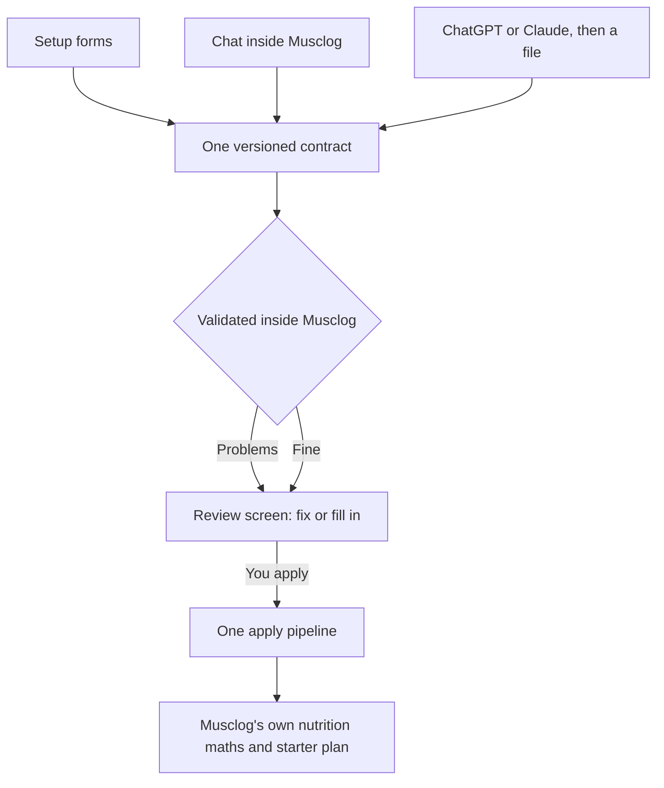

Onboarding forms are the part of an app people abandon first. Musclog's personalized setup is ten screens: units, training, experience, goals, body stats, cycle tracking, and a nutrition plan at the end. They are good screens. They are also ten screens.

So the first screen now has a third button: **Set up with AI**. You can answer a few questions in a conversation instead, and the same thing is available later from Profile as **Update with AI**.


Adding a chat is the easy half. The half I spent my time on is making sure that "an AI is involved" never means "an AI is in charge".

## Three ways in, one way out

There are three ways to answer: the forms, a chat inside Musclog, and a chat in ChatGPT or Claude that hands you a file to bring back. They look nothing alike, and they all end in the same place.




The contract is a small JSON document, `musclog-onboarding`, version 1. This is a complete one:

```json
{
  "schema": "musclog-onboarding",
  "version": 1,
  "units": "metric",
  "gender": "female",
  "ageYears": 34,
  "height": { "value": 168, "unit": "cm" },
  "weight": { "value": 62, "unit": "kg" },
  "liftingExperience": "beginner",
  "activityLevel": 3,
  "fitnessGoal": "general",
  "weightGoal": "maintain"
}
```

The schema an assistant is told to follow is not written by hand. It is generated from the same zod definition the app validates with, so the file an assistant is asked to write and the file Musclog accepts cannot drift apart:

```ts
export function buildContractJsonSchema(): Record<string, unknown> {
  const generated = z.toJSONSchema(contractDocumentSchema, { io: 'input' });
  const properties = { ...generated.properties };
  properties.schema = { const: CONTRACT_SCHEMA_ID };
  properties.version = { const: CONTRACT_MAJOR };

  return {
    ...generated,
    $id: `https://musclog.app/schemas/onboarding/v${CONTRACT_MAJOR}.json`,
    title: 'Musclog onboarding',
    properties,
    // The birthday may be a date or, when the person only knows it, an age.
    anyOf: [{ required: ['birthDate'] }, { required: ['ageYears'] }],
  };
}
```

That is all the AI ever produces: answers. It does not pick your calories, your macros or your first workout plan. Musclog still runs its own nutrition calculator and its own starter-plan picker on those answers, and the result is the exact same results screen the forms end on. That is deliberate. If a model could propose targets, I would have to decide how much to trust a number it made up, in an app people use to decide what to eat.

## The AI is untrusted input

Everything that comes out of a model, a file or a paste is treated as data that happens to be shaped like JSON. It is never trusted because it claims to have been validated.

The core of it is small. Each field is read on its own, and a failure is recorded instead of thrown:

```ts
if (present('weight')) {
  const parsed = weightSchema.safeParse(source.weight);
  if (!parsed.success) {
    fail('weightKg', 'invalid');
  } else {
    const kg = round1(
      displayToKg(parsed.data.value, parsed.data.unit === 'lb' ? 'imperial' : 'metric')
    );

    if (kg >= WEIGHT_KG_RANGE[0] && kg <= WEIGHT_KG_RANGE[1]) {
      draft.weightKg = kg;
    } else {
      fail('weightKg', 'outOfRange');
    }
  }
}
```

Before any field is read, the text itself is treated with suspicion. Assistants wrap JSON in code fences or add a sentence around it, so the importer is deliberately forgiving about the wrapper and strict about everything inside it:

```ts
export function parseContractText(text: string, today: Date): ContractParseResult {
  if (!text.trim()) return { ok: false, error: 'empty' };
  if (utf8ByteLength(text) > MAX_CONTRACT_BYTES) return { ok: false, error: 'tooLarge' };

  let parsed: unknown;
  try {
    parsed = JSON.parse(extractJsonCandidate(text) ?? text);
  } catch {
    return { ok: false, error: 'notJson' };
  }

  if (!isRecord(parsed)) return { ok: false, error: 'notAnObject' };
  if (parsed.schema !== CONTRACT_SCHEMA_ID) return { ok: false, error: 'wrongSchema' };

  const version = parsed.version;
  if (typeof version !== 'number' || !Number.isFinite(version) || version < 1) {
    return { ok: false, error: 'invalidVersion' };
  }
  if (Math.trunc(version) > CONTRACT_MAJOR) return { ok: false, error: 'newerVersion' };

  const { draft, issues, warnings } = normalizeAnswers(parsed, today);
  return { ok: true, draft, issues, droppedKeys: collectDroppedKeys(parsed), warnings };
}
```

The file is capped at 64 KB, identified by its `schema` field, version-checked, and only then validated field by field. Note that `droppedKeys` is computed from the raw object, which is where the review screen's list of ignored keys comes from.

A few things follow from that shape:

- **Each field is checked on its own.** A height of 900 cm is dropped and reported, and the other nine answers are kept. One bad number should not cost you the rest of a conversation.
- **Units are converted once, on the way in.** The database is always metric, so pounds and feet-and-inches become kilograms and centimetres the moment they arrive, and a weight without a unit is rejected instead of guessed.
- **Unknown keys are ignored and listed.** Assistants like adding commentary fields. They are never applied, and the review screen tells you which ones were thrown away.
- **A newer version is refused, not half-read.** If a file says it is version 2, you get "update Musclog", not a best guess.
- **An age is an estimate, and it says so.** If you only give an age, the birthday is estimated from it and labelled that way on the review, where you can replace it.

The in-app chat gets the same treatment on every turn. Each reply must match one fixed shape: what to say, what the person just told it, which answers it is asking about, and whether it thinks the answers are ready to review.

```ts
{
  type: 'object',
  properties: {
    reply: { type: 'string', description: 'What to say to the person next. Plain text.' },
    patch: {
      type: 'object',
      description: 'Only what the person stated in their latest message. Null for everything else.',
      properties: patchProperties, // one flat, typed property per answer
    },
    askedFields: { type: 'array', items: { type: 'string', enum: [...FIELD_KEYS] } },
    readyForReview: {
      type: 'boolean',
      description: 'True only after the person confirmed the summary of their answers.',
    },
  },
  required: ['reply', 'patch', 'askedFields', 'readyForReview'],
}
```

The patch is flat because models fill a flat object more reliably than the nested contract. It is rebuilt into the contract's shape and sent through the very same `normalizeAnswers`, so the chat and an imported file are judged by one validator. A feet-and-inches height or a weight without its unit is handled right there:

```ts
height = { feet: patch.heightFeet, inches: patch.heightInches ?? 0, unit: 'ft_in' };

// A weight without its unit is ambiguous (kg vs lb), so it is rejected rather than guessed.
weight: has('weightValue') ? { value: patch.weightValue, unit: patch.weightUnit } : undefined,
```

Each provider also gets its own dialect of that schema. OpenAI's strict mode needs every property to be required, so "nothing this turn" is an explicit `null`; Gemini marks them `nullable`. Same shape, three spellings.

And the turn is validated the same way as everything else.

 The model must answer in a fixed JSON shape, that reply is validated before any of it is merged, and a reply that is not valid gets one quiet second try before you are told. The model has no tools. The worst a reply can do is propose an answer that you then review.

## Nothing is saved until you look at it

Whichever route you took, you land on a review screen. Every answer is there, grouped like the forms, and tapping one opens the same kind of editor in place. Required answers that are missing are outlined, and **Looks right, continue** stays disabled until they are filled.


Further down, the screen says what is still missing and which keys it ignored, and the continue button waits:


Tapping a row opens its editor in place, with the same input the forms use:


From Profile it works differently. The AI is never told what is already in your profile, so it cannot leak it. Instead the review shows each answer next to what you have now, with a choice to apply or skip each change.

 Under the hood that is a diff, one row per answered field, where only the changed rows are kept by default:

```ts
const changed = !sameValue(field, current[field], value, current, incoming, today);
rows.push({ field, current: current[field], incoming: value, changed, keepByDefault: changed });
```

Numbers within 0.05 of each other count as the same answer, so 80 kg turning into 176.4 lb and back does not show up as a change. Only the rows you keep are written. Recalculating your nutrition targets is a separate switch, off by default, and your earlier targets stay in your history.


Applying is one pipeline for every route, and it is safe to run twice. Tapping twice, or retrying after a failure, joins the run in flight or repeats steps that overwrite rather than add. The guard is a map of promises keyed by draft:

```ts
const inFlight = new Map<string, Promise<unknown>>();

function runOnce<T>(draftId: string, run: () => Promise<T>): Promise<T> {
  const running = inFlight.get(draftId) as Promise<T> | undefined;
  if (running) return running;

  const started = run().finally(() => inFlight.delete(draftId));
  inFlight.set(draftId, started);
  return started;
}
```

A second tap, a second screen or a retry racing the first run gets the same promise back instead of starting another, which could otherwise create the user twice. And the step that turns answers into real data is shared with the old body-stats form:

```ts
export async function commitOnboardingProfile(
  answers: CompleteOnboardingAnswers,
  { useBodyFat }: { useBodyFat: boolean }
): Promise<NutritionPlan> {
  await persistFitnessProfile(toProfileWrite(answers));

  const training = parseTrainingSetup(await AsyncStorage.getItem(TRAINING_SETUP_DATA));
  const plan = calculateNutritionPlan(
    toPlanInput(answers, { useBodyFat, training, today: new Date() })
  );
  await AsyncStorage.setItem(TEMP_NUTRITION_PLAN, JSON.stringify(plan));
  return plan;
}
```

Note where the numbers come from: `calculateNutritionPlan`, Musclog's own calculator. The model's output goes in as inputs and never comes out as targets. That matters because going back and forth in the old body-stats screen used to stack a new weight and height reading every time. Moving it onto the shared pipeline fixed that as a side effect.

## The ChatGPT and Claude handoff is copy first

The obvious design is a button that opens ChatGPT with the instructions already typed in. I checked what is actually documented before building that, and it is thin:

- Claude documents a prefilled prompt only for its desktop `claude://` link. It fills the box, never sends, and cuts off at about 14,000 characters. Its [mobile links](https://support.claude.com/en/articles/14898120-open-the-claude-mobile-app-with-a-link) only cover Claude Code, and the [desktop article](https://support.claude.com/en/articles/14729294-open-claude-desktop-with-a-link) does not document a web address at all.
- For ChatGPT I could not find a documented prompt parameter. OpenAI also restricted auto-submitting prompt links after a [2025 security report](https://www.tenable.com/security/research/tra-2025-22).

The whole link logic is a length check:

```ts
export const EXTERNAL_URL_MAX_CHARS = 6000;

export function buildExternalChatUrl(target: ExternalTarget, prompt: string) {
  const base = EXTERNAL_TARGETS[target];
  const url = `${base}?q=${encodeURIComponent(prompt)}`;
  return url.length <= EXTERNAL_URL_MAX_CHARS
    ? { url, prefilled: true }
    : { url: base, prefilled: false };
}
```

So the buttons copy the instructions to your clipboard first, then open the site, and only add a prefilled link if the whole thing fits a conservative length. The real instructions carry the JSON Schema, so in practice they never fit, and copy-and-paste is the path that works. Paste and import are always there if a link fails to open.


The instructions ask the assistant to ask a few questions at a time, never invent an answer, summarize and wait for your confirmation, validate with Python and `jsonschema` when it can run code, and give you a downloadable `musclog-onboarding.json`, or one JSON block with a plain statement that it could not validate. That is best effort by nature: the assistant on the other side may not have any of those tools, which is exactly why Musclog validates everything again.

## Keys, privacy and what stays on the phone

The in-app chat can use free Musclog AI, your own Gemini or OpenAI key, or a provider you already set up. A key you paste is checked first, and saved only if the provider accepts it:

```ts
const key = apiKey.trim();
const result = await testApiKey(provider, key);
if (result !== 'ok') {
  return result; // nothing is saved, so a working key already stored is never replaced
}

await SettingsService.setGoogleGeminiApiKey(key);
await SettingsService.setEnableGoogleGemini(true);
```

It goes through the same encrypted settings as Settings → AI, so it keeps working in the rest of the app, and you remove it in the same place.


A few rules hold across all of it:

- No API key goes into a prompt, a link, the contract or the saved conversation, and a rejected key is never sent to error reporting.
- The unfinished conversation lives in its own encrypted entry. It is not in your coach chat history, it is not in backups, and it is deleted when you apply, start over, or switch to the forms.
- The setup prompt does not include your custom AI prompts or memories, because those can contain exactly the personal details this flow promises not to send.
- If you pick free Musclog AI or save a key, the later "Musclog AI" step is skipped, so the free tier cannot quietly take over from the key you just tested.

## Every failure has a way out

The failure list for something that depends on a model and a network is long: no connection, a rejected or revoked key, no credit left, the free daily limit, a timeout, a reply that is not valid. Each one gets its own explanation and its own next step, and every single one also offers the setup forms. I wrote a test that fails if a failure is ever added without that exit:

```ts
it('every AI screen offers a way out to the forms', () => {
  for (const name of ['setup', 'external', 'review', 'chat']) {
    expect(read(`app/app/onboarding/ai-${name}.tsx`)).toMatch(/useAiGuidedExit|goGuided/);
  }
});
```

It is a blunt source-level check, but it is exactly the kind of rule that is forgotten otherwise. The reason is simple: the one thing this feature must never do is trap you in a broken AI.

Switching to the forms mid-way is not a reset either. Whatever you already answered is handed to the guided screens, so they open prefilled instead of asking again.

## What I'd still like to know

I can tell you how the contract, the validation and the pipeline behave, because they are pure code with tests around them. What I can not tell you is how every model behaves on its worst day. That is the point of the design: the model's output never has to be right, only reviewable.

If you try it and an assistant produces something Musclog rejects, I want to see it. The review screen will list what was ignored, and that list is the most useful bug report there is.
