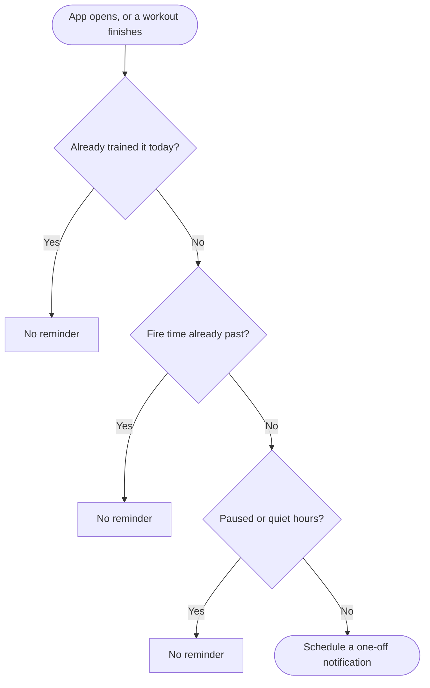

I read a long piece of research on how the big workout apps handle notifications, then checked it against Musclog. The finding that stuck: a workout app's notifications are really four different products behind one permission prompt. There's the timer that runs _during_ your workout, the reminders about your plan, the reports, and the marketing. The apps people like keep those apart. The apps people complain about let them collide.

Musclog had the pieces, but they were thin. One toggle for the rest alert, reminders that fired on a fixed weekly schedule whether you'd trained or not, and no way to say "not at 11pm."

There was one extra constraint. **Musclog has no server.** Nothing can push a notification to your phone, because there's nothing to push it. Every notification you get is scheduled by the app, on your device, ahead of time. That shaped almost every decision below.

## Notifications that are planned, not repeated

The old workout reminder was a repeating weekly trigger: "every Tuesday at 08:00". It's simple, and it's wrong in small, annoying ways. It fires on a Tuesday you already trained. It can't respect a pause. It can't stay quiet at night.

A repeating trigger is a promise the OS keeps without asking you. So I stopped using them for reminders. Instead the app lays out **one-off notifications for the next 14 days**, and re-plans them every time you open the app and every time you finish a workout.

All the rules for _whether_ a notification may exist live in one pure file, with no React and no database in it, so they're easy to test:

```typescript
export function planWorkoutReminders(input: {
  now: Date;
  sources: readonly PlannedReminderSource[];
  prefs: NotificationPreferences;
  completedTemplateIdsToday: ReadonlySet<string>;
}): PlannedReminder[];
```

Give it your schedule, your preferences and what you've already done today, and it returns the exact list of dates to schedule. A workout you finished this morning gets no reminder tonight. A reminder that falls inside your quiet hours is simply never created. Here's the path each candidate reminder takes:



The fire time is your reminder time minus the lead time you chose.

The trade-off is that the schedule goes stale if you never open the app, but the next time you do, it's rebuilt.

## The rest alert is the one that matters

Everyone in the research agreed on this: the rest-timer alert isn't "engagement". It's part of the workout. So I treated it differently from everything else.

- It has **its own Android channel**, so you can keep it loud and mute every reminder in the system settings.
- On iOS it's marked **time-sensitive**, so it isn't held back by Focus modes.
- It has **+30s** and **Next set** buttons right on the notification.
- An optional **repeat** nudges you a minute later if you haven't started the next set.
- When you're looking at the timer, it **doesn't** pop a banner over the countdown. You already feel the haptics; a second chime adds noise, not information.

The rest alert and the active-workout notification are also **exempt from quiet hours and pause**. You started that session, and silencing it at 22:30 would break your workout rather than protect your sleep.


## Asking at the right moment

Notification permission used to be something you'd find in settings, if you looked. Now the app asks **once, right after your first completed set**, when the rest timer is already counting down:

> Rest timer alerts? Your rest timer is running. Want an alert if you lock your phone or switch apps?

That is the moment the value is obvious. If you say "not now", it never asks again, and the settings toggle is still the way back.

## Choosing how much to be nudged

Not everyone wants the same thing, and "remind me on workout days" is the wrong default for someone who trains when they can. So there's an accountability style:

- **Structured:** reminders on your planned days, with an optional lead time (on time, 15, 30 or 60 minutes before) and a **Snooze 1h** button.
- **Gentle:** no daily reminders, only a nudge when your weekly goal is slipping.
- **Flexible:** no nudges at all. The app just shows what's next.

The "weekly goal at risk" nudge isn't a guilt trip. It only fires when the sessions you still owe barely fit in the days left in the week, and never when you're on track:


There's also an optional "forgot to finish?" nudge 45 minutes after your last saved set. It deliberately survives you leaving the workout screen, because leaving the screen with the workout still open is exactly the case it's for.

## Quiet hours, pause, and a way to check delivery

Two controls apply to everything except the live session. **Quiet hours** work across midnight (22:00 to 07:00 by default), and **pause** silences reminders for 3 days or a week without turning anything off. A **Delivery** section shows the permission state, lets you send yourself a test rest alert, and opens the system settings, because "permission granted" and "it will arrive" aren't the same thing.

You can also pick how often the notification's clock refreshes (5, 10, 15, 30 or 60 seconds) and whether the lock screen shows your exercise or only "Workout in progress".


## What's still missing

I'd rather say it than have you find it:

- **No Live Activity or Dynamic Island, and no ticking lock-screen countdown.** Both need native code I haven't written yet. The workout notification is text only for now, and its clock is only refreshed while the app's JavaScript is running.
- **Rotating plans still get no per-day reminders**, since they don't have fixed weekdays.
- **No timed sets** (planks, intervals) separate from the rest timer.
- **On Android 14 and later**, exact alarms may need a permission you grant in system settings, which the delivery check doesn't show yet.

## Why no server is the point

I could have bolted on a push service and made some of this easier. But it would mean an account, a device token on someone else's machine, and a server that knows when you train. Planning everything locally is more work, and it means the answer to "who knows when I lift?" stays the same: just your phone.
