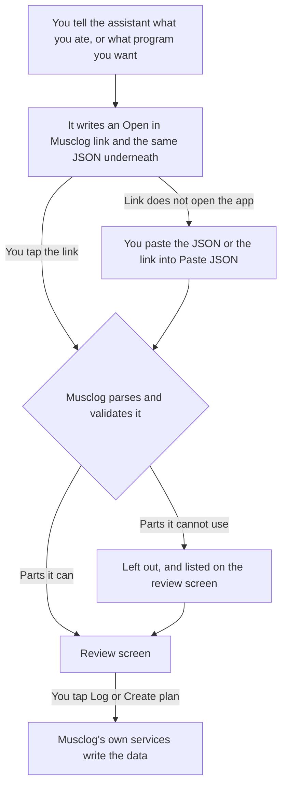
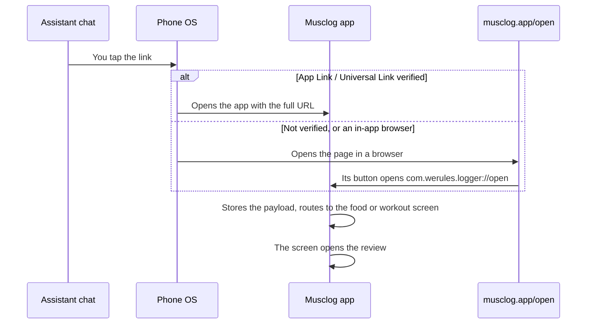
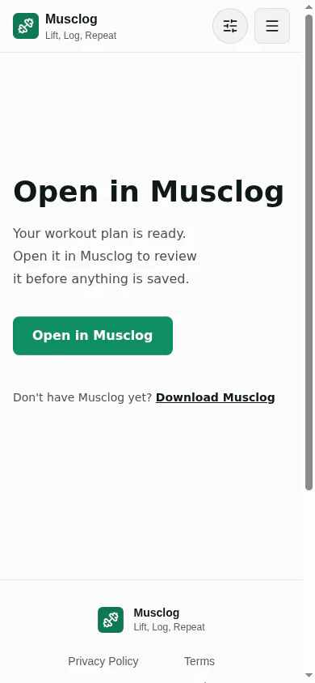
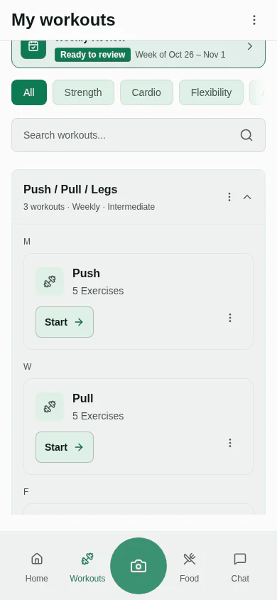

Most of the time I log food the boring way. Search, pick, set a portion, save. It works, and it is also the reason people stop logging by Thursday.

Meanwhile, I already have an assistant open in another tab that I pay for and trust more than a form. I can send it a photo of my plate and say "that was lunch". It is good at that, and I am not going to build a worse version of it inside a food diary.

So Musclog now has two new buttons that do exactly one thing: let your own ChatGPT or Claude do the thinking, and let Musclog do the saving.

- **Food:** in the Add food sheet, **Track with ChatGPT or Claude**.
- **Workouts:** in the workouts menu, **Create workout template → Build with ChatGPT or Claude**.


Neither needs an API key, a Musclog account or an AI provider set up in the app. If you want to know why that is the right shape for it, the longer version is in [my post about letting an AI set up Musclog](/blog/2026/10/i-let-an-ai-set-up-musclog-but-it-never-touches-your-data). This is the same trick used twice more, and it turns out the trick is the easy half.

## The trick, in one picture

You tap the button. Musclog copies a block of instructions to your clipboard and opens ChatGPT or Claude. You paste them, answer a few questions (or send a photo), and at the end the assistant gives you a link. There are three ways back, in order of effort:

1. **Tap the link.** It opens Musclog on the review screen.
2. **Paste the JSON.** The assistant always puts the same data in a code block under the link. Paste it, or paste the link itself, into **Paste JSON**.
3. **Import the file**, if your assistant can create one.




The assistant never talks to Musclog. There is no API in the middle, no key and no account. The only thing that crosses over is text that you carry yourself, by tap or by clipboard, which Musclog treats as untrusted input. All three roads end in the same parser, so there is one set of rules to trust.

## One tap back: a link that carries the file

The prompt used to end with "now import the file". That is a lot to ask of someone standing in a kitchen with a phone. So it now ends with this:

```text
[Open in Musclog](https://musclog.app/open#food=%7B%22schema%22%3A%22musclog-food-log%22%2C...)
```

The whole food log, minified and percent-encoded, sits after the `#`. Tapping it opens Musclog on the food diary with the review already open. Nothing is saved until you confirm, exactly as before.

### Why the data goes in the fragment

Everything after a `#` stays in the browser. It is never sent in the request, so it does not reach GitHub Pages, a CDN or any server log. A meal or a training plan is not something I want in anybody's access logs, including mine. The `/open` page also reads the fragment once and removes it from the address bar, so the analytics script, which reads the page URL, never sees it either.

### How the tap reaches the app



Only **`/open`** is claimed. On Android that is one `intentFilters` entry in `app.json` with an exact `path`:

```json
"intentFilters": [
  {
    "action": "VIEW",
    "autoVerify": true,
    "data": [{ "scheme": "https", "host": "musclog.app", "path": "/open" }],
    "category": ["BROWSABLE", "DEFAULT"]
  }
]
```

On iOS it is the `components` entry of `apple-app-site-association`:

```json
{
  "applinks": {
    "details": [
      {
        "appIDs": ["PVG62J652G.com.werules.logger"],
        "components": [{ "/": "/open" }]
      }
    ]
  }
}
```

Every other page on musclog.app, the blog included, stays in the browser. I did not want a link to a blog post to open an app.

### Why the page's button uses a custom scheme

When the OS does not open the app (no app installed, an in-app browser, or a tap from another musclog.app page), you land on the `/open` page. Its **Open in Musclog** button is the `com.werules.logger://open#...` twin of the same link. In-app browsers do not fire Universal Links, and a user tap is what lets a browser launch a custom scheme at all.



### The `action=` story

The app already had widget shortcuts that arrive as `?action=open-nutrition` and similar. The code that routes them looks for `action=` in the incoming path. A payload is free text, and a food note can easily contain the characters `action=`. So the open-link branch runs first, and only exactly `/open` can reach it:

```ts
const open = parseOpenLink(path);
if (open.matches) {
  if (!(await isOnboardingCompleted())) {
    return null;
  }

  setPendingOpenLink(open.link);
  return open.link ? OPEN_LINK_ROUTES[open.link.kind] : '/app';
}

if (path.includes('action=')) {
  // widget shortcuts
}
```

The payload is parked in a small pending slot, and the screen that owns the import picks it up: `useOpenLinkHandler` takes it on focus, so a cold start, a link tapped while the app is on another screen and a link tapped while you are already on the target screen all land. Only the **focused** screen takes it, because a second copy of the same screen lower in the stack would otherwise open a modal nobody can see.

### The parentheses gotcha

`encodeURIComponent` leaves `( ) ! ' *` alone. An unescaped `)` ends a markdown link early, so a perfectly good `"Bench press (barbell)"` would cut the link in half. The prompt therefore names the characters that stay unescaped (`A-Z a-z 0-9 - _ . ~`, the RFC 3986 unreserved set) and tells the assistant to encode everything else, with Python's `urllib.parse.quote(minified, safe='')` as the recipe, then decode the link back and compare. Musclog's own `encodeOpenPayload` follows the same rule, so the tests build links the way the assistant is told to.

If the assistant cannot encode reliably, or the link would pass 8000 characters, it is told to skip the link and say so. The JSON block underneath is the real safety net, not the link.

### ChatGPT's "Check this link is safe"

ChatGPT can stop and ask you to confirm a link it cannot verify as a public page, and a link that carries a one-off payload is never a public page. OpenAI describes the reasoning in [its post about link safety for AI agents](https://openai.com/index/ai-agent-link-safety/): a URL that carries conversation data is exactly the shape of data exfiltration the check guards against.

I think that is the correct behavior. In this case the data goes from your assistant to your own phone, so you can tap through. The prompt tells the assistant to mention it, and the JSON block under the link is there for anyone who would rather not. **Paste JSON** accepts the JSON block, and it also accepts the link itself, or a whole copied chat message that has either in it. If the link is damaged but the JSON block is fine, the block wins.

### Behind a lock

If you have turned on the workout or nutrition lock, the link still opens the app, but the review waits. The payload is held above the lock gate, and the review opens once you unlock.

### The dev-only double-effect bug

The `/open` page removes the fragment from the address bar after reading it. In development, React runs effects twice. The second run saw the already-removed, empty fragment and wiped the page state, so the button vanished. Only a link with a payload replaces the state now.

## What a food file looks like

This is a complete one. It is what you would get after telling an assistant "chicken, rice, some broccoli and a bit of olive oil, about 150 grams of chicken":

```json
{
  "schema": "musclog-food-log",
  "version": 1,
  "mealType": "lunch",
  "mealName": "Chicken, rice and broccoli",
  "foods": [
    {
      "name": "Grilled chicken breast",
      "grams": 150,
      "calories": 235,
      "protein": 46.5,
      "carbs": 0,
      "fat": 5.4,
      "fiber": 0
    },
    {
      "name": "Cooked white rice",
      "grams": 180,
      "calories": 224,
      "protein": 4.9,
      "carbs": 49.6,
      "fat": 0.5,
      "fiber": 0.7
    },
    {
      "name": "Steamed broccoli",
      "grams": 90,
      "calories": 32,
      "protein": 2.5,
      "carbs": 3.6,
      "fat": 0.3,
      "fiber": 2.3
    },
    {
      "name": "Olive oil",
      "grams": 10,
      "calories": 90,
      "protein": 0,
      "carbs": 0,
      "fat": 10,
      "fiber": 0
    }
  ]
}
```

Three decisions are baked into that shape.

**Each food carries the numbers for the amount you ate, not per 100 g.** That is how the in-app AI meal tracker already works, so one code path logs both.

**There is no date and no time in it.** The assistant does not know what day it is where you are, or that you ate at 13:30. You choose the day, time and meal on the review screen. The one hint the file may carry is `mealType`, and only if you said which meal it was.

**One or many foods, and an optional `mealName`.** You asked for single foods or several, optionally grouped. The assistant sets `mealName` only when the foods were one dish (a bowl, a sandwich), and leaves it out for an apple and a coffee. Whatever it did, you can flip it on the review.

## The prompt has to teach one convention, or your carbs are wrong

This is the part of the project I was most afraid of getting subtly wrong.

Musclog stores carbohydrates the way a US label does: **total carbs, fiber included**. Every AI estimate in the app, though, is **net carbs**: the digestible part, with fiber as its own field. The service converts on the way in. An assistant that writes total carbs into a field Musclog reads as net would make the fiber count twice.

So the instructions say it, in words a model cannot miss:

```text
- "carbs" is NET carbohydrate: total carbohydrate MINUS fiber. "fiber" is its own field.
  For example 25 g of total carbohydrate that includes 4 g of fiber is "carbs": 21 and "fiber": 4.
- Keep calories consistent with the macros: about 4 kcal per gram of protein, 4 per gram of
  net carbs, 9 per gram of fat and 2 per gram of fiber.
```

On the way in, the existing service does the conversion, and I wrote a test against the real thing on an in-memory database rather than trusting my reading of it. 200 g of rice written as 56 g net carbs and 4 g fiber ends up stored as 30 g of total carbs per 100 g.

## The bug I only found by taking screenshots

Here is the embarrassing part. I wrote all of that, the tests passed, and then I took the screenshots for this post.


The first version of that screen (the screenshot above is the fixed one) said **53.2 g** of carbs. After logging, the diary said **56.2 g** for the very same meal.

Nothing was broken in the data. The review was showing the assistant's net carbs, and the diary was showing the stored total, with the 3.0 g of fiber added. Both numbers were correct and the screen was still lying, because the person checking a meal is promised that the figures they check are the figures they get.

The fix is one small function. An assistant's own numbers become the stored total exactly as the service will store them, and a food matched to one of Musclog's own foods keeps its carbs untouched, because those already include the fiber:

```ts
export function storedCarbs(ingredient: FoodLogIngredient): number {
  return ingredient.foodId
    ? ingredient.carbs
    : totalCarbsForFoodSource('ai', { carbs: ingredient.carbs, fiber: ingredient.fiber });
}
```

And the test that should have existed in the first place logs a file through the real service, reads every log back, and checks that what the review showed equals what the diary reads:

```ts
const reviewed = sumIngredients(read.ingredients);
await logExternalFoods({ ingredients: read.ingredients, date: day, time: lunchtime, ... });

const stored = await Promise.all((await storedLogs()).map((log) => log.getNutrients()));
expect(sum((n) => n.calories)).toBeCloseTo(reviewed.kcal, 1);
expect(sum((n) => n.carbs)).toBeCloseTo(reviewed.carbs, 1);
```

I then deliberately broke the function to show the old number and watched that test fail, which is the only way I trust a test.

## Nothing is saved until you have looked at it

The review is where you stay in control. Each food has a remove button, the day, time and meal are yours to change, and for two or more foods there is a **Log as one meal** switch with an editable name.


Grouping is just a shared group id. The same code path logs a grouped meal and loose entries, in one database write:

```ts
const resolvedGrouping = resolveGrouping(ingredients, grouping);

return NutritionService.logCustomMealsBatch(toBatchIngredients(ingredients), date, mealType, {
  consumedTime: time,
  ...(resolvedGrouping.grouped
    ? { groupId: randomUUID(), loggedMealName: resolvedGrouping.loggedMealName }
    : {}),
});
```

Two small rules are in `resolveGrouping`. A single food is never a group, whatever the switch says. And a grouped meal always has a name: if you clear the field, it falls back to its foods ("Chicken, Rice") trimmed to the length limit, so the diary never shows an anonymous card.


## When the assistant gets it wrong

Assistants will sometimes hand you something that is not quite right, and the cheapest way to build trust is to say so out loud on the review.


That file had four foods. One had `"grams": "lots"`, which is not a number, so it is counted and left out. Another named a Musclog food id that does not exist and gave no numbers of its own.

That second one deserves a paragraph, because it is a trap. The prompt can include the foods Musclog already knows, with their ids, so an assistant can say "this is Musclog's food number X" and let the app use its exact macros. The existing lookup that does this quietly drops an id it cannot find and leaves the numbers it was given. For a food that arrived with no numbers, that means zeros, which means logging a **0 kcal banana** and telling you it went fine.

So the importer remembers who brought their own numbers, and drops the rest before you ever see the review:

```ts
for (const ingredient of ingredients) {
  if (ingredient.foodId || ingredient.hasOwnMacros) {
    usable.push(ingredient);
  } else {
    unresolved.push(ingredient);
  }
}
```

Two more details on that list of foods. It is only added to the prompt if **Send Foundation Foods to AI** is on in your AI settings (it is on by default, and the same switch the in-app AI respects). And it is just ids and names, about 200 of them, which takes the prompt from roughly 4.5 KB to roughly 21 KB. The macros never travel: they come from your own database.

## Workouts: same pipeline, different contract

The workout side is the same trick with a different file, `musclog-workout-plan`.


The file names exercises by their catalogue slug, so the prompt lists **all 873 of them**, which makes it roughly 25 KB. That is far too long for a prefilled chat link, so the prompt still travels by clipboard. The way back is the part that got shorter: one tap.

An assistant that has been told "give the reps as a range" will happily write `"8-12"` as text. The reader accepts that and turns it into a top of 12 and a bottom of 8, the way bundled programs store a range:

```ts
const range = /^\s*(\d+)\s*[-–—]\s*(\d+)\s*$/.exec(value);
if (range) {
  const low = Number(range[1]);
  const high = Number(range[2]);
  return low < high ? { reps: high, minReps: low } : { reps: low };
}
```

It is lenient about that kind of slip and strict about identity. The matcher tries the exact slug first, then a name in any language the app ships in, and only accepts a match when **exactly one** exercise fits. It never picks the closest-looking one for you.


I put a made-up exercise in that file on purpose:


A plan with 16 exercises that quietly became a plan with 15 would be worse than a plan that says so. The unknown one is named and left out, and you decide whether to create the rest.

Three more choices, all aimed at one thing: nothing about this path is special once the file is accepted.

- **The file has no loads.** The assistant does not know what you lift. Musclog suggests starting weights from your own profile when the plan is created.
- **Weekdays make a weekly plan, no weekdays make a rotating one.** The reviewed plan is converted into the same shape the bundled programs use, and created by the same function, so slug lookup, starting loads, supersets and plan membership all behave identically.
- **Nothing is created until you tap Create plan.**



## What I tested, and what I know I have not

There are 56 tests for the food and plan contracts: the pure contract and parsing code, the grouping rules, the service with its dependencies mocked, and the integration test above against the real nutrition service. The link adds 44 more: the encoder (including `( ) ! ' *` and non-ASCII), finding a link inside a markdown link, angle brackets, a bare URL and a whole copied message, rejecting other hosts and other paths, a damaged link falling back to the JSON block, a food link pasted into workouts, the 64 KB cap applying to the decoded payload, a link built the way the prompt tells Python to build it, the focused-screen rule of the hook, and the lock wiring. I broke the carbs conversion, the review totals and the grouping on purpose, and each time the suite noticed.

What I can not test is the other side of the file. How a given model behaves on its worst day is out of my hands, which is exactly why the design never needs it to be right, only reviewable. If an assistant writes something Musclog rejects, the review tells you what it left out, and I would love to see that file.

There is also one gap I want to be upfront about. The in-app AI plan generator checks the exercises you have marked as "never" or injured, and swaps or drops them. **The ChatGPT and Claude path does not**, because the plan comes from outside and I have not wired that check in yet. The instructions do ask the assistant about injuries and limitations, but Musclog does not re-check the answer. If you have restrictions, look over the review.

## What stays private

- Only the instructions are copied. Nothing about you and no API key is in them.
- Musclog never sees a photo. The photo goes from you to your assistant.
- The data in a link lives in the URL fragment, which never leaves your phone and is removed from the address bar on the bridge page before analytics can read it.
- The file or link is capped at 64 KB, identified by its `schema` field, version-checked and read food by food and exercise by exercise.
- Whatever Musclog could not use is listed, never silently dropped.

Both buttons are in this release. If you try one, I want to hear how your assistant did.
