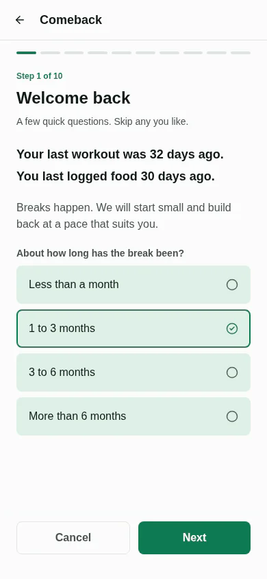
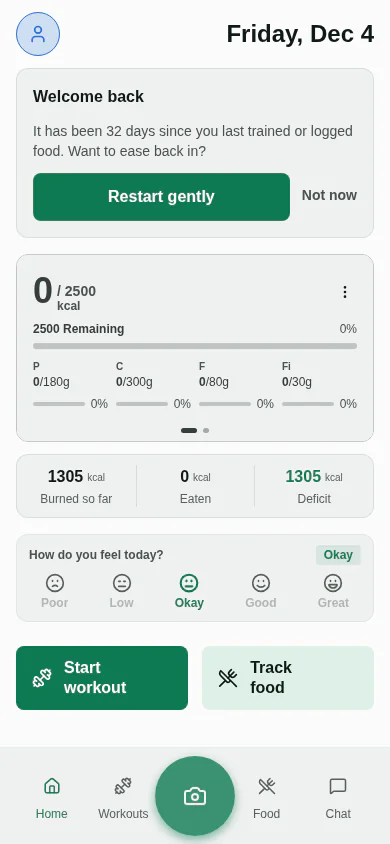
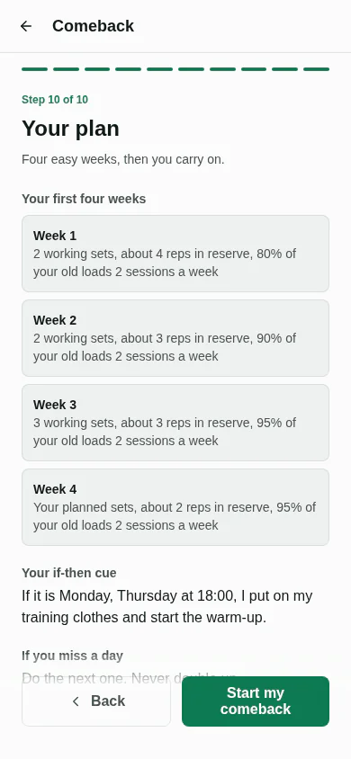

When you return to the gym after a break, start at a fraction of the weight you used before the break, not at your old working weights. A common rule is to start lower the longer you were away, then climb back over a few weeks. Musclog uses one fixed version of this: it starts at 90% of your pre-break load after a break under a month, 80% after one to three months, 70% after three to six months and 60% after more than six months, then adds about 10 percentage points a week for four weeks. The rest of this post shows the numbers, a worked example, and how the app handles the ramp.

## The starting percentages

These figures are Musclog's own ramp. Each week's share is the starting share plus 10 points for each week after the first, capped at 95%, so the ramp never reaches the old weight.

| Break length       | Week 1 | Week 2 | Week 3 | Week 4 |
| ------------------ | ------ | ------ | ------ | ------ |
| Less than a month  | 90%    | 95%    | 95%    | 95%    |
| 1 to 3 months      | 80%    | 90%    | 95%    | 95%    |
| 3 to 6 months      | 70%    | 80%    | 90%    | 95%    |
| More than 6 months | 60%    | 70%    | 80%    | 90%    |

Alongside the load, the ramp limits how hard each week is. Musclog's targets are about four reps in reserve in week 1, three in weeks 2 and 3, and two in week 4 (reps in reserve means reps you could still have done). It also caps working sets per exercise at two in week 1, two in week 2, three in week 3, and your normal plan in week 4. If you report low energy, week 1 drops to one working set.

## A worked example

Say your last squat session before the break was 100 kg, and you were away for one to three months. Musclog's ramp gives:

- Week 1: 80% of 100 kg is 80 kg.
- Week 2: 90% is 90 kg.
- Week 3 and week 4: 95% is 95 kg.

The app then rounds each figure down to a load your gym can actually make. With the app's default plates (25, 20, 15, 10, 5, 2.5 and 1.25 kg, on a 20 kg bar), all three figures are reachable exactly: 80 kg is 30 kg a side, 90 kg is 35 kg a side, and 95 kg is 37.5 kg a side, which is one 25, one 10 and one 2.5 kg plate. Your gym's real plates may differ, and the app uses the ones you set up.

## What counts as a "break"

The app asks how long you were away and offers four bands: less than a month, one to three months, three to six months, and more than six months. The baseline is the load from your last session before the break, not your best ever. A restart never moves that baseline, so it does not compound if you restart twice.

## Which numbers are ours

The ramp's shape is general restart advice: start deliberately light, use a few sets, leave plenty of reps in reserve, and never double up after a miss. No study gives load percentages or schedules for it. So the percentages, the break bands and the caps above are **Musclog product choices, not results from a study**. Treat them as conservative defaults. If your own sets feel much easier than the ramp suggests, you can progress faster, and the app never goes below a load you already completed during the comeback.

## Starting with a simple plan

If you want a plan that is easy to restart, the [Short Full Body Gym program](/programs/short-full-body-gym) is two workouts, A and B, about 30 minutes each, with two sets of about ten reps per exercise. That is the kind of low-volume start the ramp assumes. You can see every program on the [programs page](/programs).

Musclog's Short Full Body templates come in three versions: gym, home and no equipment. Pick the one that matches where you train, then let the ramp set the first loads.

## How the app runs it

Comeback mode is opt-in. The app offers it when you have been away for a while, and nothing changes until you accept. It eases the start rather than dictating a plan: it changes the loads and the set and effort limits above, and it keeps your own exercises. It checks in with you at weeks 2 and 4, and if you tell it a week felt too hard, it holds the ramp back a week before climbing again. After week 4 the normal progression rules take over.

Nutrition follows the same gentle approach: the app keeps you at maintenance for the first two weeks, then offers a modest deficit from week 2 that you can accept or decline.

## Safety

If you are coming back from an injury, surgery, or an illness, see a doctor or physiotherapist before you load anything, and follow their advice over any percentage in this post. A cold start is not a substitute for medical clearance.

## Summary

Start 10 to 40% under your old load, depending on how long you were away, then climb about 10 points a week for four weeks. Musclog does this for you with its own numbers, asks before it changes anything, and explains each change. You can get it on your phone with [Musclog](/download).
