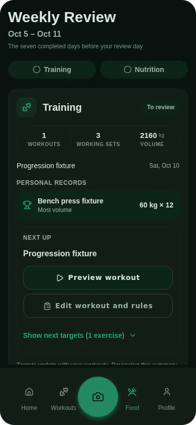

A deload week is a planned week of lighter training, usually with lighter loads or fewer sets, so that you recover and can keep progressing afterwards. You need one when your lifts stop moving for reasons that rest is likely to fix, and the usual sign is that you are grinding through sets you used to find easy. Below is what the signs look like, how to run a deload yourself, and what [Musclog](/download) does on its own when a lift stalls.

## Signs you may need one

A few signs point the same way: the same weight feels much harder than it did a few weeks ago, you miss reps you normally hit, and you can barely leave any reps in reserve on your working sets. Reps in reserve is the count of reps you could still have done before failure, and it is a practical way to rate effort ([Zourdos et al. 2016](https://doi.org/10.1519/JSC.0000000000001049) describe a scale built on it). If most of your sets end at zero in reserve for more than a session or two, the training is asking more than you can recover from.

These signs can also come from poor sleep, a stressful stretch, or an illness, so a deload is often the right answer even when the program itself is fine.

## How to run one yourself

These are rules of thumb, not study results:

- **Keep the same exercises.** A deload is about how hard you train, not what you train. Changing the movements at the same time makes it hard to tell later what worked.
- **Cut the load, the sets, or both.** A common approach is to use about 10 to 20% less weight, or to drop about a third of your working sets, and to keep the reps.
- **Leave more reps in reserve.** Aim to finish each set with three or four reps left, so the week feels easy on purpose.
- **Keep the sessions.** Training at the normal frequency with lighter work keeps the movement pattern familiar. Skipping the week entirely is a rest week, which is a different thing.
- **Go back to normal after one week.** Then judge the next block against the numbers you wrote down before the deload.

If a joint hurts, or the pain is sharp rather than tired, stop and see a doctor or physiotherapist rather than treating it as a deload.

## What Musclog does on its own

Musclog changes a single exercise's load only when its own numbers say so, and it tells you why.

**Automatic deload, per exercise.** A deload happens after two sessions in a row at the same load where you ended with nothing in reserve, or two in a row where you missed the planned reps. One hard session repeats the same load, because one bad day is not a stall. These two-session rules are Musclog product choices.

**How big the cut is.** The new load is 10% lighter or one load step lighter, whichever is larger. This is a Musclog default. The result is then rounded down to a load your gym can actually make. The rounding matters: a 10% cut of a light dumbbell can round back up to the same weight, which would change nothing. For example, a 100 kg squat with a 2.5 kg step has a 10 kg cut, so the target is 90 kg, and the app picks a load at or below 90 kg that the gym can make, strictly lighter than 100 kg.

**Lighter week, from the Weekly Review.** Once a week the Weekly Review looks at your training and may suggest a lighter week. It only suggests one when the evidence is there. All of these are Musclog product choices:

- Two or more exercises deloaded on their own in the same week, or
- At least six rated working sets with an average of 0.5 reps in reserve or less, and a stall, meaning either a one-rep-max goal that is stalling or declining, or at least one exercise that deloaded on its own, or
- Six decided weeks have passed since the last lighter week, which is the fallback so the rhythm does not depend on the numbers alone.

A lighter week sets each exercise's load to the same deload described above, keeps the planned reps, and keeps about two thirds of the working sets, rounded and never fewer than one. The planned effort is set to four reps in reserve, so sets stay easy even if the app re-targets a set between sets. Warm-up sets are left alone. You still choose whether to take the suggestion. Nothing changes until you tap.

Training done inside a lighter week is left out of the history the app uses to judge your next progression. Otherwise the week after a deload would look like a drop in strength.

The app explains each automatic change next to the set it changed, in the same spirit as [my app now explains every number it changes](/blog/2026/10/my-app-now-explains-every-number-it-changes), so you can see whether a load moved because of your numbers, your plan, or your own choice.

## Starting from a plan

If you follow a fixed plan such as one of the [free programs](/programs), a deload is simply a lighter version of the same week. Run it as described above, then return to the plan at the loads you wrote down before the deload. If the plan itself is too demanding for the long run, a deload will only buy time; the fix is a lower volume or a simpler program.

## Summary

Deload when the signs stack up: loads feel heavier, reps are missed, and you have no reps left in reserve. Keep the exercises, cut the load or sets for one week, and go back. Musclog handles the same logic automatically per exercise and suggests a lighter week from your review, and it shows you the reason each time.

Get the app on your phone with [Musclog](/download).
