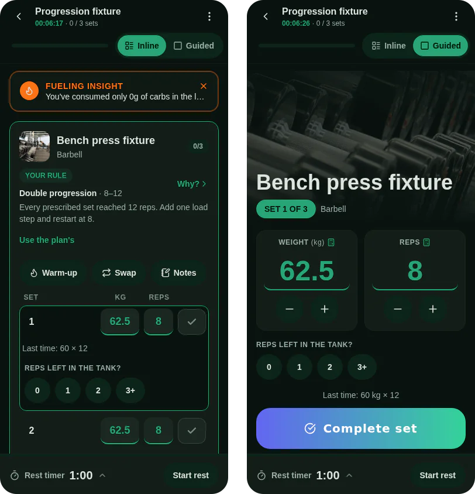

Double progression is a way to decide when to add weight. You pick a rep range, such as 8 to 12. You add reps at the same load each session until every set reaches the top of the range. Then you add the smallest load you can actually set, go back to the bottom of the range, and start climbing again. That is the whole rule. It is not the only method that works, but it is a simple one, and it needs nothing but a log of your sets.

The "every week" in the title is a rough picture, not a schedule. Load goes up when your reps reach the top, which for some lifts is weekly and for others takes a month.

## The rule in four steps

1. **Pick a rep range.** For a press or row, 8 to 12 is a common choice. For a leg press, 10 to 15 might fit better. The range is yours to choose.
2. **Work at one load and add reps.** Each session, try for one more rep than last time on the sets that fell short.
3. **When every set reaches the top, add load.** Add the smallest step your equipment allows, so the increase is small enough to repeat.
4. **Drop back to the bottom of the range.** The new load will feel harder, so the reps fall. Climb again from there.

The rule is about the weakest sets, not the best one. A session of 12, 12 and 10 has not reached the top, however good the first set was.

## A worked example

These numbers are invented for illustration. They are not data from anyone.

Say your range is 8 to 12, and you start a chest press at 40 kg for 8 reps on each of three sets.

| Session | Sets (reps at 40 kg) | What happens next                |
| ------- | -------------------- | -------------------------------- |
| 1       | 8, 8, 8              | Add reps                         |
| 2       | 9, 9, 8              | Add reps                         |
| 3       | 11, 10, 10           | Add reps                         |
| 4       | 12, 12, 11           | Not all at 12, so add reps       |
| 5       | 12, 12, 12           | Every set at the top: add load   |
| 6       | 8, 8, 8 at 42.5 kg   | Repeat the climb from the bottom |

In session 5 every set reached 12, so the next session starts at 42.5 kg, the next 2.5 kg step, for 8 reps. The 2.5 kg step is an example. Use the smallest increase your machine or plates allow.

## How Musclog applies it

Musclog does not ask you to count this on paper. It works from your logged sets, and it shows the reason for each target.

- **Each exercise has a progression rule.** When you add an exercise to a workout, or edit it, you can leave the rule on automatic or choose one. The choices are double progression, linear, top set with back-off sets, and percentage of a training max. The rule editor is where you choose it.
- **Double progression.** Here the rule holds the load for the whole exercise until every set reaches the top of your range. Then the load moves for the whole exercise, starting from the first working set.
- **Automatic, the default.** Automatic does not wait for every set. It judges the session by its weakest working set. It progresses when your last session's average reps in reserve was at least 2, which is the target effort the app uses, and when you hit the planned reps. Its default mode climbs reps first, to the top of the range, then adds load and drops back down. A setting can switch it to adding load each session instead.
- **Holding and deloading.** If you missed reps or had no reps left, the first such session repeats. A second one in a row at the same load triggers a lighter target, about 10% lower or one load step, whichever is larger, rounded down to a weight you can really set.
- **The step.** Without a gym profile, the default step is 2.5 kg, or 5 lb in imperial. With a gym set up for a barbell, the step is twice the lightest plate the gym has at least two of, because plates go on both sides.

The reason is shown next to the target. The post on [how the app explains each number it changes](/blog/2026/10/my-app-now-explains-every-number-it-changes) covers that in detail.

Effort ratings are your own estimates. If you do not rate a set, the app progresses on reps alone, which is a cruder signal, so rating a few sets a week helps.

## What to do this week

- Pick one or two exercises and a rep range for each.
- Log every working set with its weight and reps.
- Add reps until every set hits the top, then add the smallest step and drop back down.
- If you miss reps twice in a row at the same load, repeat the load or take a lighter target rather than pushing through.

If an exercise hurts, stop and check with a doctor or physiotherapist. No progression rule replaces that.

You can find exercises with their own guidance in the [exercise library](/exercises), and whole programs built on these ideas in the [programs](/programs) list. Musclog applies the rules above to your logged sets, and [Musclog](/download) runs on your phone.
