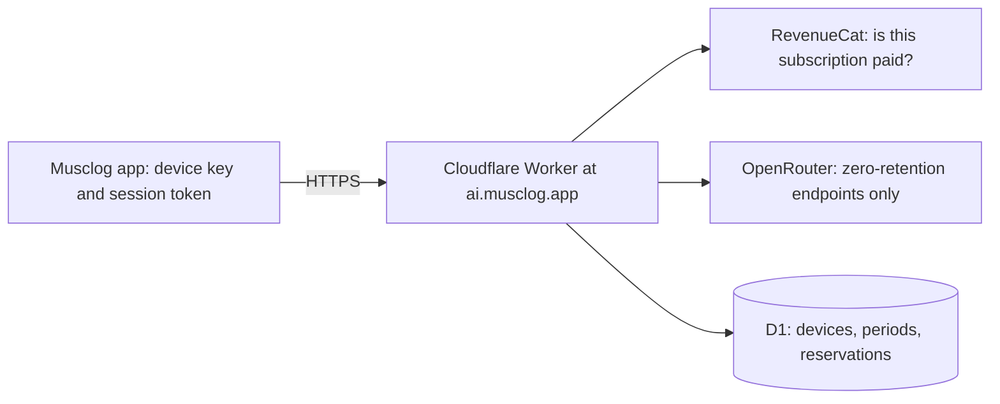

Musclog has no accounts. Your workouts, your food and your weight live on your phone, and I have no database with your name in it. I like that, and I wanted to keep it.

I also wanted people to be able to use the AI features without hunting for an API key, pasting it into a settings screen and paying a provider they have never heard of. That needs a server, because someone has to hold a key, pay the bill and stop a stolen session from running up a stranger's tab. And a server that charges money normally needs a login.

The result is **Musclog Iron**, an optional monthly subscription that runs the AI for you. It took a Cloudflare Worker, a D1 database, OpenTofu, RevenueCat, OpenRouter, two store consoles, a few hundred tests and a new Loggy pose. This post is the whole build, in the order I would explain it to another developer: how a server knows who you are when there is no "you", how it keeps spending below what you paid, how it keeps your messages out of its own logs, how all of it is deployed, and what the two stores made me do. If you want the short, non-technical version, that is [a separate post](/blog/2026/11/meet-musclog-iron-ai-with-nothing-to-set-up-and-nothing-else-locked).

Everything below is in the repository: the app side in `utils/premium/` and `services/premium/`, the server in `services/premium-worker/`, the infrastructure in `infra/`.

## The shape of it



The first decision was the boring one that made everything else smaller. Musclog already talks to AI providers through the OpenAI-compatible client, so the hosted option is **just another provider**: a base URL and a key. The base URL is the Worker. The "key" is a one-hour session token. The Worker is a narrow Chat Completions proxy, not a general gateway, and the app only had to learn one new provider entry.

Three things sit behind the Worker:

- **RevenueCat** answers one question: does a store-verified subscription exist for this device?
- **OpenRouter** routes the request to a model, with settings I will come back to.
- **D1**, Cloudflare's SQLite, holds the ledger. It stores devices, billing periods and per-request reservations. It has no column for message text.

## Running it on Cloudflare's free plan, on purpose

I set myself a rule before writing any code: **no payment method on the Cloudflare account.** A free plan cannot bill me, so a bug, a flood or a viral day cannot turn into a surprise invoice. The price is that the design has to fit inside the free limits, and prove it.

The limit that matters is D1's 100,000 rows written per day. So I counted the writes. I measured them on a local D1 (Miniflare), which is not Cloudflare's billing counter, so treat the numbers as a model, not an invoice. One AI request costs about six writes in total:

| Step                                                          | Writes | Reads        |
| ------------------------------------------------------------- | ------ | ------------ |
| Reserve (insert `pending`, update the period, flip to `held`) | 3      | 8            |
| Read the reservation back                                     | 0      | 1            |
| Settle (update the period, update the reservation)            | 2      | 5            |
| Prune, amortized                                              | 1      | about 8      |
| **Total**                                                     | **6**  | **about 22** |

At 1,500 subscribers with a realistic mix of light, average and heavy users, that comes to about 42,000 writes a day: 42% of the limit. A refused request costs no writes at all.

So the limits are part of the design rather than an afterthought:

- **A global cap of 9,900 requests a day.** A cron job sums today's requests every 15 minutes and sets a flag; the reserve statement reads the flag, so refusing costs nothing extra.
- **A per-user ceiling of 60 requests a day and two in flight**, so one person can consume at most 0.6% of the day.
- **Sign-ups close at 1,500 subscribers.** The app reads `accepting_new` from `/v1/config` and hides the Subscribe button, so the gate applies before anyone pays.
- **A 512 KB body cap**, enforced before any database work, because a request body is CPU and I would rather refuse a huge one early.
- **A rate-limit binding** (30 per minute): by IP for the unauthenticated challenge route, by device for chat. In production and staging a missing binding makes the Worker refuse to serve instead of serving unthrottled.

And it says what it cannot do: ten thousand subscribers would need about 280,000 writes a day and do not fit on the free plan. The design does not upgrade itself. Growing past 1,500 would be my decision, with a $5 plan, and the sign-up cap is how that decision gets forced.

## Infrastructure as code: OpenTofu, with a deliberate split

I wanted the cloud setup to be something I could read, review and rebuild, not a list of dashboard clicks I would forget. The question was where to draw the line between Terraform and Wrangler.

I chose what I called Path B: **Wrangler uploads the code and keeps the secrets, and OpenTofu owns everything around the script.** The reason is secrets. Official docs say Wrangler preserves secrets that are not in its file, and nothing official says a Terraform upload of the script does. Terraform providers have also stored secret values in state in plaintext. So no secret ever touches Terraform config or state. The three secrets (`OPENROUTER_API_KEY`, `REVENUECAT_V2_SECRET_KEY`, `SESSION_HMAC_KEY`) are set with `wrangler secret put`, and the deploy script ends by checking that all three exist, by name only.

What OpenTofu owns, in `infra/premium/`:

- the **D1 database**, with `prevent_destroy`,
- the **custom domain** `ai.musclog.app`,
- the **workers.dev subdomain and preview URLs, switched off** (Wrangler's own `workers_dev = false` does not turn previews off),
- the **two cron triggers**: every 15 minutes, and daily at 00:30 UTC,
- optional alert policies.

Two guards live in the code. The provider is pinned to an exact version. And the hostname variable has a validation that **refuses `api.musclog.app`**, because that is the live barcode API and pointing the Worker at it would be a very bad day:

```hcl
validation {
  condition     = var.custom_hostname != "api.musclog.app"
  error_message = "api.musclog.app is the live Barcode API and must never point at the premium Worker."
}
```

State is a local file, **encrypted by OpenTofu's state encryption** (AES-GCM, key from a PBKDF2 passphrase that lives in an environment variable outside the repo), with encryption enforced for both state and plans. I like that this is one setting rather than a bucket and a policy, and it is the reason I used OpenTofu rather than Terraform.

One script runs the whole thing in the right order, `scripts/premium-deploy.sh <staging|production>`: tests and typecheck, `tofu init`, a workspace per environment, then **D1 first** (a targeted apply, because Wrangler needs the database id that Terraform creates), then migrations, then the code, then the full plan and apply, then a check that the secrets exist, then a smoke test against `/v1/config`. It shows both Terraform plans and waits for a typed `yes` at each apply. It has a `--dry-run` that prints every command and needs no credentials, which is also how CI exercises it.

CI is deliberately boring: `.github/workflows/premium-checks.yml` runs the Worker's tests and types, `tofu init -backend=false`, `fmt -check` and `validate`, `shellcheck`, and both dry runs, with **no secret anywhere**. Every action is pinned by a full commit SHA, the only permission is `contents: read`, and the workflow file is not allowed to mention applying, deploying or the vendors' names. A test pins all of that. There is no apply from CI at all.

### RevenueCat and OpenRouter as code too

The rest of the setup is code as well, with a stricter rule: **nothing here is allowed to delete or to spend.**

- **RevenueCat entitlements and offerings** are JSON files in `infra/revenuecat/config/`, applied by `scripts/infra.sh` by `lookup_key`. `apply` is a dry run unless I pass `--yes`, and anything that looks like a price needs a second flag. **Products and prices are never created here**: the stores own them, and the script only exports them for reference.
- **OpenRouter** (the workspace, key settings and guardrails) is an OpenTofu module of its own. Key _values_ are never in it. An API key resource must never be replaced, because its value is shown once at creation and the live ones are in the Worker and the app, so the docs say that any `replace` line in a plan means stop.
- **Exports are sanitized snapshots** (`infra/snapshots/`), records of what the dashboards say, and they never overwrite the files that say what I want.

Some things still live only in a dashboard, and the runbook lists them honestly: RevenueCat's restore behaviour (which has to stay "Transfer to new App User ID", for reasons below), store credentials, and OpenRouter's account-level privacy settings.

## Who are you, if there is no you

RevenueCat wants an "app user id". The usual answer is your account id. I have no accounts, so the id has to come from somewhere else, and it has to be something a stranger cannot pretend to be.

The first time you open the Musclog Iron screen, the app generates a P-256 key pair on the device (`@noble/curves`, pure JavaScript, so no new native module). The private key goes into the platform's secure storage, marked `WHEN_UNLOCKED_THIS_DEVICE_ONLY`. That flag matters on iOS: the default storage class migrates through encrypted device backups, which would quietly clone the key onto your next phone. The id is a hash of the public key:

```ts
export const RC_ID_PREFIX = 'mlg1_';

export function deriveRcId(publicKey65: Uint8Array): string {
  if (publicKey65.length !== 65 || publicKey65[0] !== 4) {
    throw new Error('Expected a 65-byte uncompressed P-256 public key');
  }

  return RC_ID_PREFIX + bytesToHex(sha256(publicKey65));
}
```

That id is also what RevenueCat knows you as. Two details turned out to matter more than they look:

- **The uncompressed key, not the compressed one.** The library's `keygen()` hands back the 33-byte compressed key. Hash that and the app and the server derive different ids from the same key. The code refuses anything that is not 65 bytes starting with `0x04`.
- **RevenueCat is never configured anonymously.** If the SDK starts with an anonymous id and a purchase happens, RevenueCat aliases the anonymous id to the identified one instead of transferring it, and the check on my side fails. So the SDK is configured lazily, never at boot, and only with `appUserID = rc_id`. Opening the app does not talk to RevenueCat at all.

The id is not a secret. It shows up in RevenueCat's dashboard, and I treat it as public. What makes it safe is that the Worker never accepts a request on an id alone. It re-derives the hash from the public key you send, and then wants a signature.

## Proving you hold the key

Enrolling a device is a small challenge-response:

1. The app asks `GET /v1/challenge` for a nonce. The Worker returns a timestamped, HMAC-signed value, valid for two minutes.
2. The app signs one string with the device key:

```ts
`musclog-premium-v1\n${purpose}\n${rcId}\n${nonce}\n${bytesToHex(sha256(body))}`;
```

3. It sends the id, the public key, the nonce and the 64-byte signature to `POST /v1/enroll`.

The string is domain-separated (`musclog-premium-v1`) and bound to a purpose (`enroll` or `session`), so a signature made for one thing cannot be replayed as another. The nonce is single use: the Worker keeps a monotonic `last_nonce_ts` per device and refuses anything older, so no nonce table is needed. It also rejects **high-S** signatures. WebCrypto will happily verify both encodings of the same ECDSA signature, which would give an attacker a second valid-looking value for free. Requiring the canonical one means the nonce, not the signature bytes, is the replay key.

Only then does the Worker call RevenueCat's v2 API and look for a subscription that meets all of these:

- the store is the App Store or Google Play,
- the environment is `production` (on the staging Worker it is `sandbox`, and the production Worker refuses test purchases),
- the subscription was purchased, not granted,
- the product is on an allowlist,
- and the subscription's `customer_id` is **exactly** `rc_id`.

If none qualifies, the answer is `subscription_required`. If more than one does, it answers 503. I would rather have an enrollment fail than guess whose subscription it is.

Passing that check returns a session token: `v1.<claims>.<HMAC>`, valid for an hour, tied to one device. Every chat request carries it, plus an `Idempotency-Key`.

### The restore detail

There is one more rule that lives in a RevenueCat dashboard rather than in my code: restore behaviour must be "Transfer to new App User ID". When you add a second phone, you tap Restore. RevenueCat then moves the subscription to the new device's id, and the old id stops showing as entitled. App Store guideline 3.1.2(a) says a subscription has to work on all of your devices, so the Worker keeps the older device valid as long as the subscription gives access, and **the app shows Iron's status from the Worker's answers, not from RevenueCat's local customer info**, which would say the older phone has lost it. All your devices share one allowance, and there is a safety ceiling of 25 devices per subscription (the least recently used is evicted past it).

If that dashboard setting is ever changed, enrollment fails closed. That is the right way to be wrong.

## A budget that follows the payment

This is the part I spent the most time on, because it is the part where a bug costs real money.

The rule is simple to say: **for every paid period, the most Musclog can spend on inference, OpenRouter's fee included, is at most half of that payment's net proceeds.** The other half is for refunds, exchange-rate movement, estimation errors and keeping the project alive.

Note what the rule is keyed on. Not the user, not the device, not the RevenueCat id, all of which can change. The budget row is keyed by `payment_key = sha256(store ‖ transaction id)`: the store's own id of the payment that covers right now. Reinstalling, restoring, resetting the device key or moving to a new phone all point at the same store transaction, so they read the same row. A renewal is a new transaction, so a new row. There is no way to get a second budget out of one payment, and the database refuses to create overlapping active periods for one subscription.

The cap is computed from RevenueCat's reported proceeds, which are after tax and store commission, and then shaved:

```
net_proceeds = proceeds × (1 − 0.03 estimate haircut) × (1 − 0.05 exchange-rate haircut)
               − RevenueCat's 1%
cap          = floor(net_proceeds × 0.5 / 1.055)    // 1.055 is OpenRouter's fee
```

Three more limits sit inside that cap: the first three days of a first period are capped at a quarter of it (that is the refund-prone window), a single day is capped at 40%, and nothing ever exceeds a hard maximum of two dollars. If RevenueCat has not reported proceeds yet, or reports zero, the cap is zero and the Worker answers `revenue_unverified`. Missing information means no spending, never a guess.

### Exactly-once, in one SQL statement

A request has to be admitted, run and charged **exactly once**, even if the phone retries, the network drops mid-stream or a Worker isolate dies halfway. The ledger does it with reservations. Before the upstream call, the Worker reserves the worst-case cost of the request, and the reserve is a single guarded insert:

```sql
INSERT OR IGNORE INTO reservations
  (payment_key, req_id, body_hash, reserved_u, state, hold_token, created_at, expires_at)
SELECT :pk, :id, :bh, :r, 'pending', :hold, :now, :exp
WHERE  NOT EXISTS (SELECT 1 FROM meta WHERE key = 'breaker' AND value = 'open')
  AND  EXISTS (SELECT 1 FROM devices d WHERE d.rc_id = :rc AND d.status = 'active')
  AND  EXISTS (SELECT 1 FROM periods p WHERE p.payment_key = :pk AND p.status = 'active'
         AND :now >= p.period_start AND :now < p.period_end
         AND p.spent_u + p.reserved_u + :r <= p.cap_u
         AND p.inflight < :max_inflight /* ...and the daily and early caps */)
```

(Trimmed: the real one has the early and daily caps in the same `WHERE`.) Everything that decides admission, from the circuit breaker to the device status to the remaining budget, is evaluated in one statement. There is no read-then-write gap for two requests to slip through together.

The `Idempotency-Key` the app sends is **bound to the request body's hash**. Send the same key again while the first request is still running and you get `in_progress`. Send it after the request finished and you get `already_processed`. Either way nothing is charged twice, and the same key with a different body is refused outright. When a reply finishes, the real cost replaces the reservation. If the outcome is unknown, because the connection died or the upstream timed out, the request is **charged at its reservation**. Failing closed on money means occasionally charging an allowance for a reply that never arrived, rather than ever giving away free compute.

A cron job every 15 minutes sweeps reservations that never settled. Before any of the Worker existed I wrote a spike for exactly this logic: fire 100 concurrent reserves at a budget that fits 37 of them, and check that exactly 37 get in, 63 are refused, and `spent + reserved` lands on the number it should. The same SQL is now pinned by tests that run against a real D1 in Miniflare.

## Rebuilding the request instead of filtering it

The app never chooses the model. It sends an OpenAI-shaped body and the Worker **rebuilds** it field by field from an allowlist, instead of deleting the fields it dislikes:

- Allowed: `messages` (text, and `image_url` as data URLs only, so OpenRouter never fetches an arbitrary address), `response_format` as `json_schema`, `tools`, `tool_choice`, `stream`, `temperature`, `max_tokens`, `stop`.
- Added by the Worker: the model, from a config string; clamped `temperature` and `max_tokens` per feature; a low reasoning effort; and the `provider` object.
- Anything else is a 400 whose error names the path of the offending field and never echoes content. Plugins, web search and model arrays are not allowed.

The model itself is a config value, not code: today it is `openai/gpt-6-luna`, picked from a shortlist where zero retention, structured output, tool calling and price are filters rather than preferences. That filter removed more models than I expected. I built a benchmark from the app's real prompts and schemas to compare candidates, but I have only run part of it, which is one more reason the model is a setting I can change without shipping an app. Google's Gemini models, for example, are not eligible, because Google now requires a safety-retention tier on its endpoints, which is exactly what zero retention is meant to exclude. The config validates on every cold start and the Worker refuses to serve a config that fails, so a typo cannot quietly change what your messages are sent to.

The `provider` object is the privacy promise:

```ts
provider: {
  zdr: true,
  data_collection: 'deny',
  require_parameters: true,
  allow_fallbacks: false,
  max_price: { prompt, completion, image },
}
```

`zdr: true` limits routing to OpenRouter's zero-data-retention endpoints. `data_collection: 'deny'` excludes providers that train on prompts. `allow_fallbacks: false` means that if no such endpoint is available, the request **fails** instead of quietly going somewhere weaker.

I should be straight about one thing: OpenRouter's account-wide ZDR setting is **off** on the account that serves Musclog Iron. So the per-request object is the only thing keeping a request on zero-retention providers, and I do not want that to rest on a field nobody re-reads. That is why there is a function that throws if any of the three fields is missing or different, called on every body right before it is sent:

```ts
export function assertPremiumPrivacy(body: Record<string, unknown>): void {
  const p = body.provider;
  if (!isObj(p) || p.zdr !== true || p.data_collection !== 'deny' || p.allow_fallbacks !== false) {
    throw new Error('premium_privacy_invariant_violated');
  }
}
```

The server config is validated on every cold start, and the validator rejects any configuration that relaxes those fields. There is no flag to turn them off. A daily job also reads OpenRouter's public list of zero-retention endpoints and checks that the configured model still has one at the pinned price. If it does not, the circuit breaker opens and the Worker stops serving until I look at it.

OpenRouter also receives a `user` field, so it can spot abuse. It is the first 16 characters of a hash of the subscription, not your device id, your name or your email address.

### The exception I had to write down

"Zero retention" is not quite absolute, and I only found out because I went looking. OpenRouter announced that, starting 27 October, it would screen **every** inference request, zero-retention traffic included, for child sexual abuse material while the request is in flight, and may keep a request it flags for review, reporting and legal preservation. Its documentation says that this does not allow general retention or any use for training.

I think that is reasonable, and I do not think it should be a footnote. So the consent screen in the app says it, the privacy policy says it, the paywall's own wording says "apart from a screening for child abuse material that the law requires", and the consent has a version number so that a change like this asks people again. The first draft of my consent text said "do not keep your content" without the exception. A promise is only worth something if it is the true one.


While checking that dialog I found a bug of my own. The longer text made it taller than a 320×568 screen, so the title was clipped and the buttons were below the fold. `ConfirmationModal` had no way to scroll its message, so it gained a `scrollable` mode where only the message scrolls and the title and buttons stay put. My first version had a second flaw, which the person who reads these dialogs spotted at once: text scrolling under a fixed row of buttons just looks cut off. So the scrolling message now carries the same cue as the app's other long screens, a fade into the dialog's own surface and a chevron that scrolls to the end, and both disappear when you reach the bottom. Long translations are the usual way this breaks, and the consent exists in ten languages.


## Logs with nowhere to put your messages

"We do not log your messages" is easy to write and hard to keep. So instead of promising to be careful, the code makes the mistake difficult.

The Worker's logger accepts one type:

```ts
export interface LogEvent {
  route: string;
  status: number;
  code?: string;
  latency_ms?: number;
  lineage_prefix?: string; // first 8 hex chars of a hash
  model?: string;
  tokens?: number;
  cost_u?: number;
  overrun?: boolean;
  severity?: 'info' | 'error' | 'high';
}
```

There is no free-text field. A prompt, a token or a device id cannot be logged by accident because there is nowhere to put it, and a `sanitize` step drops any other key a caller tries to spread in.

Error reporting needed the same care, and it taught me something. The Worker reports crashes to Sentry, and I assumed "no request data" was a setting. Then I read what the SDK does by default: its fetch integration records a span for every outgoing call, and the RevenueCat call's URL contains the device id (`/customers/mlg1_...`). It would also add trace headers to the OpenRouter and RevenueCat requests. So that integration is removed, no request is a propagation target, and the scrubber drops spans, request data, user, breadcrumbs, extras and every exception message (an upstream failure could echo content). What is left is little more than the exception type, the stack and four tags. Cloudflare's own per-request "invocation log" is switched off for the same reason: I cannot promise what is in it.

What the Worker does keep:

| Data                               | Kept                                                                                        |
| ---------------------------------- | ------------------------------------------------------------------------------------------- |
| Request fingerprint and ledger row | 7 days after the request settles                                                            |
| Usage counts per billing period    | 60 days after the period ends                                                               |
| Device identifier and public key   | Until it is removed on request (no cron deletes it)                                         |
| Message text, photos, replies      | Never                                                                                       |
| Your IP address                    | Not stored. It is only a rate-limit key, and Cloudflare sees it as it would for any request |

The third row is the one I like least. There is no "delete my device" endpoint yet, because designing a safe one means designing authentication for it. For now it is an email to me and a one-line `DELETE` against D1, and the privacy policy says exactly that.

## What the app shows

The app side is smaller than the server, but it is where most of the care for the person goes.


A few rules made it into the code because the first versions broke them:

- **Hosted is just another provider, and there is no silent fallback.** If the hosted request fails, Musclog does **not** retry it against another provider, because that would change who receives your messages. The failure is one typed error (`HostedAiError`: budget, daily limit, subscription, removed, unavailable, busy and so on), shown in plain words, never the Worker's own text. A used-up allowance tells you that your own key or the free option still work; it does not switch for you.
- **Waiting is always visible.** A purchase is two waits: the store, then the Worker confirming it, and RevenueCat's API can lag a fresh purchase by seconds. So the enroll call retries only the lag errors, three times at two, four and eight seconds, and the screen says what is happening in one polite line, never a fake percentage. You can close the screen mid-purchase and the purchase continues; the consent question is waiting when you come back.


- **One retry owner.** Each logical request gets one idempotency key, the OpenAI client's own retries are switched off, and only one function retries (502, 503 and 504, a busy `409`, a `429`), never an auth or a payment error.
- **The price is never in the copy.** Every price you see is the store's own string, because a number I typed would be wrong in another currency and a store review would be right to reject it.
- **A kill switch in two places.** A server variable turns hosted AI off for everyone with a deploy, and a build variable hides the whole screen in the app. The build one is not allowed in `eas.json`, `app.json` or `package.json`: a test fails if it appears, so it can only be set as an EAS variable.

The app also has a Premium test harness screen that exists only in a special build profile, for running the identity checks against real stores. A guard test fails if any other build profile carries its flag, and the release scripts refuse to promote that build. It is a test tool, not a feature, and it never ships.

## The two stores

### Google Play, from the command line

I made a rule: do store work with scripts, not by clicking, so it is reviewable and repeatable. For Google Play that means [gplay](https://github.com/tamtom/play-console-cli) behind three small scripts.

- `scripts/play.sh` keeps the **store listing as files**, ten locales of title, short and full description under `android/play/metadata/`, with `pull`, `plan` (a diff), `check` (applies it in a throwaway edit, validates and discards) and `up`. It enforces Play's limits (30, 80 and 4,000 characters) and refuses anything destructive without a flag.
- `scripts/release-android.sh` builds through EAS and **refuses a bundle signed with the debug key**, runs gplay's preflight, refuses a version code that is not above every code on Play, and uploads to the internal track by default. Production needs a staged rollout, and promoting anything to production needs a flag confirming it is not the test-harness build.
- **The subscription product itself** is read and edited with `gplay subscriptions`: one monthly auto-renewing base plan, with Google's default grace period. When I renamed the product from Premium to Iron, that was a single `subscriptions update` call; the product id and the base plan id can never change.

Play's rules shaped the copy more than I expected: no naming competitors in the listing, no "free" in the title or short description, and the short description may not repeat the full one. The listing never says "no subscription", because after Iron that would be false. It says everything except the optional AI allowance is free.

What the command line could not do, I did by hand, and it is worth knowing why. **The Data safety form** is write-only through the API: it replaces the whole declaration, and there is no call to read what is there today, so one script run could silently erase the existing answers. I keep a table of the answers in the docs and enter them in the console. **Real-time developer notifications** (so Play tells RevenueCat about renewals and cancellations promptly) are a Pub/Sub topic in a Google Cloud project plus a field in the console; as I write this, mine are not connected yet.

And testing taught me the sharpest lesson of the whole project. A Play **license tester**'s purchase is a sandbox purchase, and the production Worker refuses sandbox purchases on purpose. So a real test means a real card and a refund afterwards, and my own Google account must not be on the license-tester list. I found out by being refused by my own safeguard.

### The App Store

Apple's side is quieter because the iOS app is still in TestFlight, but the plumbing is the same shape: `asc` behind `scripts/appstore.sh` keeps the listing as files, a vendored compliance guard scans the app's sources before any submit and fails on a high finding that is not listed, with a reason, in a known-findings file, and the privacy manifest lives in `app.json`, never in the generated iOS project. Adding RevenueCat meant adding Purchase History, User ID and Device ID to that manifest, and a test now checks that the committed manifest matches `app.json`, because I found that it had been missing them.

## Testing the contract, not just the pieces

The Worker has 350 tests that run offline: OpenRouter and RevenueCat are injected fakes, D1 is Miniflare's. But two halves that are each correct can still disagree about a signed string or a response shape. So one test imports the **app's own** pure client (`premiumFlows.ts`, `hostedClient.ts`, `deviceKeyCrypto.ts`) and runs it against the **real** Worker handlers. Change the signed string on one side and that test fails.

That test has a price. Those app files may only use relative imports, because the Worker package has no `@/` alias, and its CI installs only its own dependencies, so the `@noble` imports resolve from its own `node_modules`. I found that one the hard way, when CI failed on a clean checkout that my laptop's root `node_modules` had been hiding.

## What went wrong

Real accounts show you things tests cannot, and a few of these are traps I would rather you skip.

- **RevenueCat's v2 API does not use the store's product ids.** The Play product is `musclog_premium_monthly`, but the API reports RevenueCat's **own** id (`prod...`) for it. An allowlist written with the store identifier matches nothing, so every enrollment answers `subscription_required` and the cause is invisible from the outside. The config validator now refuses a store identifier in production and staging on cold start.
- **"Checking Musclog Iron..." forever.** The device stored `active` at enrollment and nothing ever replaced it. When a test subscription lapsed, the session call was refused, usage was never read, and the AI settings row never left its loading state. On top of that, React Native's `fetch` has no timeout, so a stalled request could hang the screen just the same. A refusal now marks the device as lapsed, the screen re-reads its status after the usage call, and the identity and price calls time out.
- **Test purchases and real purchases live in different worlds.** RevenueCat reports a Play license tester's purchase as a sandbox purchase. The production Worker accepts only production purchases, on purpose, so sandbox testing goes through a separate staging Worker, and a configuration that lists `sandbox` for production is refused when the Worker starts.
- **A privacy promise went stale in one afternoon.** See the child-abuse-material screening above. The fix was a text change in ten languages, a consent version bump, and a scrolling dialog.

## A new Loggy, because it deserved one

Every other part of this project is invisible, which is the problem with infrastructure. So Musclog Iron got a mascot moment: a new Loggy pose with a dumbbell overhead, a VIP rosette, sweat drops, and a kettlebell with "IRON" on it.


He is not a drawing I exported. Loggy is generated from a **library of parts**: one SVG per part and variant (`arm-l/iron`, `drops/iron`, `kettlebell/iron`, the torso, the legs), a face for each expression, one shared palette, and a `poses.json` that says which parts stack, bottom to top, for each pose. A script composes every pose from those parts, plus an animated twin whose keyframes are plain CSS, and a test fails if a generated file is out of date. The consequence I like: the torso and legs are the same ones every other pose uses, so a change to one of them reaches all 24 poses at once. The iron pose adds only seven parts of its own.


The animation is a handful of CSS rules, and its header comment is the spec: the dumbbell arm presses overhead and back, the upper body dips with each rep while the shoes and the kettlebell stay planted, the sweat drops pulse at the top, the rosette swings on its ribbons, the leaf sways and the two sparkles twinkle in alternating phase. Every layer opens and ends on the still's own frame, which is how the still and the moving version can be the same image at rest, and is what you get when "reduce motion" is on.

His green also follows your theme, which is why the pose reads correctly in every palette. And since you will ask: his artwork is dedicated to the public domain, like all of Loggy, and the earlier post about [how he started as a kettlebell](/blog/2026/11/my-mascot-was-a-kettlebell-named-loggy-until-i-remembered-what-a-log-is) explains why he is a log at all.

He opens the one-time announcement tour that introduces Iron, and the tour tells you in its first lines that it will not show a banner like that again.


## What is not done

- **Photos.** Hosted vision is off in the Worker's config, so a photo meal needs your own key or the free option. The Worker supports images; I have not tested enough photos to switch it on. The app asks the Worker whether photos are on, and says so instead of sending a request that would be refused.
- **No remove-device call.** See the table above.
- **The full identity test matrix.** I designed a twenty-step test of how RevenueCat behaves across restores, resets and transfers, and built the harness for it. What I have actually run is the real thing, end to end, with a real card. The matrix is still open.
- **Play's real-time notifications** are not connected yet.
- **Native-speaker review.** The privacy text and Iron screens exist in ten languages, but nine of those are machine-translated and are waiting for people who speak them.

If you want to read it rather than take my word for it, start with `services/premium-worker/src/proxy/chat.ts`, `utils/premium/premiumFlows.ts` and `infra/premium/`. The design document with the attack table is `docs/plans/musclog-premium.md`. And if you find a way to get a second budget out of one payment, I would genuinely like an email.
