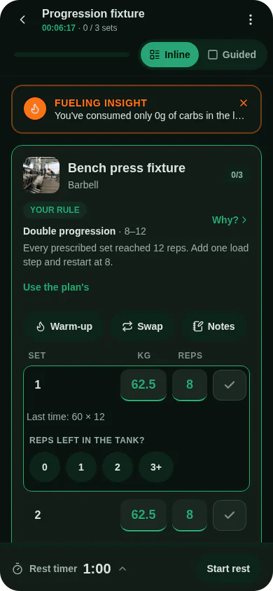

To estimate your one-rep max, take a weight you lifted for a few reps, add the reps you had left in the tank, and run that through a formula that predicts the heaviest single you could lift. Musclog's [one-rep max calculator](/tools/one-rep-max) does this with seven published formulas, averages them, and refuses any set above 10 reps.

## What an estimate is

A true one-rep max (1RM) is the heaviest weight you can lift once with good form on a given day. The direct way to find it is to work up to a single attempt, which is the method most people should avoid unless they are trained and have a spotter (more on that below).

An estimate skips the single. You do a set of a few reps at a weight you can control, and a formula converts that set into the load you would expect to manage for one rep. The formulas were fitted to lifting data, so they are approximations. The useful question is not "what is my exact max" but "how strong am I, roughly, and what load should I start from today?"

## The formula the calculator uses

Musclog does not rely on one formula. For each set it computes seven estimates, Epley, Brzycki, Lander, Lombardi, Mayhew, O'Connor and Wathen, and takes their plain average. The average is the number the app shows for a logged set, and the calculator uses the same function, so the two cannot disagree.

Every formula works on one input: the reps counted to failure, which is your reps plus your reps in reserve. Epley, for example, is `weight × (1 + reps ÷ 30)`. The others use different curves over the same reps value.

Here is one set worked through by hand. You lift 100 kg for 5 reps and could have done no more (reps in reserve 0), so the reps value is 5.

- Epley: 100 × (1 + 5 ÷ 30) = 100 × 1.1667 = **116.7 kg**
- Brzycki: 100 ÷ (1.0278 − 0.0278 × 5) = 100 ÷ 0.8888 = **112.5 kg**
- Lander: 100 ÷ (1.013 − 0.0267123 × 5) = 100 ÷ 0.8794 = **113.7 kg**
- Lombardi: 100 × 5^0.1 = 100 × 1.1746 = **117.5 kg**
- Mayhew: 100 ÷ (0.522 + 0.419 × e^(−0.055 × 5)) = 100 ÷ 0.8403 = **119.0 kg**
- O'Connor: 100 × (1 + 0.025 × 5) = **112.5 kg**
- Wathen: 100 ÷ (0.488 + 0.539 × e^(−0.035 × 5)) = 100 ÷ 0.9405 = **106.3 kg**

The seven values run from 106.3 to 119.0 kg. Their average is (116.7 + 112.5 + 113.7 + 117.5 + 119.0 + 112.5 + 106.3) ÷ 7 = **114.0 kg**. That is the estimate. The calculator shows the low and high values next to it, so you can see how much the formulas disagree on the same set.

## Reps in reserve count as reps

Reps in reserve (RIR) is how many more reps you could have done before failure. The calculator adds it to the reps you did. A set of 5 with 2 reps in reserve is calculated exactly as 7 reps taken to failure.

Take the same 100 kg for 5 reps, but with 2 reps in reserve. The formulas now see 7 reps. The average becomes 119.6 kg, about 5.6 kg above the 114.0 kg from the set taken to failure.

That gap is the reason to be honest about effort. If you enter 0 reps in reserve on a set you stopped 2 reps short of, you will underestimate your strength. Leave the field empty if you went to failure; the calculator treats empty as 0. The field accepts whole numbers from 0 to 9.

## Why sets above 10 reps are not trusted

The calculator refuses a set with more than 10 reps. This is Musclog's own choice, not a result from a study. Above 10 reps the app treats a set as a measure of endurance rather than strength, so it gives no estimate.

The reasoning is in the calculator's message: the formulas were built around lower rep counts, and the further they are stretched, the further they drift from the truth. A set of 15 tells you that you can keep a weight moving for a while. It does not tell you what you could lift once, because the formula has to extrapolate a long way to get there.

The rule applies to the reps you typed, not to reps plus reserve. A set of 10 with 3 in reserve is accepted and is treated as 13 reps to failure. The app also ignores sets above 10 reps when it measures strength levels and goals, so the number on the calculator matches what the rest of Musclog uses.

If your heavy work is in the 12 to 20 rep range, use the calculator on a heavier set of 10 or fewer, or test a lighter-rep set at a weight you can repeat.

## Testing a true max

You can test a real one-rep max. Warm up thoroughly, pick a weight that is a small step above your estimate, use a spotter or safety pins, and make one attempt. If it moves, add a small amount and try again later. If it does not, drop the weight and try another day.

It is riskier than an estimate. A failed single can pin you under the bar, and a true max is most useful for a competition or a specific test, not for picking the next day's load. For ordinary training, an estimate from a set of a few reps gives you a number to plan with and carries no risk of a failed single.

## How to use the table

The calculator also lists the weight at each percentage of your estimated one-rep max, from 100% down to 50%, with the reps to failure the same formulas predict at that load. Each row gives a working weight and how many reps the formulas expect you to manage with it before failure. Rows past 10 reps are marked as extrapolated: they come from the same formulas stretched beyond the range this post just called unreliable, so read them as a rough guide only.

Treat the table as a starting point. Your own bar speed, your sleep and your technique change the numbers. If a load feels much easier or harder than its row says, that is information for the next set, not a reason to trust the table over your body.

Try the [one-rep max calculator](/tools/one-rep-max) with a set you did this week. [Musclog](/download) uses this same estimate for the sets you log, so the number you see in the calculator is the one the app will use.
