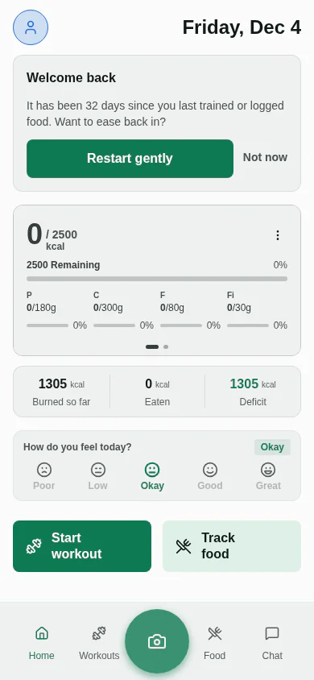
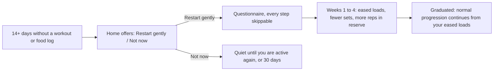
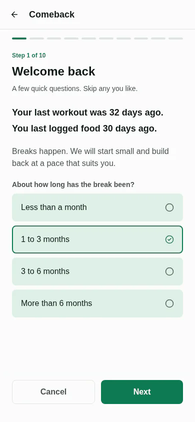
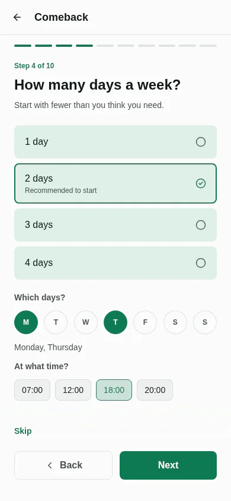
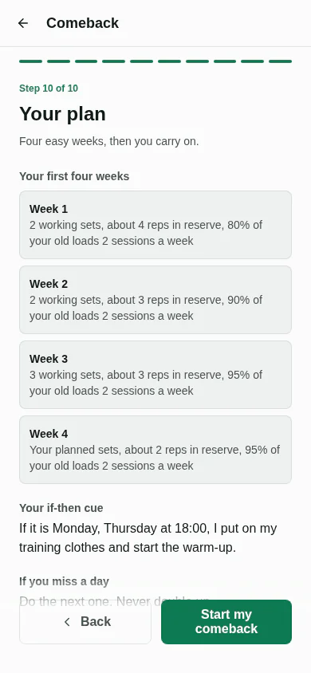
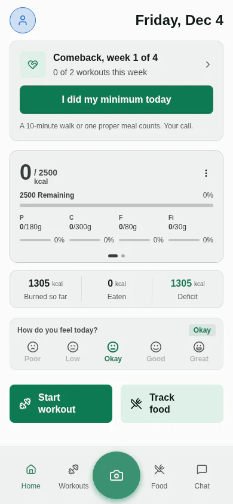
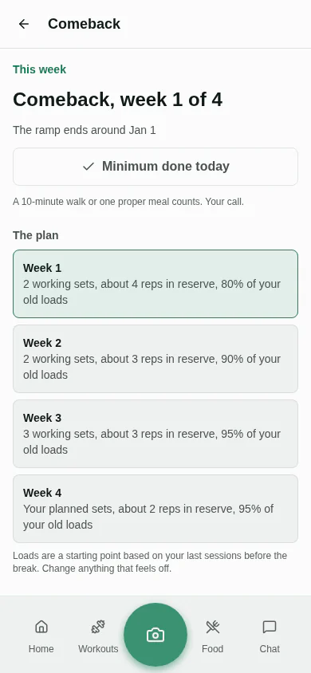

This summer was an intense stretch of travel, and by the end of it I had stopped logging my food and stopped training.

When I wanted my routine back, I noticed that Musclog had no answer for that moment. A workout plan starts you at the weights you left off at. A streak counter starts at zero. Nothing in the app is built for "I've been away for a month or two and I'd like to restart without hurting myself or feeling terrible about it."

So I built that. **Comeback mode** is a gentle restart for people who stopped training, stopped logging food, or both. The short version:

- After 14 or more days without a workout or a food log, Home **offers** to ease you back in. Nothing changes unless you say yes.
- A short questionnaire (every step skippable) sets up the plan.
- For four weeks, your workouts use lighter loads, fewer sets and more reps in reserve, easing up each week.
- Food starts at maintenance. A small deficit is offered at week two, never applied on its own.
- A one-tap "I did my minimum today" counts, and a missed day is never made up by doubling the next one.



_Screenshots here use demo data._

The rest of this post is about why it works the way it does, because almost every number in it came from a decision I had to defend.

## What the research says, and what it doesn't

I didn't want to invent a restart program from gut feeling. Before writing any code I read a research brief on returning to training and eating after a long break: a synthesis of public-health guidance, strength-training evidence and behaviour-change studies. It was written around a rougher scenario than mine (a long break, weight gain, a lot of stress), so its advice leans cautious, which is what a restart needs.

One caveat: I'm relaying its conclusions. I haven't re-verified every study it leans on, so read the figures below as the brief's, not as my own literature review.

What it agrees on:

- **Don't recreate the old routine on day one.** WHO guidance for inactive adults is to start with small amounts and raise frequency, duration and intensity gradually. Activity no longer has to come in 10-minute bouts to count.
- **Start deliberately easy.** Two full-body strength sessions a week plus easy cardio. In the first sessions, 1 to 2 sets and about 3 to 4 reps in reserve; by weeks 3 and 4, about 2 to 3. Training to failure isn't needed, and the brief points to the ACSM resistance-training position stand for that.
- **Progress by how recovery feels, not by a formula.** It specifically warns against treating "add 10% a week" as a law, because the evidence behind it is thin and inconsistent.
- **Make the minimum version trivially easy, and never double up after a miss.** Planning interventions ("if it's Monday at 18:00, I put my training clothes on") improve physical activity on average: a modest but real effect across 41 trials. In Lally's habit study, repeating something in a stable context built automaticity. It took anywhere from 18 to 254 days, and missing a single day didn't derail it.
- **Don't diet hard while you rebuild.** Eat regularly with protein first, start at maintenance, and only then take a modest deficit of about 300 to 500 kcal, if energy, mood and sleep allow.
- **Measure against week one, not your old peak.** Check in around weeks 2, 4, 8 and 12.
- **Self-compassion beats tough love after a lapse.**

What it does **not** give you is a load. It says to start deliberately under-dosed, with 1 to 2 sets and 3 to 4 reps in reserve. It does not say "start at 80% of what you lifted before". So the code splits cleanly in two, and `RESEARCH.md` in the repo records which side each number is on:

| Taken from the brief                                    | My product choices                                            |
| ------------------------------------------------------- | ------------------------------------------------------------- |
| 1 to 3 working sets, 3 to 4 reps in reserve early       | The load factor by break length, and the weekly step          |
| Two strength days a week plus easy cardio               | The 14-day lapse threshold and the 30-day re-offer            |
| The 10-minute minimum day                               | Reps in reserve of 4, 3, 3, 2 across weeks 1 to 4             |
| The if-then cue, and "do the next one, never double up" | Deficit size: 300 kcal, or 500 if you report plenty of energy |
| Check-ins at weeks 2, 4, 8 and 12                       | "Stalled" meaning 10 days of silence during a comeback        |
| Maintenance first, then a 300 to 500 kcal deficit       |                                                               |

I'd rather say that out loud than present a made-up 80% as science.

## It offers, it doesn't assume

The trigger is a gap of `COMEBACK_OFFER_MIN_GAP_DAYS` (14 days). A fortnight off is a holiday or a busy stretch, not a lapse.

The two halves are judged separately, because someone can stop training and keep logging food:

```ts
// A half the person never used cannot have lapsed.
const workoutLapsed = workoutGapDays !== null && workoutGapDays >= COMEBACK_OFFER_MIN_GAP_DAYS;
const foodLapsed = foodGapDays !== null && foodGapDays >= COMEBACK_OFFER_MIN_GAP_DAYS;
```

If only one half has lapsed, the offer is for that half. If both have, it's for both. Someone who never logs food is never told they lapsed at logging food.

Reading "when did they last…?" is three indexed `take(1)` queries (latest completed workout, latest food log, latest weigh-in), not a scan of history, because it runs every time Home gains focus.

**"Not now" stays quiet for that gap.** The offer comes back only if you were active again in between and then lapsed, or after 30 days. Nagging someone who just told you they're not ready is the opposite of the point.



## The questionnaire starts small on purpose

Ten steps, about 30 seconds, every one skippable. Break length is pre-selected from your actual gap, so all you have to do is correct it if it's off.



The days question is the one I'm happiest with. Its subtitle is "Start with fewer than you think you need", it recommends two, and it offers a maximum of four. Pick your weekdays and a time, and that becomes the if-then sentence on the final screen.



A few other choices:

- **You can ease into your own plan, take a short one, or decide later.** The short plans are three neutral **Short Full Body** templates (gym, home, no equipment), roughly 30 minutes each, created as a weekly plan on the days you chose.
- **Food tracking depth is a choice.** Everything, calories and protein only, or just log meals with no numbers yet.
- **One optional energy question changes the plan.** Answering "Very little" caps week one at a single working set instead of two.
- **For breaks of three months or more**, the plan screen adds one line: check with a doctor first if you have chest pain, fainting or a known heart condition. The brief is clear that someone with symptoms or known disease should be assessed before hard training, and equally clear that routine screening of healthy people is not supported. A single line is the compromise. Under the energy question there is also a quiet link to talk to someone, with no diagnostic language.



## The ramp is one file

All of the arithmetic lives in `utils/comeback/comebackProgram.ts`. It starts from how long you were away, then steps up:

```ts
const BASE_LOAD_FACTOR: Record<BreakLength, number> = {
  under1m: 0.9,
  '1to3m': 0.8,
  '3to6m': 0.7,
  over6m: 0.6,
};

const RAMP_TARGET_RIR = [4, 3, 3, 2] as const;
const RAMP_LOAD_STEP = [0, 0.1, 0.2, 0.3] as const;
```

The load factor is `min(0.95, base + step)`. It never reaches 100%. For a one-to-three-month break, that gives the four weeks in the screenshot above:

| Week | Working sets           | Reps in reserve | Share of old loads |
| ---- | ---------------------- | --------------- | ------------------ |
| 1    | 2 (1 if energy is low) | 4               | 80%                |
| 2    | 2                      | 3               | 90%                |
| 3    | 3                      | 3               | 95%                |
| 4    | your plan's            | 2               | 95%                |

The brief warns against treating a fixed percentage per week as a rule, and this schedule steps by ten points a week, so it's fair to ask whether I broke my own advice. It's a starting schedule, not a law. The check-ins below can hold it, and the rules below keep it from overriding what you've actually lifted. The file's header comment says outright that these numbers are product choices, and `RESEARCH.md` records them as such.

A few rules took more thought than the numbers did:

- **The baseline is your last session _before_ the break.** It's filtered in the database query, not afterwards, because four comeback weeks of eased sessions could otherwise push the pre-break one out of the list of recent sessions the app looks at.
- **The ramp never asks for more than your pre-break load, and never less than what you've already done during the comeback.** If those two ever disagree, the floor wins. Otherwise a lift you'd already handled comfortably could be dropped back down.
- **It applies even if workout suggestions are set to manual.** Manual means "don't change things on your own", and this is the opposite: you opted in to a ramp. It also beats a Weekly Review "repeat" or "lighter week" decision while it's running.
- **It explains itself.** An eased number never looks like something you chose. Each set carries its reason ("Comeback week 1: …, about 80% of what you lifted before the break. Leave about 4 reps in reserve", with the weight and reps where the dots are), and "Use plan" puts the original plan back. That's the same rule I wrote about in [my post about explaining every number](/blog/2026/10/my-app-now-explains-every-number-it-changes).

After week four, normal progression takes over from the loads you've been using, not from the old ones.

## "Too hard" is the only answer that changes anything

At weeks 2 and 4 the Weekly Review asks one question: too easy, about right, or too hard. Weeks 8 and 12 are reflections on the Comeback screen, with nothing to adjust.

```ts
export function weekShiftAfterCheckpoint(current, feel, week) {
  // Only the ramp checkpoints can hold it; 8 and 12 are reflections after graduation.
  if (feel !== 'hard' || week > COMEBACK_RAMP_WEEKS) {
    return current;
  }

  return Math.min(MAX_WEEK_SHIFT, current + 1);
}
```

"Too hard" holds the ramp for a week. "Too easy" does nothing. The result is an app that slows down on your word but never speeds up on it, which fits the research's main worry: doing too much too soon. If you want heavier, the loads are yours to change, and graduation is four weeks away.

The check-in is still due when a week was held back. It follows the calendar, so it doesn't quietly stop asking.

## The minimum day, and a streak that doesn't punish you



During a comeback, Home shows **"I did my minimum today"**. A 10-minute walk or one proper meal counts, "Your call". It's one tap, and it exists because the brief's most useful behavioural rule is that the minimum successful version has to be so easy it works on a bad day.

While a comeback is running, the streak card shows **active days this week** instead of a streak. A streak is the one number that punishes a gap: coming back after a break means starting at zero again.

The plan screen also says it in four words: "Do the next one. Never double up."

## Food: maintenance first, and the deficit is an offer

For the first two weeks your targets are maintenance, calculated from the formula and deliberately **not** from the empirical estimate. The usual weight-trend estimate interpolates across the gap, from weigh-ins that can be two months old, and a detrained body isn't the body those weigh-ins describe.

At week two the app **offers** a small deficit, with the numbers it would mean: 300 kcal, or 500 if you said you had plenty of energy. It's clamped to the minimum-calorie floor and never applied without a tap. Tracking depth is a one-tap toggle at any time ("Just log meals for now", "Show protein only").

## The app gets quieter, then says one thing

Reminders that keep firing into weeks of silence read as nagging, and they never change tone. So after 14 days without activity, workout reminders, the weekly-goal warning and the nightly overview stop until you're active again or start a comeback.

Instead there's **one** welcome-back notification per gap, at 18:00 on the day the gap reaches 14 days. It's skipped if you chose the flexible accountability style, and it respects quiet hours and pauses. It opens Home, where the offer is waiting. All of that is a pure function over facts that `refreshAllNotifications` reads once, so the notification planners never touch comeback state themselves.

## The Comeback screen



It shows where you are in the ramp, the plan, and a short "Since you came back" summary: workouts, days with food logged, minimum days. Under it, in plain type: _Measured against your first week back, not your old peak._ Below that are food tips tailored to how you said you eat, including photo and chat logging when AI is set up, and **Edit my answers** and **End comeback** at the bottom. Ending it keeps your history and returns workouts to normal progression.

## What I deliberately didn't build

- **Phase- or mood-based prescriptions.** The energy question makes the start gentler. It doesn't generate advice about how you "should" train today.
- **A guilt-framed streak.** See above.
- **An automatic deficit.** It's always an offer.
- **Clinical screening.** One line of text and one quiet link. This is a fitness app, not a clinician.

## Why it matters more than it looks

Until now, Musclog treated someone coming back after six weeks exactly like someone who trained yesterday: the same plan, the same loads, the same reminders.

I stopped for a summer, and the way back was the part my own app didn't have. Now it does. It's opt-in, it's built on what the research agrees on, and the numbers the research doesn't give are written down as mine.

If you've been away, give it a go. If you'd have set the numbers differently, I'd genuinely like to hear it: they're all in one file.
