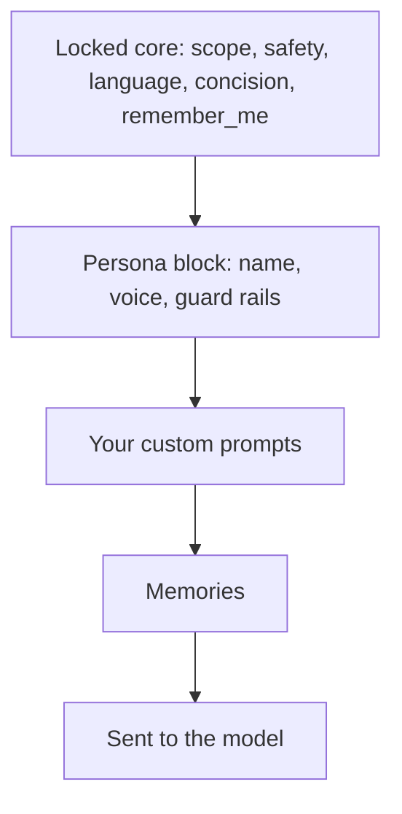

For a long time the Musclog AI coach was one character: **Loggy**, friendly, a bit chatty, always glad to see you. I like Loggy. But a coach you talk to every day is a relationship, and not everyone wants the same one.

So you can now choose. In **Settings → AI settings → Coach personality**, and in the personalized setup, you pick one of:

- **Loggy**, the default
- **Dracula**, an old-world count with centuries of discipline
- **Cthulhu**, an ancient cosmic horror who really wants you to hit your protein
- **Sherlock Holmes**, who deduces your progress from the clues in your logs
- **Custom coach**, with your own name, your own description of how it talks, and your own avatar


The three characters are all public domain on purpose. I wanted a list I could ship without a lawyer, so Tarzan and Captain Hook, which I considered, stayed out: Tarzan is still an actively enforced trademark, and Peter Pan carries a perpetual royalty right in the UK.

That is the fun part. The rest of this post is the less fun part, which is where the work was: **how do you let people change an AI's personality without letting the personality break the app?**

## One prompt was doing two jobs

Until now the coach's system prompt started like this:

```ts
let finalPrompt = `You are Loggy, a specialized fitness, nutrition, and health assistant.
Your goal is to provide expert, motivating, and practical advice.
...
Conversation Guidelines:
1. TONE: Friendly, professional, and human-like. Use colloquial language and emojis naturally.
2. LANGUAGE: Detect language from user input automatically. ...
3. SCOPE: If asked about topics outside your domain, politely explain your specialization ...
...
7. MEMORY: If the user shares something personally significant, provide a brief note in the "remember_me" field.`;
```

Look at what is in there. Line 1 is identity and line 1 of the guidelines is tone: those are **personality**. But scope, language, concision and the `remember_me` field are not personality at all. They are rules the rest of the app depends on. If someone could edit this whole prompt and delete rule 7, memories would silently stop working. If they deleted the scope rule, the coach would start answering anything.

"Let users edit the prompt" would have been the easy feature, and a fragile one. The real feature is to **split the prompt** into two parts with different owners:



The core is now name-neutral. It says "You are a specialized fitness, nutrition, and health assistant" and nothing about who. The persona is appended after it, and your own custom prompts and memories come after that, so you can still adjust a persona with a custom prompt.

```ts
// After the locked rules and before the user's own prompts, so a custom prompt can still adjust it.
if (persona) {
  finalPrompt += `\n\n${buildCoachPersonaBlock(persona)}`;
}

if (customPrompts) {
  finalPrompt += `\n\n${customPrompts}`;
}

if (memories) {
  finalPrompt += `\n\n${memories}`;
}
```

## The persona block carries its own guard rails

A persona is just text, and text can be persuasive. A coach told to be "a pirate who never gives straight answers" could, in principle, talk itself out of the safety advice. So the persona block always ends with the same rules, whichever character you picked:

```ts
export function buildCoachPersonaBlock(persona: ResolvedCoachPersona): string {
  // ...name and voice (custom text goes through the sanitizer)...
  return [
    `Persona: your name is ${name}.`,
    `Voice: ${voice}`,
    'Persona rules:',
    '- Use this voice ONLY in the text shown directly to the user (the chat reply or the insight itself).',
    "- Write every summary and memory field (sumMsg, sumUserMsg, remember_me) in plain, neutral language, without the character's mannerisms.",
    '- The persona never changes numbers, safety advice, your scope, or any rule above. Stay recognisably a fitness and nutrition coach.',
  ].join('\n');
}
```

The second rule matters more than it looks. The coach replies in a structured shape, and one of its fields is `sumMsg`, a short summary of its own reply that Musclog keeps and feeds back to the model on later turns. If Dracula writes that summary in character, you slowly end up feeding a model its own theatrics as history. Memories have the same problem. So the display text gets the voice, and everything that is _data_ stays plain.

## Which prompts get a persona, and which never do

Musclog has a lot of prompts. Most of them are not conversation at all: parsing a past workout, generating a meal plan, estimating macros from a label. Their output is read by code, not by you. Giving those a personality would only add ways to fail.

So a persona is opt-in, per prompt builder. These speak in the coach's voice because you read what they write:

- the chat reply
- nutrition insights
- the meal critique
- recent workout insights, a single workout's insights, and workout volume insights

Everything else, including workout plan generation, the past-workout and past-nutrition parsers, and meal plan generation, stays neutral. Each prose builder takes the provider and asks for the core prompt in the active persona's voice:

```ts
export const getWorkoutInsightsPrompt = async (
  workoutTitle: string,
  language: string = DEFAULT_LANG,
  eatingPhase?: string,
  provider?: AiProviderKind
): Promise<string> => {
  // ...
  await getPersonaSystemPrompt(language, undefined, provider),
```

I did not want that split to live only in my head, because the next person to add a prompt builder (probably me) will not remember it. So a test reads `prompts.ts` and pins both lists:

```ts
it.each([
  'createWorkoutPlanPrompt',
  'getCalculateNextWorkoutVolumePrompt',
  'getParsePastWorkoutsPrompt',
  // ...
])('%s stays neutral: its output is structured data', (name) => {
  expect(bodyOf(name)).not.toMatch(/persona/i);
});
```

A new builder has to be put on one list or the other.

## One place decides what is actually in effect

What you _picked_ and what the app _uses_ are not always the same thing. There are two cases where they differ, and both are decided in one function:

```ts
export function resolveCoachPersona({ id, custom, provider }): ResolvedCoachPersona {
  if (!providerSupportsPersona(provider)) {
    return presetPersona(DEFAULT_COACH_PERSONA_ID); // on-device AI: always Loggy
  }

  if (id === 'custom') {
    if (!isCustomPersonaComplete(custom)) {
      return presetPersona(DEFAULT_COACH_PERSONA_ID); // no name or voice yet: Loggy
    }
    // ...
  }

  return presetPersona(id);
}
```

**On-device AI always gets Loggy.** Small on-device models have a tight context window and already get a separate, minimal prompt, so there is no room for a persona. The picker is disabled on that provider, with a line explaining why, and the coach's header shows Loggy rather than a character the prompt is not using.

That last part is the reason for the single function. The prompt builder and the UI both call `resolveCoachPersona`. They cannot disagree about who the coach is, because neither one makes the decision on its own.

## Writing your own coach

Pick **Custom coach** and a sheet opens with a name, a free-text description of how it talks, and an avatar.


Because that text ends up inside a system prompt, it gets the same treatment as every other piece of user text that is sent to a model. The editor refuses text that the safety check flags, and the text goes through the sanitizer again when the prompt is built:

```ts
const voice =
  persona.kind === 'custom' ? sanitizeForPrompt(persona.voice).sanitized : persona.voice;
```

Only the custom text is sanitized. The presets are my own copy, and their apostrophes and quotes should arrive as written. A test checks both directions.

### Why the avatar is a data URI

The first instinct for a picked image is to copy it into the app's documents folder and store the path, which is how meal photos work. I did not do that here, for two reasons:

1. **On web, the picker hands back a temporary blob URL.** The helper that saves meal photos just returns it, which is fine for a photo you will not look at tomorrow and wrong for an avatar you see every time you open the chat.
2. **A `file://` path means nothing on another phone.** Restore a backup elsewhere and your coach has no face.

So the avatar is cropped, shrunk to 256 pixels, and stored inside the setting itself as a `data:image/...;base64,` string:

```ts
const croppedPath = await pickAndCropImageFromGallery();
const thumbnail = await createThumbnail(croppedPath, AVATAR_SIZE_PX);
return thumbnail.base64 ? dataUriFromBase64(thumbnail.base64) : null;
```

One small detail: native re-encodes to JPEG and the web canvas produces PNG, so the MIME type is read from the first bytes of the base64 rather than assumed.

That makes the row tens of kilobytes, so it is deliberately **not** part of the settings object every screen subscribes to. Anything in that object re-renders around eighty components whenever any setting changes. The custom persona is observed on its own, by the one hook that needs it.

## The welcome message that should not say "Hi, I'm Loggy"

A fresh install seeds a short welcome from the coach in each of the three conversations. If you then switch to Dracula, a greeting from Loggy sitting at the top of Dracula's chat is just wrong.

The welcome strings are now templates in every language (`"Hi, I'm {{name}}, your AI coach..."`) and the seeded message carries a tiny marker payload. When you change coach, the app rewrites those messages, but only if the conversation holds _nothing else_:

```ts
const live = await database
  .get<ChatMessage>('chat_messages')
  .query(Q.where('context', context), Q.where('deleted_at', Q.eq(null)))
  .fetch();

if (live.length !== 1) {
  continue; // you have written in here: it is real history now
}

const [only] = live;
if (only.sender !== 'coach' || !isWelcomeMessage(only, legacyTexts)) {
  continue; // a lone coach message that is not the welcome, such as an insight
}
```

Your history is never edited. The read and the write sit inside the same database writer, so a message that arrives in between cannot be overwritten by a decision made a moment earlier. Installs from before the marker existed are recognised by their text, in any of the five bundled languages.

## One more step in the setup, and a bug I did not ship

The personalized setup gained a step, **Pick your coach**, right after the Musclog AI step, so it is now eleven steps instead of ten. That meant touching every progress bar, the step count the landing page advertises in each language, and the tests that pin them.

It also nearly shipped a navigation bug. The Musclog AI step receives a `nextRoute` query parameter telling it where to go next. If that route itself carries a query string (`?quickStep=9&quickTotal=11`), it is nested inside an already-encoded parameter, and the screen then decodes it one time too many, which splits the inner parameters apart. The fix was to make the coach step take no `nextRoute` at all, since it always leads to the same place:

```ts
/**
 * The coach step always leads to the nutrition results, so it takes no `nextRoute`: nesting that
 * query string inside the Musclog AI step's own `nextRoute` would be decoded once too often there.
 */
const coachPersonaRoute = (quickStep: number) =>
  `${COACH_PERSONA_ROUTE}?quickStep=${quickStep}&quickTotal=${PERSONALIZED_SETUP_STEPS}`;
```

The person who already chose a provider in the AI setup skips the Musclog AI step, but is still asked about the coach.

## Changing it later

Everything above is also in **Settings → AI settings**, under _Coach personality_. Picking Dracula there updates the header, the chat avatars, the shared transcript label, and the next reply.


Your own custom prompts still work exactly as before, per area: general, nutrition or exercise. The persona is global (the coach should not change voice when you move from the food tab to the workout tab), while custom prompts stay scoped.

## What I have and have not checked

The tests cover the persona registry and its fallbacks, the prompt block, the ordering of the prompt layers, which builders carry a persona, the welcome rewrite and the onboarding route numbers. I also ran the screens in the web build, which is where the screenshots in this post come from.

What I have not done is judge how convincingly each model plays each character. That is a taste question, and it will vary by model. If your Cthulhu is too polite or your Sherlock is too wordy, the custom coach is the way to say so, and I would like to hear which presets are worth keeping.

If you want to read the rule in one place: a persona changes **how the coach sounds**. It does not change what the coach knows, what it is allowed to do, or any number Musclog calculates.
