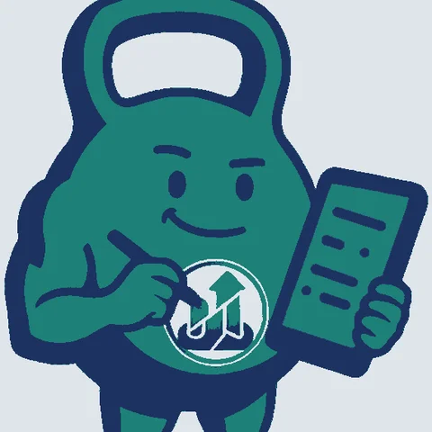
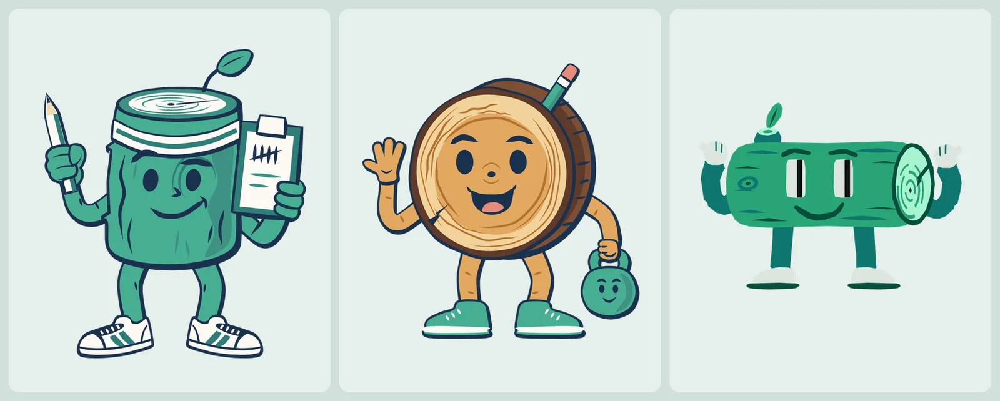
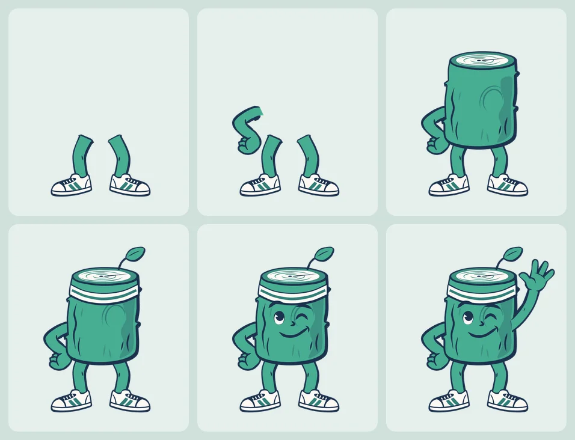
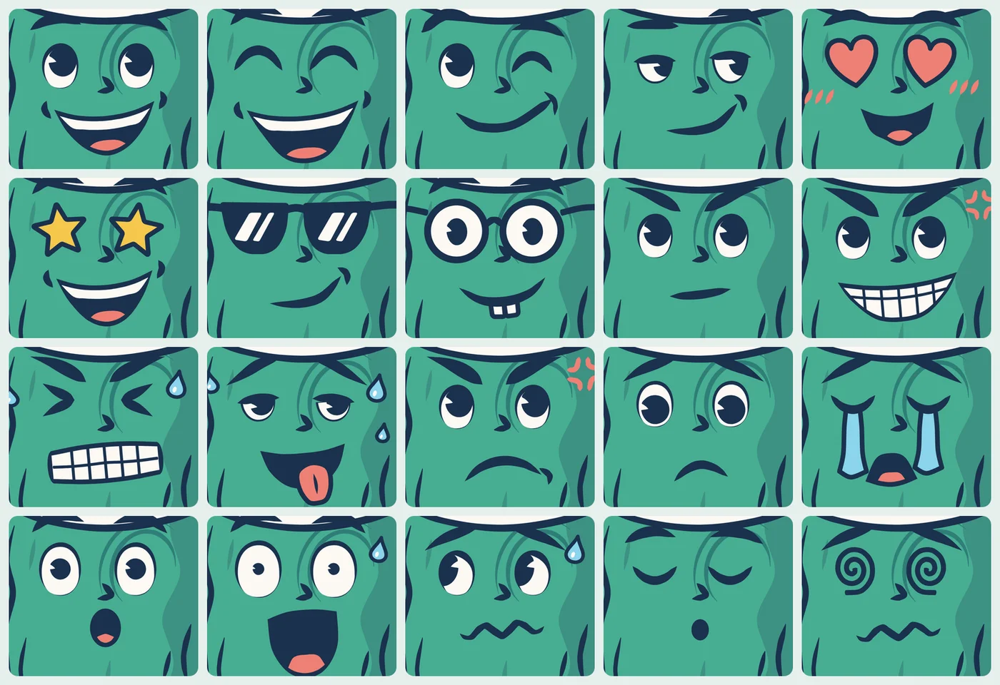
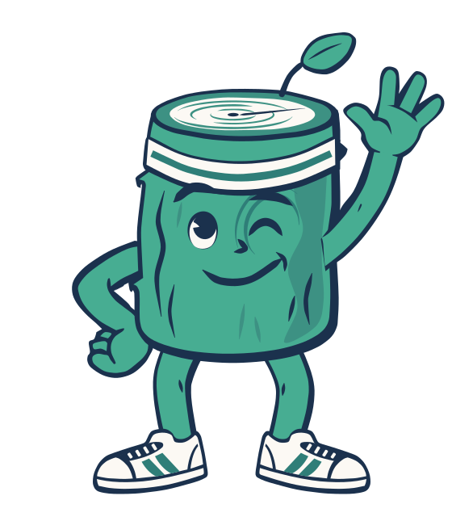
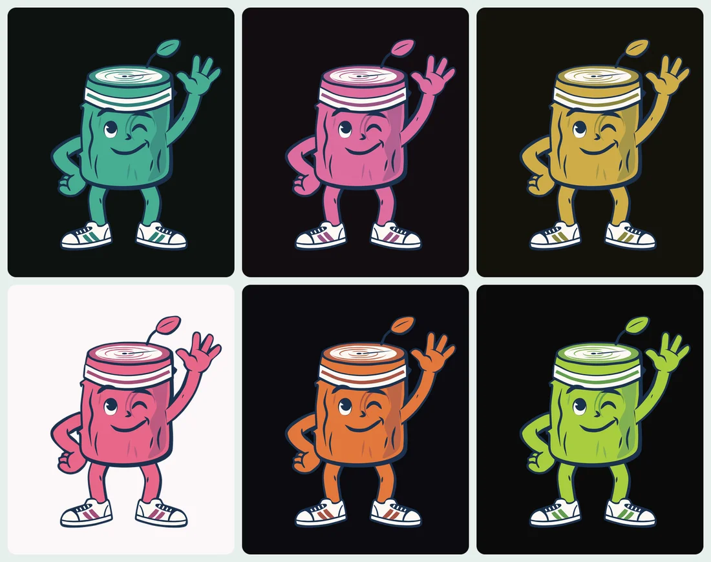

Musclog is a logging app, so when the AI coach needed a name I called him Loggy. Logging, Loggy. Obvious.

For eight months, Loggy was a kettlebell.

## A kettlebell with a clipboard



He was a teal kettlebell with a pencil in one hand, a clipboard in the other and a little chart badge on his belly. He arrived on 5 March as the coach's chat avatar, a small round picture next to a message, and for that job he was fine. The name came from the verb. The picture came from the gym. They never met.

Then one day I actually looked at the word. _Log._ As in the thing you put on a fire. A log is a piece of wood. The mascot of a logging app should be a log, and I had been walking around with a kettlebell named after a piece of wood.

## Three logs

On 5 November I ended up with three candidates:



- **A** is a log standing up, with a headband, a leaf sprouting from the top, sneakers, a pencil and a clipboard covered in tally marks. Counting in fives is about the oldest way anyone has ever logged anything.
- **B** is a round slice of trunk with growth rings, waving, with a small kettlebell in his other hand as a nod to where he came from.
- **C** is a log lying on its side with arms and legs.

I did not agonise over it, and the history shows it. B and C share one commit. A got five of its own in under an hour: `pencil-up`, `hands-fixed`, `chunky-hands`, `gripping-hands`, `flat-head`. Three of the five are named after hands.

A is the one you have been looking at. He is also the coach's avatar now, replacing the kettlebell, and the coach is still Loggy by default (the [persona post](/blog/2026/11/my-ai-coach-can-be-dracula-but-it-cannot-change-your-numbers) explains what changes when you pick someone else).

## One picture is a logo

A mascot that is a single picture is a logo. I wanted him to react: celebrate a finished workout, shrug when an import goes wrong, wave hello. That needs poses, and a lot of them.

I ended up with twenty:


All of them are in the repo, so you can look at every one without opening the app: [`assets/avatars/loggy-poses`](https://github.com/blopa/musclog-app/tree/main/assets/avatars/loggy-poses) has the stills, [`loggy-animated`](https://github.com/blopa/musclog-app/tree/main/assets/avatars/loggy-animated) has the moving versions, and [`loggy-parts`](https://github.com/blopa/musclog-app/tree/main/assets/avatars/loggy-parts) has the pieces they are built from.

## Nothing here is auto-traced

The reference for each pose is an image from Gemini, the same way I got the glass lighting for [the app icon](/blog/2026/10/i-lost-my-app-icon-so-a-script-draws-six-of-them). A reference is where it stops. Every pose in the repo is redrawn as SVG paths, and I was not willing to auto-trace it. A tool like potrace gives you one wobbly blob per colour: nothing can pass behind anything, and nothing can be animated, because there are no parts, only a flat stain.

So the paths are written by hand, with Claude doing the drawing and me checking each one against the reference. The method lives in a skill, and it is mostly bookkeeping. Crop a part at 3x, put a grid over it, read coordinates off the grid, write the path in crop pixels, and map those into the SVG with one scale, one anchor and one rotation:

```python
crop('ref.png', 25, 230, 150, 300, 'left.png', zoom=3)
proof('left.png', [], 'left-grid.png', grid=50)

T = mapper(crop_anchor=(203, 625), svg_anchor=(62.5, 255), scale=0.223, rotate=-7.2)
```

Then render the part next to the reference and compare. Not as thumbnails. At the same scale, zoomed into every join.

I did not arrive at that method; I arrived at it by rejecting the alternatives:

- **Shapes that were generated, not traced, were horrible.** Capsules and ellipses standing in for limbs read as a stack of sausages.
- **Green shapes with a uniform outline stroke were "close but not quite there".** The reference's line weight varies, and a stroke cannot. What worked was tracing the ink itself: one navy silhouette for the whole mass, with the green shapes on top.
- **A limb in front of the body needs its own outline and fill.** Letting the body's outline stand in for an arm, with a few crease marks on top, looks like no arm at all. The first version of the thinking pose got exactly that review.
- **Do not invent anatomy to rescue a bad reference.** When the thinking arm looked wrong I gave it a shoulder and a long hanging arm, and the review was "super long arm". The fix was a corrected reference. Limbs on this log are short and thick, and the whole figure has to agree.

## The first ten poses were ten copies of the same log

By the night of 5 November each pose was a complete SVG with its own copy of the torso and all fifty faces: the waving one was 1,197 lines and 187 KB. By the next afternoon there were ten of them. Fixing the log's edge meant editing ten files and hoping I was consistent.

It is the same lesson as the icon: keep the parts, not the picture. So I split him up. `assets/avatars/loggy-parts/` now holds one small SVG per part and variant (`arm-r/wave.svg`, `leg-l/standing.svg`, `mug/coffee.svg`), one file per face, one style sheet, and one manifest that says how a pose is stacked:

```json
"wave": {
  "viewBox": "-30 0 560 640",
  "face": "wink",
  "alternateFaces": true,
  "layers": [
    "leg-l/standing",
    "leg-r/standing",
    "arm-l/hip",
    "hand-l/hip",
    { "group": "body", "children": ["log/default", "leaf/default", "sweatband/default", "@face"] },
    "arm-r/wave",
    "hand-r/wave"
  ],
  "animated": { "upper": ["arm-l", "hand-l", "body", "arm-r", "hand-r"] }
}
```

The list is bottom to top, the same order SVG paints in. That is why an arm can pass behind the torso while its hand stays in front:



The torso (`log`, `leaf`, `sweatband` and a face) is one group that every pose shares. Fix the log once and twenty poses change. There are 118 parts and 50 faces in the library, and one command, `npm run generate-loggy`, composes every pose from them.

A part is art and nothing else. It may contain a `<g id>` and `<path class d>` and that is all. Colours come from classes in `palette.css` (`.s0` to `.s21`), so a path with an inline `fill`, a `style`, or a class that is not in the palette fails the build with the file named. That sounds fussy, and it is what makes the next two sections possible: a colour can only change in one place, because it can only be written in one place.

## Fifty faces, one pair of eyes

Faces are parts too. Here are twenty of the fifty:



Making them one at a time went wrong in a way I should have predicted. Each face got drawn with its own idea of what an eye is, and side by side they looked like different characters wearing the same log. At 2 a.m. on 6 November I redid all of them: every open eye is now one drawing, a white eye with a big dark pupil, and only where it looks changes. Closed eyes and the symbolic ones (hearts, stars, spirals, crosses) kept their own look, because they were never competing.

## Making him move

Each pose has an `animations/<pose>.css` next to it, plain CSS keyframes. This is the wave:

```css
#hand-r {
  transform-origin: 448px 191px;
  animation: loggy-hello 2.88s ease-in-out infinite;
}

@keyframes loggy-hello {
  0%,
  75%,
  100% {
    transform: rotate(0deg);
  }
  19%,
  56% {
    transform: rotate(6deg);
  }
  39% {
    transform: rotate(1deg);
  }
}
```

Two rules keep this honest. The origin sits on the joint it moves, otherwise the ink splits at the wrist. And every layer opens and closes on the still's own frame, so the first frame of the animation is exactly the drawn pose. Here is the actual file the website uses:



A browser plays that by itself. The app is not a browser. `react-native-svg` does not run CSS animations or SMIL, so an animated SVG imported as a component would just be a still. That meant a second generator, which reads the same CSS and writes each pose out as a component with the motion as a table of data:

```ts
'hand-r': {
  origin: [448, 191],
  durationMs: 2880,
  easing: 'ease-in-out',
  fns: ['rotate'],
  frames: [
    { at: 0, args: [[0]] },
    { at: 0.19, args: [[6]] },
    { at: 0.39, args: [[1]] },
    // ...
  ],
},
```

A small pure module, `utils/loggyAnimation.ts`, plays that table the way a browser would: cubic-bezier easing per interval, and the transform functions composed in the order they were written. One Reanimated clock drives every layer of a pose, and each layer takes the remainder against its own duration. Native hands the result to an SVG group as a `matrix`. The web build of `react-native-svg` only knows the SVG `transform` attribute, so there it goes out as a string:

```ts
const transform = IS_WEB
  ? { transform: loggyMatrixToTransform(pose.matrix) }
  : { matrix: pose.matrix };
```

Because every layer starts and ends on the still's frame, a still needs no second drawing. Without a clock, every layer is a plain group, and that is the pose he is drawn in when you switch **Animated Loggy** off, or when your phone asks for reduced motion. The animated twin also drops the hidden faces: the wave's still is 203 KB, and the file above is 38 KB.

## One log, six colours

Then I put him in the Shock theme and he looked like he had wandered in from a different app. A bright green log on a hot pink screen is a stranger.



Only three of his colours change: the body green, the deeper green of the headband stripes and shoe stripes, and the shade between them. Everything else is fixed (the navy outline, the cream, the tan, the coral, the sky blue, the gold of a trophy), so that a pose still reads as Loggy and only his green follows the theme. That works because of the palette rule from before. In `palette.css`, those greens are written as a variable with a fallback:

```css
.s1 {
  fill: var(--loggy-body, #47ad92);
} /* body green (themed) */
```

A renderer that knows nothing about themes draws the fallback, so every SVG is still a correct picture of the original Loggy. The generators swap the whole expression for the theme's colour. What each theme's colours are is one table:

```js
'kinetic-shock': { body: '#dd6d9e', deep: '#995485', shade: '#b36090' },
'kinetic-volt': { body: '#cfac49', deep: '#8a853e', shade: '#a69648' },
```

I found those values by moving the green to each theme's brand hue at Loggy's own lightness, then checking the result on the theme's backgrounds. Light brands needed a nudge: Volt's yellow and Scope's lime had to be lifted, or he turns mustard and olive and dulls the theme he is standing in. A test checks that his body stays readable against his own outline and against every surface of the theme, and a new theme without an entry fails it, so a theme cannot ship with a stranger in it.

Two cases where a green must **not** follow the theme:

- **The salad.** The lettuce is the same hex as his body. If it used the themed class it would turn pink in a pink theme, and a pink salad is a different joke. It has fixed classes of its own.
- **The year-in-review posters.** Their backgrounds are built around his green, and a pink log on the coral poster disappears. They draw him in the classic green on purpose.

### The website cannot read your theme

On the website, Loggy is an SVG file in a CSS background, and an image cannot read the page's theme variables. So there is one copy of each pose per palette. Seven themes make six palettes, because Depth and Light share the emerald. The page's stylesheet picks the file from `html[data-theme-id]`, which a blocking script sets before the body renders. Switching the image with JavaScript after hydration would flash the default green first, in exactly the theme you picked to get away from it. For visitors who ask for reduced motion, the same stylesheet selects a still copy, so they never download the animation at all.

## He shows up at moments, not everywhere

The temptation, with twenty poses, is to put him on every screen. A mascot on every screen stops meaning anything, so the code holds the list: a test fails if a new file draws him without being added to an allowlist with a reason. He appears at the start of setup, on a finished workout, on the first meal, workout or goal you ever log, on an empty screen that really is empty, and for the [offer to ease you back in](/blog/2026/11/i-stopped-after-a-summer-of-travel-so-musclog-can-ease-you-back-in) after a long break. He is never on cycle tracking, locks, body measurements, settings or the coach itself, and he never praises or scolds you in copy.

He can also be hidden. **Settings → Visual → Loggy → Show Loggy** removes him everywhere, and an empty state that would have shown him falls back to its icon.

## Loggy is public domain

Since all of this is a library of SVG parts in a public repo, it seemed silly to keep him locked up. **Loggy's artwork is released under [CC0 1.0](https://creativecommons.org/publicdomain/zero/1.0/): public domain, no attribution, any use, commercial included.** Draw your own pose, put him on a poster, use him in your own fitness app, print him on a mug. You do not have to ask or give credit. A link back is appreciated, never required.

What that covers and what it does not:

- **Covered:** the part library, every still and animated pose, and the website's copies. The folders are [`loggy-poses`](https://github.com/blopa/musclog-app/tree/main/assets/avatars/loggy-poses), [`loggy-animated`](https://github.com/blopa/musclog-app/tree/main/assets/avatars/loggy-animated) and [`loggy-parts`](https://github.com/blopa/musclog-app/tree/main/assets/avatars/loggy-parts), and the pictures in this post.
- **Not covered:** the Musclog name, logos and app icon, because CC0 does not waive trademarks. The coach's other characters are separate works. The code that draws and generates him stays under the app's GPL-3.0-or-later license.

I picked CC0 over something that needs a credit line because the point is that nobody has to think about it. It is spelled out where someone would look for it: [`LOGGY_LICENSE.txt`](https://github.com/blopa/musclog-app/blob/main/assets/avatars/LOGGY_LICENSE.txt) has the scope and the full legal text, the README says it, and every generated SVG carries a one-line notice in its header, so a file downloaded on its own still says what it is. A test fails if a generated file loses it.

## What I would tell my past self

**The name and the picture should agree.** Eight months of a kettlebell named after a piece of wood is a long time to not notice, and the first log took under an hour once I did.

**Keep the parts, not the export.** Ten finished pictures were ten maintenance problems. One library of parts is twenty poses for the price of one, a theme for free, and an animation that can be read back from plain CSS.

**Let an image model explore and let a person draw.** The references saved me from staring at a blank canvas. The tracing is what made them parts you can move, recolour and animate, and the reviews I gave early on ("horrible", "close but not quite there") are still the best description of why.

Between the first concept on the afternoon of 5 November and the last colour on the night of 7 November, it was a little over two days. A kettlebell would have taken one image and zero thought, and it would still be a kettlebell named after a piece of wood.
