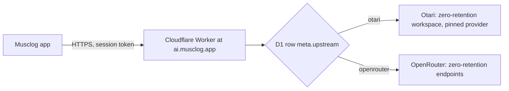

Musclog Iron went live yesterday. It is the optional subscription that runs Musclog's AI features for you, through a small server of mine that forwards requests to an AI gateway. I wrote about [what Iron is](/blog/2026/11/meet-musclog-iron-ai-with-nothing-to-set-up-and-nothing-else-locked) and about [how the server works](/blog/2026/11/hosted-ai-for-an-app-with-no-accounts-a-device-key-a-worker-and-a-spend-ledger), and it launched on [OpenRouter](https://openrouter.ai).

Not even a day later I learned about **[Otari](https://otari.ai)**, an AI gateway from [Mozilla.ai](https://www.mozilla.ai/product/otari), and it stopped me in my tracks. A quick note on the name, because it confused me too: Mozilla.ai is its own company, separate from Mozilla (the Firefox people), though Mozilla invests in it. Musclog is the workout app that cares a lot about privacy: no accounts, no ads, your data on your phone, every line of code in the open. If Iron's requests have to pass through a gateway, I want it to be one that is open source and built by a team that shares those values, and Otari is exactly that.

So Musclog Iron is moving to Otari. This post is about why, what Otari does, and how I built the move so that it takes one command.

## What Otari is

Otari is an **open source AI gateway** ([Apache 2.0, on GitHub](https://github.com/mozilla-ai/otari)), built on Mozilla.ai's `any-llm` library. A gateway sits between an app and the companies that run AI models: you send one OpenAI-compatible request to one address, and it routes it to a provider, tracks what it cost and enforces the limits you set. Otari reaches more than 40 providers through that one endpoint.

Here is why it fits Musclog so well:

- **You can read it.** The gateway that handles Iron's requests is code anyone can open. If I want to know what it does with a header, I can find the line, and so can you.
- **You can run it yourself.** The same code can be self-hosted for free. I use the hosted service at otari.ai, and knowing the door is always open is a privacy feature in itself.
- **It does not keep your conversations.** Otari's privacy notice says it does not receive or store the contents of your requests. It keeps only the metadata it needs to run: token counts, which model, which provider, latency and cost.
- **Zero data retention is a workspace switch.** A workspace can require it, and then only providers declared to keep no prompt or completion data may serve it. Musclog Iron's workspace has it on, so a provider that has not made that commitment cannot serve Iron at all.
- **Budgets and keys are built in.** Every key can have its own monthly spending cap, and the workspace decides which providers may serve it. That maps directly onto how Iron already thinks about money: never spend more than half of what a payment brought in.
- **Usage you can see.** Spend, requests, errors and latency, by model, provider and key, both in the dashboard and through an API that my own reporting script reads.
- **A lower fee.** Otari adds 4.5% to a top-up, against the 5.5% Iron pays today. Every cent saved there is room in your allowance.

## Your consent comes first

Iron has one rule I will not bend: **the app never silently changes who receives your messages.** Moving the service to a new gateway is the biggest possible version of that, so it gets the same treatment as everything else in Iron:

- Before Iron runs on Otari, the consent text in the app and the privacy policy will name Otari and say what it does with a request, in all ten languages.
- The consent has a version number, and changing who receives your data raises it, so the app asks you again. Nobody is moved without being told.

The tooling enforces that order, which I will come back to.

## Two gateways in the code, one switch

I did not want a migration. A migration is a big deploy that is hard to undo. What I wanted was a **switch**: both gateways wired into the server, one of them active, and a single command that flips between them in seconds, without a deploy.

Keeping both is deliberate. Each gateway has its own catalogue of models and providers, and having both in the code means Iron can always offer the best models from both worlds. If the best model for meal photos ever lives on one side and the best one for chat on the other, Iron is ready for it. Otari is where Iron is going.



The switch is one row in the server's D1 database, `meta.upstream`, and one script:

```bash
scripts/premium-upstream.sh production status
scripts/premium-upstream.sh production set otari          # a dry run: prints the SQL
scripts/premium-upstream.sh production set otari --yes    # writes it
```

The server reads the row at most every 30 seconds, so a flip takes effect in under a minute. The app's own view of the server settles within five, because it caches the server's `/v1/config` for that long. That endpoint now describes the **active** gateway, for example whether photos are available, so the app never offers something the current gateway cannot do.

The interesting part is everything that makes this switch safe.

### A half-configured switch can never send a request

The row is not trusted on its own. Otari is used only when **all** of these are true: the row says `otari`, the server's configuration lists the Otari models and prices, the Otari key is set as a secret, and the client was built. Anything else serves the gateway Iron already uses and logs `upstream_misconfigured` at high severity. A typo can never send a request somewhere that was not set up for it.

The script adds two guards of its own. It refuses `set otari` when the configuration has no Otari models. And on production it refuses unless I also pass `--consent-ready`, a deliberate speed bump that exists so the consent text is always updated first.

### One request, two bodies

The server never forwards what the app sends. It **rebuilds** the request from an allowlist, field by field. That code used to produce one gateway's body directly. Now it produces a **gateway-neutral** body, and each gateway gets its own small builder:

```ts
if (upstream === 'otari') {
  upstreamBody = buildOtariBody(req.neutral, otari, req.feature, env.WORKER_ENV);
  assertOtariPinned(upstreamBody, otari);
} else {
  upstreamBody = buildOpenRouterBody(req.neutral, config); // asserts the privacy invariant
}
```

The two gateways speak almost the same language, and the differences are exactly where care matters:

- On **Otari**, zero retention is the workspace's guarantee, and the request names a **pinned model**: `deepinfra:z-ai/glm-5.3-flash` rather than just `z-ai/glm-5.3-flash`. Otari's documentation says this spelling "never falls back", so the request goes to that provider and nowhere else. `assertOtariPinned` refuses to send a body whose model is not pinned to an approved provider.
- On **OpenRouter**, the request carries a `provider` object with `zdr: true`, `data_collection: 'deny'` and `allow_fallbacks: false`, and `assertPremiumPrivacy` refuses to send without it.
- Small differences in naming, such as how reasoning effort is spelled, live in the builders and nowhere else.

The refactor had to change nothing for anyone using Iron today. So before touching the code, I recorded the exact request bodies the old code produced for seven kinds of request, and a test now checks that the new code reproduces them **byte for byte**. The server's test suite has 500 tests, and they run against both gateways.

### Checking every answer

A pinned model should only ever be served by its provider, and Iron checks that it was. Otari reports who served each request in the `Otari-Provider` header and whether a fallback happened in `Otari-Fallback`. If either one is not what Iron asked for, the server opens its **circuit breaker** and stops serving until I have looked. If the header is ever missing, that is logged too, so the check can never quietly stop working.

### Money, still exactly once

Iron's ledger reserves the worst-case cost of every request before it goes out and settles it at the real cost afterwards, so no allowance is charged twice and Musclog never spends more than half of a payment. That ledger did not change at all. Two small things did:

- **Reading the cost.** Otari puts the cost of every request right in the response, as `usage.cost_usd`, so the server settles at the exact amount. If a cost is ever unknown, the request is charged at its reservation: failing closed on money.
- **Recognising retries.** Each request carries an `Idempotency-Key` bound to a hash of its body. That hash now covers the gateway-neutral body, so a retry that happens to straddle a flip is still recognised as the same request.

### Counting on both sides

Every night the server compares what its ledger spent with what the gateway charged, and stops serving if they disagree by more than a small tolerance. With two gateways, that check now adds both together, so a flip in the middle of the day never looks like a discrepancy. Otari's usage API makes this easy: the server asks for its spend over exactly the window it is checking.

Every request to Otari also carries three tags, `app`, `env` and `feature`, and nothing about a person or a device. That lets me see in Otari's dashboard and API how much chat, structured answers and photos each cost, which is exactly what I need to keep Iron's allowance generous. A daily check also tells me when the Otari budget is running low, and `scripts/infra.sh report` puts Otari's spend, errors, latency and budget left in one place.

## Picking the best model for each job

This is the part I am most excited about. Iron uses one model for everything today. On Otari I can pick one per kind of request: a fast model for chat, one that is strict about JSON for the structured answers the app reads, and one that can see for meal photos. Otari's catalogue is full of strong open-weight models on zero-retention providers, many of them at a fraction of a cent per thousand words.

The shortlist: GLM 5.3 Flash, DeepSeek V4.1 Flash, Qwen 3.8 Flash, Mistral Small 4 and Gemma 4 for text, and Qwen3-VL and Nemotron VL for photos. I am not choosing from a price table. The benchmark I built from the app's real prompts and schemas now speaks to Otari too (`--gateway otari`), and it counts any answer not served by the pinned provider as a failure. I will pick from what it measures.

## What happens next

1. **Run the benchmark** and pick a model for each kind of request.
2. **Run Iron on Otari on the staging server** with a test build: chat, structured answers and photos, with the ledger and Otari's dashboard agreeing on every cent.
3. **Update the consent and the privacy policy** in all ten languages to name Otari, and raise the consent version so the app asks you.
4. **Flip production** with one command.

If you want to read it rather than take my word for it, start with `services/premium-worker/src/upstream/select.ts`, `services/premium-worker/src/proxy/upstreamBody.ts` and `scripts/premium-upstream.sh`. And if you build anything that talks to AI models, take a look at [Otari](https://github.com/mozilla-ai/otari). It is the gateway I wish I had found a day earlier.
