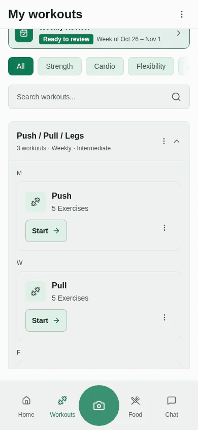

Push Pull Legs (PPL) is a split that groups your training by movement pattern. One workout is for pressing, one for pulling and one for legs. Run the three once a week for a three-day plan, or go through them twice for the classic six-day version. Musclog has the full program written out, with every exercise, set and rep, and you can open it in the app with one tap from the [Push Pull Legs program page](/programs/push-pull-legs).

## The three workouts

The program has three workouts. It is one workout per day, not six different ones, so when you run it twice a week you repeat the same three sessions.

**Push (day 1)** trains the chest, shoulders and triceps.

| Exercise                                  | Sets × reps |
| ----------------------------------------- | ----------- |
| Barbell Bench Press - Medium Grip         | 3 × 10      |
| Barbell Incline Bench Press - Medium Grip | 3 × 12      |
| Barbell Shoulder Press                    | 3 × 10      |
| Side Lateral Raise                        | 3 × 15      |
| Butterfly                                 | 3 × 12      |
| Seated Triceps Press                      | 3 × 12      |
| Triceps Pushdown                          | 3 × 12      |

**Pull (day 2)** trains the back and biceps.

| Exercise                          | Sets × reps |
| --------------------------------- | ----------- |
| Barbell Deadlift                  | 3 × 8       |
| Wide-Grip Lat Pulldown            | 3 × 10      |
| Seated Cable Rows                 | 3 × 12      |
| Bent Over Barbell Row             | 3 × 10      |
| Machine Shoulder (Military) Press | 3 × 15      |
| Dumbbell Bicep Curl               | 3 × 12      |
| Hammer Curls                      | 3 × 12      |

**Legs (day 3)** trains the quads, hamstrings, glutes and calves.

| Exercise                    | Sets × reps |
| --------------------------- | ----------- |
| Barbell Squat               | 3 × 10      |
| Leg Press                   | 3 × 12      |
| Romanian Deadlift           | 3 × 12      |
| Lying Leg Curls             | 3 × 12      |
| Leg Extensions              | 3 × 12      |
| Rocking Standing Calf Raise | 3 × 15      |

Each workout is listed at about 60 minutes in the program file. The rep targets are single numbers, not ranges, so every set is the same number of reps.

## Running it as a six-day week

Each workout is done twice a week in the six-day version: push, pull, legs, then push, pull, legs again, with a rest day where it fits your week. Counting the sessions, that is two push days, two pull days and two leg days, so each muscle group is trained twice a week.

If you only have three training days, run the three workouts once each. Each muscle group is then trained once a week, which is less frequency than the six-day version but a complete program.

The program page's advice is to do the workouts in order and repeat the cycle: the order matters more than the weekday. So if a session slips by a day or two, do the next workout in the list rather than skipping ahead, and carry on from there.

## Starting weights and progression

Start with weights you can lift with good form and a couple of reps left in the tank. Musclog suggests starting weights from your own profile when you open the program.

The program page gives one simple rule of thumb for adding weight: when you reach the top of the rep range on every set, add weight next time. It is a rule of thumb, not a research result. Since the file lists one rep target per exercise, a practical version is to add weight once you hit the target on every set.

The [exercise library](/exercises) lists every movement in the program.

## Who this split suits

PPL suits someone who can train about 60 minutes on three days, or on six days in a six-day week.

If you have an injury or a health condition, check with a doctor or physiotherapist before you start, and choose lighter weights while you find out what your body tolerates.

## Open it in Musclog

Open the [Push Pull Legs program](/programs/push-pull-legs) and tap **Open in Musclog**. The app shows the program as a review, and nothing is saved until you confirm it. You choose the weekdays, and the starting weights come from your profile. If four days suit your week better, read [Upper/Lower 4-day split for people with jobs](/blog/2026/11/upper-lower-4-day-split-for-people-with-jobs).

For more programs, see the [free workout programs](/programs) page.

## Start in Musclog

[Musclog](/download) keeps the program's workouts, sets and weights in one place, so the next session starts from what you did last time.
