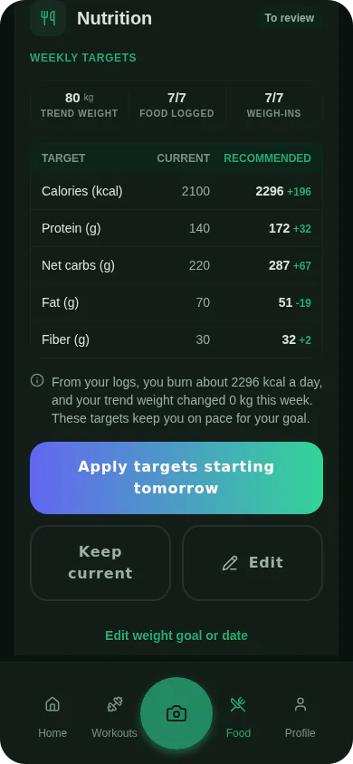

A TDEE calculator estimates your total daily energy expenditure, the calories you burn in a day, from a formula and a few answers about you. It gives a sensible starting point. It cannot know your body, so the number it gives is an average for people like you on paper. The better estimate comes from your own records: what you ate, and how your weight moved while you ate it. Musclog has a [calculator](/calculator), and [the calorie deficit tool](/tools/calorie-deficit) turns a goal weight and date into a daily number using the same formula. This post explains where the formula's limits are and what Musclog does once it has your data.

## What a formula does

Most calculators do two steps. First they estimate your resting energy use (BMR) from your sex, age, height and weight. Then they multiply it by an activity factor.

Musclog's formula is Mifflin–St Jeor for a new user, and Katch–McArdle when you have a body-fat value between 5% and 60%. For Mifflin–St Jeor the app adds 5 for male, subtracts 161 for female and subtracts 78 for other. It then multiplies by one of five activity factors: 1.2 (sedentary), 1.375 (light, 1 to 3 days a week), 1.55 (moderate, 3 to 5 days), 1.725 (active, 6 to 7 days) and 1.9 (super active, with a physical job).

Here is the arithmetic with invented numbers: a man of 80 kg, 180 cm and 35 years.

- Mifflin–St Jeor: 10 × 80 + 6.25 × 180 − 5 × 35 + 5 = 1,755 kcal a day at rest.
- Moderate activity: 1,755 × 1.55 = about 2,720 kcal a day.

That 2,720 is not wrong for an average man of that size. It is a population estimate, and it has two weak points that a formula cannot fix.

- **The activity factor is a guess.** You choose one of five boxes. Two people in the same box can burn very different amounts through a day, and the difference is often in the unplanned movement, not the workouts.
- **The formula sees only four inputs.** It does not know how your body handles food, how much you move without noticing, or how your energy use changes when you eat less for a few weeks.

## Energy in, weight out

[Hall and colleagues (2011)](https://pubmed.ncbi.nlm.nih.gov/21872751/) quantified how an energy imbalance shows up in body weight over time. The idea that matters here is simple: if you know what you ate and how your weight changed, you can work backwards to roughly what you burned. A formula guesses that from the outside. Your records measure it.

## What Musclog does instead

When you log food and weigh yourself, Musclog estimates your TDEE from those records. The rules below are product choices, not findings from a study.

- **Intake.** The app averages your calories over the days you logged food. Days with no food log are left out of that average, so a forgotten day does not read as a day of eating nothing. If you use the fasting-day option, a day you marked as fasted counts as 0 kcal.
- **Weight.** It does not use raw scale readings. Readings on the same day are averaged, days with no reading are filled in with a straight line between the neighbouring readings, and an exponential average smooths the series. The result is a trend weight. The reason is that a trend reduces the noise of daily scale changes, so one morning's reading is not read as a verdict.
- **Window.** The default is the 30 days ending today. It needs at least two weigh-ins and food logged on at least seven days. Food is counted over the same interval as the weight change, from the first trend point in the window to the last, so a short weight history is never paired with food from the whole month.
- **Past window.** If the last 30 days are too thin, the app measures the 30 days ending the day after your last food log, or ending at your last weigh-in when weighing stopped first. It labels that estimate as coming from a past window and shows its dates. The fallback is chosen so that it does not run past your last food log, because a trend would otherwise spread a change over weeks you did not record.
- **Fallback.** With too little data in either window, the app uses the formula.

From the intake average and the change in stored energy, the app works out the energy you used, then adjusts it using the rates it uses for fat and lean tissue. Those rates are fixed values the app chose.

## Why the numbers are still estimates

Even with records, the estimate has limits. Food logs are estimates of what you ate. Scale weight is a trend, not a fact. A window of 30 days can be too short for a slow change to show clearly. Musclog's calorie deficit tool shows its daily target as a range, 10% of your energy use either side of the target. The 10% is a product choice, not a measured error.

Treat the result as a number to test, not a rule. A practical routine:

1. Log food every day you can, including the days that do not go to plan.
2. Weigh yourself most days, and read the trend rather than a single morning.
3. Look at the estimate after a few weeks. If the trend is not moving the way your target says, change the intake by a small amount and check again.

If you have a medical condition, are pregnant, or have a history of disordered eating, talk to a doctor or dietitian before you cut calories on a target from any calculator.

## Try it in Musclog

The [calorie deficit tool](/tools/calorie-deficit) gives a starting target from a goal weight and date, using the same formula and calorie floor as the app. Once you log food and weight in [Musclog](/download), the app replaces the formula with your own measured estimate once it has enough data, and labels any older window it has to use.
