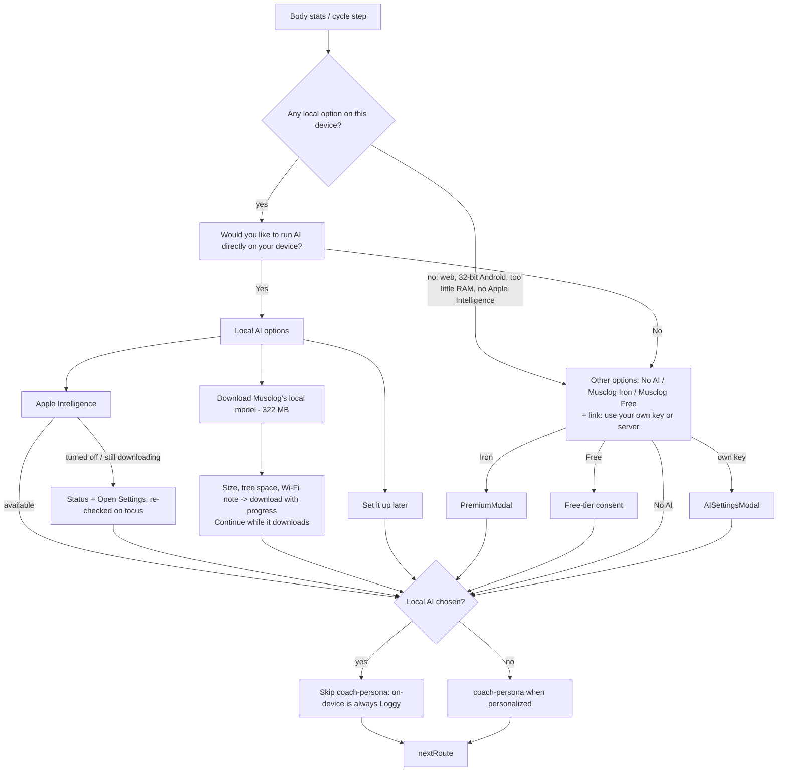

# On-device AI and the AI onboarding step

Active plan. Work the phases in order, tick the status table as each ships, fold the lasting rules
into `AGENTS.md`, `docs/CURRENT_FEATURES.md` and `docs/RESEARCH.md`, then delete this file and its
line in `AGENTS.md`.

**Status, 2026-11-23.** Implemented in code (sessions 1 and 2, see the status table and "Implementation status"); not yet run on any device.
The model sizes, speeds and benchmarks below are vendor figures from model cards and docs read on
that date, not measurements of ours; P0 and P7 replace them with measurements.

## Goal

Run AI entirely on the phone (private, offline, free, no key and no subscription) and offer it
first in onboarding, next to Musclog Iron, the free tier and own keys. Musclog must stay fully
usable with no AI.

## Decisions (maintainer, 2026-11-23)

- **D1** Keep today's intention routing plus constrained JSON. Real tool calling is a later, separate project.
- **D2** Build around ONE downloadable model: **LFM2.5-VL-450M** (text and vision).
- **D3** Download from **Hugging Face, pinned to a commit**, checked against SHA-256 values in an app-side manifest. No mirror.
- **D4** Stay on `@react-native-ai/apple` 0.12 and `ai` v6. Add a tiny Swift module for availability reasons. No iOS 27 image input through Apple.

## Implementation status (2026-11-23, session 1)

Done and tested (Jest, `tsc` clean): P1 (native helper `modules/on-device-ai`, `constants/localModels.ts`, `utils/localModels/*`, `services/localModels/modelStore.ts`), P2 (`llamaRuntime.ts`, `utils/onDeviceLocal.ts`, `utils/onDeviceEngine.ts`, `utils/onDeviceStatus.ts`, `onDeviceStatusStore.ts`, `hooks/useOnDeviceStatus.ts`, `coachAI.ts` wiring, `aiSchemaValidate.ts`, `AiService` probe, `SettingsContext`), P3 native side (Swift availability reasons, not compiled or run on a device), the pure and orchestration half of P6 (`utils/localFoodPhoto.ts`, `estimateMealFromPhotoOnDevice`), the storage category, `LocalModelCard`, `services/onDeviceAiSetup.ts`, onboarding route helpers.

Session 2 added the two onboarding screens, the `musclog-api` own-key link (`ConnectedAISettingsModal`), the Settings section (`OnDeviceAiSection`), the `AINotConfiguredModal` `localNotReady` variant, `ON_DEVICE_INTENTIONS` (meal and workout plans stay cloud-only), the snapshot in the on-device prompt, the notices modal, the 2.18.0 What's New page, all ten locales, the `llama.rn` plugin in `app.json`, the bench route and the docs. Still open: `npm run prebuild:android|ios` (maintainer), every device check, P7 numbers, store listing text, and an older complete model revision as a fallback while an update downloads.

Deviations from the plan below, on purpose: (1) the downloaded model lives in Android `noBackupFilesDir` (module `storageDirectory()`), not behind a backup-rules plugin; (2) `aiSchemaValidate` gates the downloaded engine only (Apple's guided generation is OS-enforced, cloud providers are server-enforced and their callers tolerate partial answers); (3) a chosen on-device provider never falls back, so `PROVIDER_PROBES['on-device']` returns a config whenever `use_on_device_ai` is on and the request throws `OnDeviceUnavailableError`; (4) unmatched photo items are estimated by name through `refineTrackedMeals` instead of being left blank; (5) the choice order on `musclog-api` stays Iron, free, none; (6) a killed download restarts its file (resume data exists only after a clean pause), and an older installed revision is not used while a new one downloads.

## 1. Current architecture findings (verified in the repo)

**Provider abstraction**

- Kinds, in priority order: `AI_PROVIDER_KINDS` in `constants/ai.ts:49` = `hosted, gateway, on-device, local, gemini, openai, claude`. `AI_PROVIDER_STRENGTH` marks `on-device` and `local` as `basic`.
- `PROVIDER_PROBES` in `services/AiService.ts:102-184`: each probe says whether its provider is usable and builds its config. `getAiConfig` (195) takes the first usable one; `getAiConfigForProvider` (219) runs one probe.
- `CoachAIConfig` and `PROVIDER_CONFIGS` in `utils/coachAI.ts:174-268`. on-device gets 4500 chars, `promptComplexity: 'minimal'`, no foundation foods and no memories.
- `isAiConfigured` in `context/SettingsContext.tsx:597-629` mirrors the probes. **Existing drift**: for on-device it reads only `useOnDeviceAi`, never availability, so the UI can say "configured" while `getAiConfig()` returns something else.

**Existing on-device AI**

- Real implementation: `utils/onDeviceAi.ios.ts`, using `@react-native-ai/apple` 0.12.0 and `ai` 6.0.333. `ai` is imported in this file only.
- Stubs: `utils/onDeviceAi.ts` (Android/default) and `.web.ts`.
- Availability is `apple.isAvailable()`, a boolean from `SystemLanguageModel.default.availability == .available` in `AppleLLMImpl.swift`. It gives no reason.
- Structured output: the 0.12 native code already converts a JSON Schema into a runtime `GenerationSchema` (`AppleLLMSchemaParser.createGenerationSchema`), so Apple's constrained decoding applies to our schemas.
- Setting: `use_on_device_ai` (`constants/settings.ts:460`). UI: `components/modals/AISettingsModal.tsx:804-845`, iOS only.
- The chat reply is plain text (`sendViaOnDevice`, `coachAI.ts:1134`), streamed through `streamOnDeviceMessage`.
- The prompt is `getMinimalSystemPrompt` plus `getAppleIntelligenceContext` (`utils/prompts.ts:277, 485, 655`).
- On-device calls bypass `withLlmRetry`, so they get no timeout.
- Images return `null` with a TODO at `coachAI.ts:2033, 2379, 2743`. `useChatMessages.ts:790, 845, 886` show `coach.errors.featureRequiresCloudAi`.

**The `local` kind is something else**: an OpenAI-compatible server such as Ollama (`localConfig`, `AiService.ts:53-65`). It must not be confused with the new downloadable model.

**Chat, "functions" and validation**

- No provider receives `tools` or `functionDeclarations`. The `FunctionDeclaration`s in `utils/prompts.ts:1507-2132` are used only as JSON schemas for structured output:
  - `getSchemaFromFunctionDeclaration` (`coachAI.ts:1573`)
  - `StructuredDialect = openai | gemini | claude | on-device` (1588)
  - `requestStructured` (1630), the single dispatch point for structured requests
- Routing is the user-armed intention (`CHAT_INTENTIONS`, `constants/chat.ts:62`: workouts, meal plan, analyze progress, track meal, nutrition check), never chosen by the model.
- Validation today:
  - `parseStructuredJson` (1610) is `JSON.parse` with no schema check.
  - Each feature then normalizes its result: `NutritionService.normalizeAiMealIngredients` (`NutritionService.ts:1459`), the suggestible-exercise check in `processWorkoutPlanResponse` (`utils/workoutAI.ts:64`), and `processMealPlanResponse` (`utils/nutritionAI.ts:108`).
- What writes without a tap:
  - Writes at once: memories (`persistCoachReply`, `services/coachReplyStream.ts:91`), meal plans and workout plans.
  - Waits for confirmation: track meal (`markMealAsTracked`, `useChatMessages.ts:990`).
- Nothing in chat logs or edits workout sets today. So "Log 3 sets…" and "my last set was 8 reps" are new features, outside this plan (D1).

**Vision**

- `generateWithImageStructured` (`coachAI.ts:1825`) is the single entry point for photos.
- Resize goes through `utils/aiImage.ts` + `utils/aiImagePlan.ts` (photo quality tiers).
- `estimateNutritionFromPhoto` (2737) uses the trackMeal schema, then `refineTrackedMeals` and `ingredientMacroProblems` (`utils/mealPlausibility.ts`).
- OCR-before-AI exists (`USE_OCR_BEFORE_AI_SETTING_TYPE`).

**Onboarding**

- Quick setup (7 steps) and personalized setup (11 steps) both pass through `app/app/onboarding/musclog-api.tsx` via `musclogApiRoute(nextRoute)` (`utils/onboardingRoutes.ts:44`), called from `quick-body-stats.tsx:199` and `personalizedCycleRoutes` (57-70).
- The choices come from `availableAiChoices` (`utils/onboardingAiChoice.ts`): Iron, free tier, none.
- BYOK is reachable only through landing → "Set up with AI" → `ai-provider.tsx`, Profile, What's New `openProfileAiSetup`, and Settings → AI.
- `skipMusclogApi` skips the step after a key or free tier was chosen.
- `coach-persona` follows in personalized setup.
- "Completed" is the AsyncStorage `onboardingCompleted` flag (`utils/onboardingService.ts:44`), and there is no re-onboarding. Existing users are reached through What's New pages (`data/whatsNew/*.json`, `utils/whatsNew/catalog.ts` conditions and actions).

**Subscription**

- "Musclog Free" in code is only the free AI tier: provider `gateway`, setting `use_musclog_free_tier`, consent `needsFreeTierConsent`, off on production web. There is no free plan object.
- Musclog Iron gates hosted AI only: `isPremiumUiEnabled`, `usePremium`, `SETTINGS.useHostedAi`, with the entitlement checked by the Worker. Hosted never falls back to another provider.

**Infrastructure to reuse**

- Local Expo modules: `modules/theme-app-icon`, `modules/witmotion-ble`, loaded through `requireOptionalNativeModule` and autolinked from `modules/`.
- `expo-file-system` ~58: the new `File`/`Directory`/`Paths` API, with `Paths.availableDiskSpace` and `File.downloadFileAsync({ onProgress, signal })`, and the legacy `createDownloadResumable` (pause/resume, `savable()`).
- No checksum on any download today. `@noble/hashes` exists but hashing 300 MB in JS is too slow.
- `Device.totalMemory` gate: `utils/tabKeepAlive.ts` (`LOW_MEMORY_DEVICE_BYTES` 3.3e9). iOS `memoryWarning` listener: `TabKeepAlive.tsx:75`.
- Storage screen: `services/storageUsage.ts` + `utils/storageUsage.ts` + `StorageUsageModal`.
- Bench precedents: `app/app/test/optical-bench.tsx` (on-device bench screen), `spikes/premium-p0/bench` + `docs/PHOTO_BENCHMARK.md` (photo set and manifest, Nutrition5k fetch).
- No third-party-licenses screen exists. The About group is at `app/app/(tabs)/settings.tsx:212`, with `components/cards/LegalLinksCard.tsx`.
- Platform: RN 0.88.1, Expo ~58.0.26 (the request said SDK 55; it is 58), New Architecture on, iOS deployment target 17.0, Android minSdk 26. ABIs: armeabi-v7a, arm64-v8a, x86_64.

## 2. Proposed provider architecture

**Keep one provider kind, `on-device`, with two engines.** Add `OnDeviceEngine = 'apple' | 'gguf'` and a new setting `on_device_engine` (a `SettingDefinition`, default `apple` on iOS, `gguf` elsewhere).

- Both engines share what already makes on-device different: basic strength, the minimal prompt, the Loggy persona, no memories, and no silent fallback.
- The difference is a capability object, not branches: `getOnDeviceCapabilities(): { engine, vision: boolean, contextChars, structured: true }`. The `return null // on-device can't parse images` TODOs become a `vision` capability check.
- A separate kind would touch every provider table (`AI_PROVIDER_KINDS`, `CoachAIProvider`, `PROVIDER_CONFIGS`, `PROVIDER_PROBES`, the three `SettingsContext` copies, labels) for no behavioural gain.

**Module layout** (platform siblings keep `platformModuleParity` green):

- `utils/onDeviceAi.ts` (Android): the gguf engine. `utils/onDeviceAi.ios.ts`: dispatches on the engine to Apple (existing code) or gguf. `utils/onDeviceAi.web.ts`: a stub that stays unavailable.
- Every variant exports the same functions: `sendOnDeviceMessage`, `streamOnDeviceMessage`, `sendOnDeviceStructured`, plus new `sendOnDeviceStructuredWithImage`, `getOnDeviceStatus` and `getOnDeviceCapabilities`.
- `services/localModels/llamaRuntime.ts`: the only file that imports `llama.rn`.
  - Loading is lazy on the first request, with one context at a time.
  - The text model loads alone. The vision projector is attached with `initMultimodal` only for a photo request and released after it.
  - The model unloads after `LOCAL_MODEL_IDLE_MS` (2 min), on AppState `background`, and on iOS `memoryWarning`.
  - One request at a time, shared with the coach reply stream's "one reply at a time" rule.
  - `AbortSignal` maps to `stopCompletion`.

**Structured output (D1)**

- Add `'gguf'` to `StructuredDialect`. For a gguf request, `requestStructured` passes the schema as llama.rn `response_format: { type: 'json_schema', json_schema: { schema } }`, which compiles it to a GBNF grammar, so the model can only emit JSON of that shape.
- Apple already constrains through `GenerationSchema`.
- **New, for every provider**: `utils/aiSchemaValidate.ts`, a small, pure JSON Schema validator for the subset our declarations use (type, properties, required, enum, items, min/max).
  - It runs inside `requestStructured` after `parseStructuredJson`.
  - A failure is `{ kind: 'malformed' }`, which the existing paths already handle.
  - The feature normalizers stay the second gate, and the existing review screens the third.
  - Constrained decoding guarantees shape, not truth, and no model output reaches the database without one of those gates.

**Which intentions run on-device**: one table, `ON_DEVICE_INTENTIONS` in `components/coach/coachIntentions.ts`.

- Chat, analyze progress, nutrition check and track meal (text, and photos where `vision` is true) are allowed.
- `GENERATE_MY_WORKOUTS` and `GENERATE_MEAL_PLAN` stay cloud-only. They write without review, and a 450M model is not trusted to plan. The benchmark may relax this.
- The three existing `featureRequiresCloudAi` branches read this table.

**Context for gguf answers**

- "How much protein have I eaten today?" and "what did I train yesterday?" are answered from injected context, not tool calls.
- Add the existing coach snapshot block (`utils/coachSnapshot.ts`, a few hundred chars) to the minimal on-device prompt, alongside the recent-workouts lines.
- Raise the gguf budget to about 8000 chars, the same as `local`. The KV cache stays small at `n_ctx` 4096.
- Apple keeps 4500.

**Availability is one reactive answer**

- `services/localModels/onDeviceStatusStore.ts` is module-level, like `premiumStore`. It holds `{ engine, state: 'ready' | 'needsDownload' | 'downloading' | 'appleOff' | 'appleNotReady' | 'unsupported', progress? }`, exposed through `hooks/useOnDeviceStatus.ts`.
- `PROVIDER_PROBES['on-device']` and `SettingsContext.isAiConfigured` both read it, which fixes the existing drift.
- When the chosen on-device engine is not ready, there is **no fallback to a cloud provider**: the data recipient would change, the same rule as hosted. The coach opens a "Local AI isn't ready" sheet with the fix (Download / Open iOS Settings / Choose another AI). It is a variant of `AINotConfiguredModal`, not a new modal family.

**Errors and timeouts**: gguf calls go through `withLlmRetry` (idle timeout, abort). An out-of-memory or load failure maps to a new `OnDeviceUnavailableError` in `utils/aiErrors.ts`, shown through `describeAiError`. Apple keeps its current path, and adding `withLlmRetry` to it too is cheap.

## 3. Onboarding flow, copy, states

The two new screens replace the single Musclog AI step. They count as **one step**, so step totals (7 and 11) and `PERSONALIZED_STEP` do not change. The route builders (`musclogApiRoute`) point at the first new screen and keep passing `nextRoute` unchanged. Watch the double-decoding pitfall noted in AGENTS.md.

**Screen 1, `app/app/onboarding/on-device-ai.tsx`.** It is shown only when `getOnDeviceStatus()` finds at least one engine possible.

- Title: "Would you like to run AI directly on your device?"
- Points: "Private: your data is processed on this phone." "Offline: works without an internet connection." "Free: no API costs or subscription." "Some phones need to download a small AI model first."
- Two cards: "Yes, use local AI" / "No, show other options".

**Screen 2A, `on-device-ai-options.tsx`.**

- **Apple Intelligence** card: iOS, and only when the Swift module says the device is eligible. Its state line is one of:
  - Ready
  - "Turn on Apple Intelligence in Settings" (opens `app-settings:`)
  - "iOS is still downloading the model"
  - "Answers may be in English", when the app language is not supported (Russian and Polish are not on Apple's list)
  - Note under it: "Text only. Photos need the downloadable model or a cloud option."
- **Musclog local model** card: shown when the device passes the RAM and ABI gate. It shows:
  - "LFM2.5-VL 450M by Liquid AI · 322 MB · text and food photos"
  - free space (`Paths.availableDiskSpace`)
  - "Include photo support (+103 MB)", checked by default
  - a mobile-data note (NetInfo)
  - "License: LFM Open License"
  - Download states, in one `LocalModelCard` component shared with Settings: idle, checking space, not enough space (needed vs free), downloading x% with Pause/Cancel, paused (Resume), verifying, installing, ready, failed (reason + Retry).
  - "Continue while it downloads" lets onboarding move on.
- **Set it up later**: stores the engine choice with no model. Settings and the coach sheet offer the download afterwards.

**Screen 2B is the existing `musclog-api.tsx`**, reordered to No AI / Musclog Iron / Musclog Free (free only when `isMusclogGatewayAvailable()`; Iron only when `usePremium().enabled`). It keeps the existing consent and `PremiumModal` behaviour.

- One quiet text link, "Use your own API key or a local server", opens `AISettingsModal` as a child modal. On close, if `isAiConfigured`, the flow continues.
- BYOK stays discoverable without adding a fourth card.

**Choosing local writes**: `use_on_device_ai = true`, `on_device_engine`, and `skipMusclogApi`. It enables no cloud provider.

**Existing users**: not sent through onboarding. A What's New release page "Run AI on your phone" carries a new `requires: 'onDeviceAiPossible'` condition and an `openOnDeviceAiSetup` action that opens the on-device section of AI settings.

## 4. Apple Intelligence strategy (D4)

- Facts, from Apple pages that could be read:
  - Foundation Models is the developer API for the system's ~3B on-device model.
  - Devices: iPhone 15 Pro/Pro Max, iPhone 16 or later, iPhone Air, M1+ iPads. Apple Intelligence must be enabled, the device and Siri language must match, and it is not offered on devices bought in mainland China.
  - Languages include English, Portuguese, Spanish, Dutch, German, French, Italian and Turkish. Russian and Polish are not listed.
  - Guided generation uses constrained decoding.
  - Tools are Swift `Tool`s that the framework runs itself.
  - Image prompts arrive with the 27 releases (not used, D4).
  - No entitlement is mentioned.
  - Acceptable-use rules forbid unsupervised high-impact decisions in medical domains. Our estimates are always reviewed by the person, so the existing review screens are the compliance argument.
- Not readable (JavaScript-only pages); verify in Xcode during P3: the exact availability enum cases, the context size (commonly cited as 4096 tokens), and any background rate limiting.
- **New `modules/on-device-ai`** (Expo module, iOS + Android), the one native helper for this plan:
  - iOS: `appleAvailability()` returns `available | deviceNotEligible | appleIntelligenceNotEnabled | modelNotReady | unsupportedOs | unknown`, and `appleSupportsLocale(tag)`.
  - Both platforms: `sha256File(path)` (CryptoKit / `MessageDigest`, streamed) and `setExcludedFromBackup(path)` (iOS `isExcludedFromBackup`; a no-op on Android, where the model folder goes in the backup exclusion rules).
- Apple keeps its text-only role: chat, insights and structured text extraction. Food photos on an Apple-only setup show the "needs the photo model or cloud" state (open question Q2).

## 5. Downloadable model integration (D2)

- **Runtime: `llama.rn`** (MIT, mybigday). Facts:
  - Requires the New Architecture from v0.10.
  - Has an Expo config plugin for CNG builds.
  - Uses Metal on iOS; OpenCL on Adreno 700+ and an experimental Hexagon backend on Android.
  - Supports `response_format.json_schema` → GBNF and Jinja chat templates with `tools` (not used, D1).
  - Handles multimodal input through an mmproj file, with images as `file://` paths or base64, and has session save/load.
  - Latest release seen is 0.13.0-rc.12 (2026-11-17), with llama.cpp b12445. P0 pins the newest stable at implementation time.
  - Not found, so measured in P0: minimum iOS version, binary size, and whether armeabi-v7a is shipped.
- **Use it directly, not `@react-native-ai/llama`.** That package needs `ai` v7 (contradicts D4), adds `react-native-blob-util`, downloads with no checksum or atomic install, and warns of a crash after structured output unless `state_cache_budget_mb` is 0.
- **MNN runtime: not used.** Its INT4 artifacts need a runtime "from the same MNN revision family", there is no React Native binding, and it has no vision path for our model. MNN-Pocket-0.3B GGUF (Apache-2.0, 192 MB, Chinese and English only, no tool or JSON claim) stays the documented fallback if the LFM license ever becomes a problem.
- **Model: LFM2.5-VL-450M** (LFM2.5-350M backbone + SigLIP2 NaFlex 86M).
  - 32K context; we use 4096.
  - Languages: English, Arabic, Chinese, French, German, Japanese, Korean, Portuguese and Spanish. Dutch, Russian, Italian, Polish and Turkish are not supported, so the UI says answers may be in English.
  - Images up to 512×512 native, larger ones tiled; `max_image_tokens` is tunable, default 256.
  - Files in `LiquidAI/LFM2.5-VL-450M-GGUF`: `LFM2.5-VL-450M-Q4_0.gguf` 219 MB and `mmproj-LFM2.5-VL-450m-Q8_0.gguf` 103 MB (the only quantized projector). Q4_K_M at 229 MB is the alternative P7 compares.
  - llama.cpp gained LFM2-VL vision in PR #15347.
- **Device gate**: `utils/localModels/deviceGate.ts`, pure.
  - arm64 only.
  - `Device.totalMemory >= LOCAL_MODEL_MIN_RAM_BYTES`, starting at 5.0e9 reported (6 GB class). This is an estimate until P7 measures peak RAM; 4 GB phones may later get text-only use.
  - Free space ≥ download size + 300 MB.
  - Not shown on web.
- **Lifecycle risks**: the OS can kill the app while a model loads under memory pressure. Load only in the foreground, release on background, keep one context, and record load failures to Sentry with tags only (engine, model id, RAM class).

## 6. Vision and food photos (architecture A)

Decision: **one multimodal model, no separate text model**. Architecture B needs two downloads (≈322 MB + 192 MB), two loads per photo turn, and model switching. The model never computes macros, so B gains nothing.

The photo pipeline (gguf with `vision`) is new code behind the existing `estimateNutritionFromPhoto` entry:

1. Resize through `utils/aiImagePlan.ts`, with a new on-device ceiling of 768 px (512 px tiles).
2. **Identify, don't estimate**: a small schema `localFoodIdentify` with `{ items: [{ name, portionHint?, estimatedGrams?, confidence }] }`, decoded under its grammar at temperature 0. No calorie or macro field exists for the model to invent.
3. **Match to our own data**: `FoodService.searchFoods` (`database/services/FoodService.ts:471`) over local foods and the bundled foundation foods (USDA and common seeds), so it works offline. When online and allowed, use the existing food search source. Only an unambiguous match is taken; anything else is left for the person, the same rule as `findExerciseByName`.
4. Build the existing trackMeal payload with `foodId`s and run it through `NutritionService.normalizeAiMealIngredients`, so macros come from the database × grams.
5. Open the existing meal review / `LogMealModal`, where every item, gram amount and unmatched name is editable before saving. Nothing is logged without that tap.

- Nutrition labels keep the existing OCR-before-AI and barcode paths, which are better than a 450M VLM at reading digits.
- `LFM2.5-VL-450M-Extract` (same sizes, its own mmproj, single-turn JSON extraction, self-reported JSON validity 98.9) is a **benchmark candidate only**. It replaces the general model only if P7 shows a clear gain on step 2.

Rejected candidates:

- SmolVLM2-256M (131 + 104 MB): English only.
- VisionPsy-Nano-460M Flash (256 + 109 MB, Apache-2.0): fast TTFT claims, but primarily English, and its README runs a patched llama.cpp fork. Re-check when upstream llama.cpp supports it.

## 7. Model download and storage

- **Manifest** `constants/localModels.ts` (pure data): `id`, `displayName`, `repo`, pinned `revision` (commit SHA), and `files[]` of `{ role: 'model' | 'projector', path, bytes, sha256, optional }`. Also `licenseId`, `minRamBytes`, `contextTokens`, `languages`.
  - URL: `https://huggingface.co/<repo>/resolve/<revision>/<path>`.
  - `scripts/local-model-manifest.js` (read-only) fills or verifies `bytes` and `sha256` from the HF tree API (LFS `oid`). A test pins the manifest's shape and that every file has a 64-hex SHA-256.
- **Pure rules** `utils/localModels/install.ts`: state machine (`idle → downloading ↔ paused → verifying → installing → ready | failed{reason}`), space check, which installed folders are stale. Tested in Jest `node`.
- **Service** `services/localModels/modelStore.ts`, native only (`.web.ts` stub):
  - Downloads with legacy `createDownloadResumable` (pause/resume, `savable()` resume data persisted in AsyncStorage, `sessionType: BACKGROUND` on iOS) into `Paths.document/local-ai/.partial/<id>@<rev>/`.
  - Then `sha256File`. A mismatch deletes the partial file and fails as `checksum`.
  - Then moves into `local-ai/models/<id>@<rev>/` and writes `installed.json` **last**. The loader reads only folders whose `installed.json` matches the manifest, so a half-installed model can never load.
  - `setExcludedFromBackup` on the folder.
  - Failure reasons: `noSpace`, `network`, `checksum`, `interrupted`, `http`.
  - A kill mid-download resumes from saved data on next open, or restarts if the server rejects it.
- **Updates**: a new manifest `revision` in an app release marks the installed model "update available". The old one keeps working until the new one is installed, then the old folder is deleted. Several installed models are supported by folder, but the UI offers one.
- **Storage screen**: a new `localAiModels` category in `utils/storageUsage.ts`, measured and deletable (it can be downloaded again). No separate storage limit is set: one model, deletion is one tap.
- Android backup rules exclude `local-ai/`. The current manifest uses `secure_store_backup_rules`, and the generated XML must come from a config plugin, not a hand edit.
- **Hugging Face vs own endpoint (D3)**: HF costs us no bandwidth, gives clear provenance, and we are not the redistributor. The risk is HF availability or rate limits. Downloads fail closed with Retry, and a mirror can be added later behind the same SHA-256 check.

## 8. Subscription and entitlement interactions

- On-device AI needs no RevenueCat, entitlement or key. It is free whatever the plan.
- Priority stays `hosted → gateway → on-device → …`, so existing users see no behaviour change. When a user picks local in onboarding, no cloud provider is on.
  - In Settings, while Iron or free tier is on, the on-device section says "Musclog Iron (or Musclog Free) is used while it is on". This follows the existing dimming pattern (`AISettingsModal.tsx:684`).
  - Q3 asks whether picking local should switch those off.
- Iron copy and `PREMIUM_CONSENT_VERSION` are unchanged. Local AI sends nothing to the Worker.

## 9. UI/UX changes

- Onboarding screens (section 3), built from `components/theme/` (`OptionsSelector`-style cards, `Button`, `ScreenHeader`, progress through the existing onboarding shell). Each screen is in the layout audit route list.
- `components/settings/OnDeviceAiSection.tsx`, extracted from `AISettingsModal`, which is already 1111 lines. It holds the engine choice (Apple / local model), `LocalModelCard`, an Apple status line, and a language note.
- `LocalModelCard` (`components/localModels/`) is shared by onboarding and Settings.
- A "Local AI isn't ready" variant in `AINotConfiguredModal`.
- `StorageUsageModal` gets the new category.
- New `ThirdPartyNoticesModal`, reached from `LegalLinksCard` ("Open-source licenses"). Its data is `data/thirdPartyNotices.json`: llama.rn MIT, llama.cpp MIT, @react-native-ai/apple, LFM Open License v1.0 full text, and the model card links.
- Copy goes in new `lang/locales/*/onDeviceAi.json` (all ten locales, whole-key tables, flat plurals) plus `settings.aiSettings.onDeviceAi.*` updates.
- No percentages for model inference progress; download progress is a real byte count, so a percentage is honest there.

## 10. Privacy, security, licensing

- Prompts, photos and answers never leave the phone with on-device AI. The only network use is the model download, which tells Hugging Face the device's IP address and the file requested. The privacy policy (all ten locales, `lastUpdated` bumped) says so. Play Data safety and App Store labels are unchanged: no data is collected.
- Model files are verified by SHA-256 before first load. A file that fails is never opened.
- Model output is never trusted: grammar constrains the shape, `aiSchemaValidate` checks it, feature normalizers check meaning, and the person confirms writes (section 2).
- **Licenses**:
  - LFM Open License v1.0: commercial use, which includes a paid subscription, is granted while the entity's annual revenue is under US$10M. At or above that, a commercial license from Liquid AI is required. "Revenue" is undefined and affiliates may count. Redistributors must pass on the license text and keep notices. Trademarks are not licensed. There is no acceptable-use section, and non-compliance terminates the license.
  - We do not redistribute (HF download), but we still show the license and attribution in the notices screen and before download.
  - `docs/RESEARCH.md` records a review trigger at revenue approaching the threshold, and the MNN-Pocket (Apache-2.0) fallback.
- Weights are data fetched at runtime, not linked code, so there is no GPL interaction.
- An F-Droid build would have to drop the download, since the model is not free/libre (noted beside the existing Play Core note).
- llama.rn MIT and llama.cpp MIT notices are bundled.

## 11. Platform compatibility matrix

| Platform / device                                     | Apple engine                | Local model (gguf)                | Photos on device |
| ----------------------------------------------------- | --------------------------- | --------------------------------- | ---------------- |
| iPhone 15 Pro / 16+ on iOS 26+, Apple Intelligence on | yes (text)                  | yes if RAM gate passes            | gguf only        |
| Same device, Apple Intelligence off / model not ready | shown with "turn on" status | yes                               | gguf only        |
| Older iPhone on iOS 17–25, ≥ 6 GB class               | hidden                      | yes (P0 confirms llama.rn iOS 17) | yes              |
| iPhone/Android under the RAM gate                     | hidden                      | hidden (text-only maybe after P7) | no               |
| Android arm64, ≥ 6 GB class                           | n/a                         | yes (CPU; OpenCL later)           | yes              |
| Android armeabi-v7a / x86 emulator                    | n/a                         | hidden / dev only                 | no               |
| Web (app and website)                                 | n/a                         | n/a; the question is skipped      | no               |
| iOS simulator                                         | per Xcode                   | CPU only, dev only                | dev only         |

## 12. Benchmarking and QA

**Harness**: a dev-only `/app/test/local-ai-bench` (pattern: `optical-bench.tsx`), guarded like every other test route.

- It runs `utils/__tests__/fixtures/localAiBench/scenarios.json` through the **real** `requestStructured` / `sendCoachMessage` paths.
- It exports a JSON result through the share sheet.
- A Jest test checks each scenario's shape and expected-field rules offline, with a fake engine.

**Measured per run**:

- download size
- cold load time
- TTFT
- prompt and generation tokens/s (llama.rn `timings`)
- end-to-end latency
- photo latency (with and without the projector already loaded)
- peak and steady RAM (Xcode Instruments / `adb shell dumpsys meminfo`, recorded by hand, since RN exposes no process memory)
- battery % and temperature over a fixed 10-minute loop
- schema validity rate
- correct-field accuracy: right meal type, right food matched, grams within ±25%
- a rubric score for prose replies

**Scenarios, English and Portuguese each**:

- "What did I train yesterday?"
- "How much protein have I eaten today?"
- track a typed meal ("Add 150 g of chicken and rice to my lunch")
- nutrition check
- analyze progress
- a 4-turn follow-up conversation
- food-photo identification: the Nutrition5k subset plus the maintainer's 20 photos from `docs/PHOTO_BENCHMARK.md` §5, scored on step 2 (names) and step 4 (grams) separately

"Log 3 sets…" and "my last set was 8 reps" are listed as **not supported** (D1), so the report doesn't count them as failures.

**Engines compared**: Apple (text only), LFM2.5-VL-450M Q4_0, Q4_K_M, and the Extract variant for photos. Accuracy runs can use desktop `llama-mtmd-cli` with the same GGUF at temperature 0; latency, RAM and thermals must be measured on phones.

**Devices**: at least one 6 GB Android (mid-range), one flagship Android, an iPhone 15 Pro (Apple + gguf), and an older 6 GB iPhone.

**Published vs ours**: every number in sections 4–6 is a vendor figure. None are on-phone measurements of ours. The doc keeps a two-column table (published / measured) that P7 fills.

**Pass bars, proposed for the maintainer to confirm**:

- ≥ 98% valid structured output
- ≥ 80% correct food names
- TTFT ≤ 2 s for text on the 6 GB Android
- photo identify ≤ 10 s
- no OOM kill in 50 runs

## 13. Phased milestones

Each phase gets the orchestration split from AGENTS.md. Judgment work (runtime lifecycle, provider wiring) is kept or given to `worker`; mechanical work (locales, manifest, notices data, tests to a spec) goes to `worker-lite`. Each phase runs the relevant Jest suites, `npm run typecheck`, `npm run lint:eslint`, prettier on changed files and translation checks, and updates docs.

| Phase | What                                              | Status                                                          |
| ----- | ------------------------------------------------- | --------------------------------------------------------------- |
| P0    | Spike: llama.rn in a dev build on both platforms  | needs devices (spike never run)                                 |
| P1    | Native helper module + model store                | done in code                                                    |
| P2    | gguf engine + provider wiring + schema validation | done in code                                                    |
| P3    | Apple availability reasons                        | done in code (Swift never compiled)                             |
| P4    | Onboarding redesign                               | done in code                                                    |
| P5    | Settings, storage, notices, What's New            | done in code                                                    |
| P6    | On-device food photos                             | done in code (not measured)                                     |
| P7    | Benchmark + thresholds                            | bench route written, runs need phones                           |
| P8    | Release docs, privacy policy, store check         | docs and privacy policy done; store listings wait for a release |

**P0 Spike (go/no-go)**

- Changes: `package.json` (llama.rn pinned), `app.json` plugin, prebuild for both platforms (then restore `android/play`, `ios/appstore` per AGENTS.md), a throwaway bench route.
- Acceptance:
  - A release-signed APK and a TestFlight/internal iOS build load the Q4_0 model.
  - The builds answer a text prompt, a `json_schema` prompt and a photo.
  - Record the IPA/AAB size delta, the iOS 17 deployment target result, armeabi-v7a behaviour, and peak RAM.
- Verify: `npm run build-android-apk-local` + `adb logcat`, and an EAS iOS build.

**P1 Native helper + model store**

- Files:
  - `modules/on-device-ai/` (Swift/Kotlin: `sha256File`, `setExcludedFromBackup`; Apple availability stubbed until P3)
  - `constants/localModels.ts`
  - `scripts/local-model-manifest.js`
  - `utils/localModels/{install,deviceGate}.ts`
  - `services/localModels/modelStore.ts` (+ `.web.ts`)
  - `utils/storageUsage.ts`, `services/storageUsage.ts`
  - Android backup-rules plugin
- Acceptance:
  - Download, pause, resume, kill-and-resume, checksum failure, no-space and delete all behave as in section 7.
  - A partial download never loads.
- Tests: `utils/localModels/__tests__/*`, `services/__tests__/modelStore.test.ts` (mocked FS + module), `storageUsage` tests.

**P2 gguf engine + provider wiring**

- Files:
  - `services/localModels/llamaRuntime.ts`
  - `utils/onDeviceAi{,.ios,.web}.ts`
  - `utils/coachAI.ts` (`StructuredDialect 'gguf'`, `requestStructured`, capability checks replacing the image TODOs)
  - `utils/aiSchemaValidate.ts`
  - `services/AiService.ts` probe
  - `context/SettingsContext.tsx` (`isAiConfigured` from the status store)
  - `constants/settingDefinitions.ts` (`on_device_engine`)
  - `services/localModels/onDeviceStatusStore.ts`, `hooks/useOnDeviceStatus.ts`
  - `utils/prompts.ts` (snapshot in the minimal prompt)
  - `components/coach/coachIntentions.ts` (`ON_DEVICE_INTENTIONS`)
  - `hooks/useChatMessages.ts`, `utils/aiErrors.ts`
- Acceptance:
  - Chat streams.
  - Structured calls are grammar-bound and schema-validated (the validator also runs for every cloud provider, with no regressions).
  - The model unloads on background and when idle.
  - No fallback when not ready.
  - `isAiConfigured` agrees with the probe.
- Tests: `utils/__tests__/aiSchemaValidate.test.ts`, `services/__tests__/AiService.onDevice.test.ts`, `llamaRuntime` lifecycle with a fake llama.rn, `platformModuleParity`, `aiProviderAgreement`.

**P3 Apple availability**

- Files: the Swift half of `modules/on-device-ai`, `utils/onDeviceAi.ios.ts` status mapping, the iOS part of `OnDeviceAiSection`.
- Acceptance: each enum case maps to its UI state, and an unsupported app language shows the note.
- Verify on an iPhone 15 Pro with Apple Intelligence on and off.

**P4 Onboarding**

- Files:
  - `app/app/onboarding/on-device-ai.tsx`, `on-device-ai-options.tsx`
  - `musclog-api.tsx` (reorder + BYOK link)
  - `utils/onboardingRoutes.ts`, `utils/onboardingAiChoice.ts`
  - `components/localModels/LocalModelCard.tsx`
  - `lang/locales/*/onDeviceAi.json`
  - `tests/layoutAudit/routes.ts`
- Acceptance:
  - Every branch in the flowchart works.
  - The skip-to-other-options path works on web and ineligible devices.
  - Step totals are unchanged.
  - coach-persona is skipped for local.
  - The layout audit is clean in all locales.
- Tests: `utils/__tests__/onboardingRoutes*.test.ts`, `onboardingAiChoice` tests, a render test for `LocalModelCard` states (`*.dom.test.tsx`).

**P5 Settings, notices, What's New**

- Files:
  - `components/settings/OnDeviceAiSection.tsx`, `AISettingsModal.tsx`
  - `AINotConfiguredModal.tsx`
  - `ThirdPartyNoticesModal.tsx`, `data/thirdPartyNotices.json`, `LegalLinksCard.tsx`
  - `utils/whatsNew/catalog.ts` + a new release JSON
- Acceptance: engine switching, download management from Settings, the notices screen listing every AI component and license, and the What's New page gated correctly.

**P6 On-device food photos**

- Files:
  - `utils/prompts.ts` (`localFoodIdentify` declaration)
  - `utils/localFoodPhoto.ts` (pure: identify result → candidate list → trackMeal payload)
  - the matching step over `FoodService.searchFoods`
  - `coachAI.ts` `estimateNutritionFromPhoto` branch
  - camera / My Meals callers through capabilities
- Acceptance: offline photo → review sheet with matched foods and grams; unmatched names left for the person; nothing saved without confirming.
- Tests: `utils/__tests__/localFoodPhoto.test.ts`.

**P7 Benchmark**

- Files: `app/app/test/local-ai-bench.tsx`, scenario fixtures, results table in the plan doc.
- Acceptance: the pass bars are decided and met, or the gate is changed. The outputs are the RAM gate, the quant (Q4_0 vs Q4_K_M), `max_image_tokens`, whether Extract replaces the general model, and whether 4 GB phones get text-only use.

**P8 Release**

- Files: `docs/CURRENT_FEATURES.md`, `docs/RESEARCH.md` (on-device AI section), `AGENTS.md` rules, privacy policy in ten locales, the `docs/GOOGLE_PLAY.md` / `docs/APP_STORE.md` notes, store listing language if AI copy changes.
- Then delete this plan and its AGENTS.md sentence.

## 14. Key decisions and trade-offs

- One `on-device` kind with engines vs a new kind: fewer tables to touch and the same prompt rules. Costs one capability object.
- Intentions + constrained JSON, no tool loop (D1): works the same for every provider and suits small models. Chat still cannot log sets.
- One multimodal model (D2): one download and one load. Its accuracy on dishes is unproven until P7, which is why grams always pass through review and macros never come from the model.
- llama.rn direct vs Callstack's wrapper: keeps `ai` v6 (D4) and our own checksum and atomic install. We maintain about 200 lines of glue.
- HF pinned (D3): free and clear provenance. Depends on HF uptime.
- No cloud fallback: privacy holds, at the cost of an explicit "not ready" sheet.
- Apple stays text-only (D4): no `ai` v7 migration risk. Apple-only users get no on-device photos.

## 15. Open questions for the maintainer

- **Q1** Confirm the pass bars in section 12 and the starting RAM gate (6 GB class).
- **Q2** Apple-only users and photos: offer the photo model (322 MB) as an add-on from the photo screen, or keep photos cloud-only for them?
- **Q3** When someone picks local AI while Musclog Iron or Musclog Free is on, should the app switch those off (local wins), or keep today's priority with a note?
- **Q4** Should meal-plan and workout-plan generation ever be allowed on-device after the benchmark, given they write without review today?
- **Q5** Download on mobile data: warn only (proposed), or require Wi-Fi unless overridden?
- **Q6** Is Musclog's revenue safely below the LFM license's US$10M threshold for the foreseeable future, and is the maintainer fine with a non-OSI model license in an open-source app?
- **Q7** Android Gemini Nano (ML Kit GenAI Prompt API): foreground only, a short device list, beta. Leave it for a later plan (proposed)?
